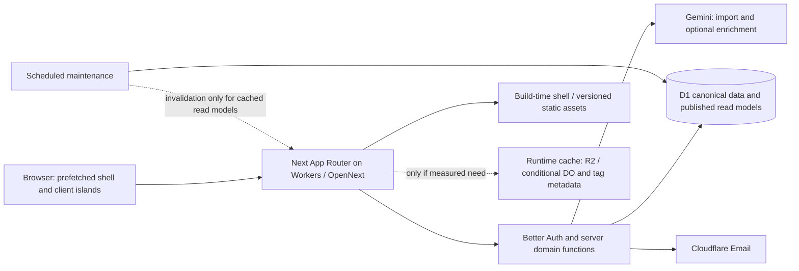

# Kuuki architecture and services audit

Date: 4 October 2026. Source baseline: `13034853df51874d20da95a3f4f3c2f7ea74f538`.

The [saved decision record and planning handoff](2026-10-04-architecture-decisions.md) consolidates the selected direction, conditional options and the user's latest mapcn/flightcn clarification. Implementation planning continues in a fresh GPT-6.1 Sol / xhigh thread.

## Recommendation

Build the next version with **Next.js App Router on Cloudflare Workers through OpenNext**, keeping D1, Better Auth, React, the existing UI components, and the flight-domain logic. Use Next's Instant Navigations to retain responsive client navigation while server-rendering compact summaries and public pages. Smaller first-load JavaScript and fewer data round trips are benefits to prove; the current React Router SPA already navigates client-side. The largest demonstrated problems are data/error contracts and unnecessary work; replacing the database or AI provider would not directly fix them.

The user explicitly requires the latest Next.js navigation and cache features. On the audit date, npm reports **Next.js 16.3.8** and **`@opennextjs/cloudflare` 1.20.8**; the adapter's peer range includes `>=16.3.8`. These are the proposed versions for a migration proof, not dependencies installed in Kuuki. Verify the version pair again when implementation starts. [Next release metadata](https://registry.npmjs.org/next/latest), [OpenNext package](https://www.npmjs.com/package/@opennextjs/cloudflare).

Three subagents audited backend/data, frontend/UX, and services before this synthesis. Their findings were checked against source, a fresh web build, API tests, the preview admission script, and current primary documentation. No application code, deployment, production data, cloud configuration, or provider account changed. Existing work in `docs/README.md` and `docs/user-journeys/` was preserved. The separate [service research](../research/2026-10-04-services-audit.md) records the integration inventory and provider evidence.

The user's requested [Opus 5.5 review](2026-10-04-opus-architecture-review.md) supports this direction with material changes incorporated here: begin with request-time application data and prefetched shells, explicitly port middleware responsibilities, benchmark Worker placement, and define rollback compatibility. A second [Opus chart review](2026-10-04-opus-charts-review.md) evaluates the requested TanStack Charts option. Both are recommendations, not implementation.

The [previous release record](../runbooks/audit-remediation-status.md) says production cutover remains pending. This audit did not reread live production. “Current” below describes this checkout, not proof that production runs it. Product documentation targets 50–500 early users; actual traffic and largest flight histories were not measured.

## What should stay, and what should change

| Current choice | Decision for a fresh build | Reason and expected UX effect |
| --- | --- | --- |
| React/Vite SPA and React Router | Replace the app runtime/routing with Next App Router. | Server-render summaries and public pages; retain layouts and state during navigation; send client code for interactions rather than every read. |
| Cloudflare Pages / Pages Functions | Replace hosting with Workers + Static Assets + OpenNext. | Fits Next rendering, streaming, and adapter-backed caches. This is architectural fit; no measured speedup from hosting migration alone. |
| D1 | Keep. | Existing relational data, batches, ownership checks, and recovery suit the stated beta. Improve query shapes before considering another database. |
| Better Auth + D1 sessions | Keep; retire the legacy session path after an accepted migration. | Preserve IDs, credential compatibility, revocation and existing account behavior. Add password recovery using the current email provider. |
| TanStack Query | Keep for interactive client data; reduce its role in initial screen reads. | Use server-rendered initial summaries; retain pagination, mutations, pending-state polling, and client refresh where useful. Avoid two independent caches owning the same screen data. |
| Zustand | Keep narrowly for local UI and draft state. | Filters can move to URL search parameters; server authentication should own identity truth. |
| Tailwind / shadcn / Radix / React Hook Form / Zod | Keep. | No evidence that a UI-library replacement improves the main bottlenecks. Preserve forms and accessible interaction primitives. |
| Recharts | Keep initially; shortlist TanStack Charts for a bounded comparison. | Prototype comparison bars and continent radar before replacing Recharts. Defer chart code until viewed; do not replace simple CSS visualizations solely to standardize on a library. |
| react-simple-maps / custom SVG route maps | Keep a small SVG preview; prototype MapLibre + mapcn for full interactive maps. | Consolidate passport/journey interactions, correct Pacific bounds, and improve route selection. Start tile-less with versioned country geometry; add PMTiles/R2 only if detailed basemaps are needed. [Map research](../research/2026-10-04-maps-options.md). |
| Gemini + `@google/genai` | Keep provisionally; replace prompt/orchestration faults first. | One multimodal call already handles text, image and PDF. Model choice needs a representative ticket benchmark. |
| Cloudflare Email Sending | Keep. | Activation is integrated; another vendor does not solve the missing general recovery flow. |
| External font / atlas / decorative asset requests | Serve pinned public assets with the app where licensing permits. | Removes browser dependencies on Google Fonts, jsDelivr and a decorative asset host; retain selective loading and compression. |
| Supabase | Retain migration history, then retire remaining unused resources after cutover acceptance. | No active browser or API Supabase data path was found. Historical exports remain relevant to preserving user data. |
| Console-only telemetry | Add request timings, Web Vitals, D1 query metrics and AI usage/outcomes. | Enables prioritization from actual waiting, failures and cost. Start with Cloudflare observability and app metrics; a new analytics vendor is optional. |

Cloudflare recommends Workers for new projects and documents the Pages migration path. OpenNext supports Next 16, App Router, Server Components, streaming, PPR and composable caching. Use Next's **Node.js runtime through Workers' compatibility layer**; OpenNext is different from `next-on-pages`. Its documentation lists Node Middleware as unsupported; version 1.20.8 does bundle Node `proxy.ts`/middleware but explicitly calls that integration experimental and unsupported. Avoid making it the authorization or host-isolation boundary. [Cloudflare platform guidance](https://developers.cloudflare.com/pages/migrations/), [migration guide](https://developers.cloudflare.com/workers/static-assets/migration-guides/migrate-from-pages/), [OpenNext compatibility](https://opennext.js.org/cloudflare), [versioned middleware source](https://github.com/opennextjs/opennextjs-cloudflare/blob/dd912000e5757ca60a0aae3a3d7df2e63ab46cb8/packages/cloudflare/src/cli/build/open-next/bundle-node-middleware.ts).

For a fresh build under the user's Next requirement, this is the recommended Cloudflare route. Without that constraint, a Workers-native React Router framework or TanStack Start application would deserve comparison because it avoids OpenNext's translation of Next internals. For the current app, migration ROI is unmeasured: compact summaries and corrected error states can improve the existing SPA first. [React Router on Workers](https://developers.cloudflare.com/workers/framework-guides/web-apps/react-router/), [TanStack Start on Workers](https://developers.cloudflare.com/workers/framework-guides/web-apps/tanstack-start/).

## Findings ranked by consequence

Priority 1 means a concrete release or trust problem. Priority 2 means a demonstrated source design issue whose production frequency or latency impact needs measurement.

| Priority | Finding and source evidence | Change |
| --- | --- | --- |
| 1 | **API failures masquerade as empty history or missing profiles.** `getFlights` catches any error and returns an empty list; stats return zeros; public profiles return null; leaderboards return empty results. TanStack Query sees successful data. [Flights](../../apps/web/src/lib/flights.ts#L129), [profiles](../../apps/web/src/lib/profiles.ts#L39), [leaderboard](../../apps/web/src/lib/leaderboard.ts#L51). | Propagate transport/server errors. Distinguish loading, confirmed empty, unavailable, and not found. Preserve last valid data during background failures; retry only suitable transient failures. Carry this contract into Next error boundaries. |
| 1 | **The deployment admission script fails in this checkout.** It requires preview KV IDs although `wrangler.toml` and `Env` no longer declare KV. Running it exits 1; both deployment jobs invoke it. [Script](../../scripts/check-preview-config.mjs#L14), [CI](../../.github/workflows/ci.yml#L60), [config](../../wrangler.toml), [Env](../../functions/env.d.ts). | Make admission reflect resources actually used, retaining D1/environment isolation. Do not recreate unused KV just to appease an obsolete check. Future Next cache resources need their own isolation validation. |
| 2 | **Dashboard reads overlap and grow with history.** The page mounts at least seven distinct read hooks plus an upcoming-sync mutation. The “fast” endpoint sends every completed flight and runs three sequential reads; filtered stats download all full flight DTOs. [Page](../../apps/web/src/routes/DashboardPage.tsx#L68), [endpoint](../../functions/api/me/dashboard-stats.ts#L38), [filtered path](../../apps/web/src/hooks/useDashboardStats.ts#L213). | Render a compact server summary, calculate favorites/country sets on the server, batch independent reads, and load filters/routes/charts only when needed. Keep map route data separate from summary data. Use server filters or reuse a bounded dataset instead of redownloading history per filter. |
| 2 | **Initial UI can show a false empty dashboard.** Missing stats default to zero before the query completes. [Condition](../../apps/web/src/routes/DashboardPage.tsx#L121). | Show a real loading shell and explicit error state. Next Suspense helps only if the application preserves these distinctions. |
| 2 | **Flight saves await full derived-state repair.** Canonical writes commit before repair, but the HTTP response waits for visits, stats, advanced stats and badges to recompute. [Create](../../functions/api/flights/index.ts#L141), [bulk](../../functions/api/flights/bulk.ts#L74), [repair](../../functions/api/_services/derivedState.ts#L174). | Preserve revision guards and atomic batches. Batch multi-flight work once. If measured save p95 warrants it, acknowledge canonical saves promptly, derive durably in the background, and expose pending publication. Do not replace durable recovery with `waitUntil` alone. |
| 2 | **Aircraft acceptance fans out into up to 20 PATCHes and incomplete refresh.** Each PATCH repairs derived data. On success only three query families are invalidated; dashboard/advanced aircraft statistics remain cached. One rejection skips all success invalidation despite other writes possibly succeeding. [Client](../../apps/web/src/hooks/useAircraftEnrichment.ts#L49), [server](../../functions/api/flights/%5Bid%5D.ts#L110), [dialog](../../apps/web/src/components/flights/AircraftEnrichDialog.tsx#L84). | One bounded bulk update with explicit outcomes and one publication pass. Reconcile all confirmed writes even after partial failure. Reuse ordinary edit's derived-state handling and show which items saved. Aircraft-only edits do not inherently change country counts. |
| 2 | **Aircraft enrichment can return misleading historical data and time out too early.** The prompt explicitly asks for today's equipment, despite passing historical flight dates. Client timeout is 30 seconds; provider timeout is 45 seconds. [Prompt](../../functions/api/enrich/_shared.ts#L54), [client](../../apps/web/src/hooks/useAircraftEnrichment.ts#L35), [timeouts](../../functions/api/import/_provider.ts#L4). | Treat equipment as historical evidence or a clearly labeled suggestion; prefer unknown over invented certainty. Align deadlines and handle ambiguous completion. Keep enrichment outside the required import/save path. |
| 2 | **Import duplicate detection examines at most the first 1,000 flights.** It preloads that page on entry and creates a client-side set. Failed reads also look empty. [Import page](../../apps/web/src/routes/ImportPage.tsx#L142). | Check only extracted candidate keys against the full owned history in a bounded server query. Preserve the user's ability to override a genuine duplicate. |
| 2 | **Date rollover depends on a page visit; recovery is held in config.** Dashboard/Flights trigger upcoming-sync; maintenance does not roll those flights forward. Both maintenance environments default to `MAINTENANCE_MODE=true`. [Sync](../../functions/api/flights/sync-upcoming.ts#L9), [Worker](../../workers/maintenance/index.ts#L11), [config](../../workers/maintenance/wrangler.toml#L9). | Include date rollover in scheduled canonical maintenance, then derive. Activate maintenance through existing release gates and monitor pending age/success, rather than assuming the cron is running. |
| 2 | **Authenticated users have no general password recovery.** Better Auth is configured for passwords; activation serves migrated accounts, not forgotten passwords. [Auth config](../../functions/api/_lib/betterAuth.ts#L23), [runtime notes](../TECH_STACK.md). | Implement a complete recovery journey with verified, one-use email links, rate limits and session revocation. A provider replacement is unnecessary. |

There is also a product-rule mismatch: the PRD says ten flights for leaderboard eligibility and unique cities, while code uses five flights and airport count for `cities`. Resolve the intended rule before porting it. [PRD](../PRD.md), [implementation](../../functions/api/_services/leaderboard.ts#L5).

## Next.js navigation and rendering design

The proposed Next configuration is:

```ts
import type { NextConfig } from 'next'

const nextConfig: NextConfig = {
  cacheComponents: true,
  partialPrefetching: true,
}

export default nextConfig
```

Next 16.3 documents these opt-ins for Instant Navigations. Each route should have content available at the click: a cached reusable shell or a Suspense fallback, followed by fresh streamed data. This makes the transition immediate; it does not make D1 or Gemini respond instantly. [Next 16.3](https://nextjs.org/blog/next-16-3), [navigation guide](https://nextjs.org/docs/app/guides/instant-navigation).

Use persistent layouts for the main navigation, `next/link` for likely destinations, and nested boundaries around authentication and data work. With Partial Prefetching, normal links prefetch the shared shell; `prefetch={true}` can add cached URL-specific content but no longer fetches all uncached dynamic data. Put filter/search-parameter reads behind the appropriate boundary. Avoid prefetching every heavy map, chart or import interaction. [Partial Prefetching guide](https://nextjs.org/docs/app/guides/adopting-partial-prefetching).

| Surface | Rendering and navigation policy |
| --- | --- |
| Landing and sign-in | Small server-rendered shell; only forms/dialogs hydrate. Self-host fonts. No charts, airport corpus or signed-in dashboard data in this route. |
| Dashboard | Reusable navigation/skeleton; server-authenticated compact summary streams first. Map, filters and analytics become separate client islands. A `lazy` import that mounts immediately still downloads immediately; visibility or interaction must govern genuinely deferred sections. |
| Flights | Server-owned filters/sort/pagination; stream the first page. Retain client selection/edit behavior and idempotent mutations. |
| Import | Prefetch its shell. Retain draft editing as client state; parse runs only after submission. Preserve review-before-save, uncertain-year confirmation and lost-response save recovery. Persist resumable drafts under an explicit user/retention policy if required. |
| Passport and analytics | Server-render compact read models; load detailed map/chart client code when viewed. |
| Public profiles / leaderboard | Stream fresh permitted aggregates after a visibility/opt-in check. Runtime aggregate caching is a later measured option. Keep individual flights, route maps and passport private; metadata and prefetch must obey visibility too. |

Server Components should call shared server-side domain functions with the D1 binding, avoiding HTTP calls back to their own `/api`. Route Handlers preserve the browser/API contract; Server Actions can call the same mutation services. Every entry point must validate identity, ownership and input. Client-side navigation guards and a shared layout are insufficient authorization.

An incremental move needs an explicit same-origin `/api` coexistence plan. Existing handlers are Pages Functions and depend on middleware populating `context.data.user`; they cannot be imported directly as Server Component data functions. The browser auth client accepts only same-origin `/api/auth`, and Better Auth uses `PAGES_ORIGIN` for its base/trusted origin. Extract reusable domain functions, and either port the API/auth boundary first or route the existing API under the same canonical origin during coexistence. Prove cookie forwarding/renewal, CSRF/origin checks, sign-out and the isolated activation origin before moving authenticated pages. This is a migration gate, not a reason to add a permanent proxy service. [Middleware](../../functions/_middleware.ts#L16), [auth client](../../apps/web/src/lib/auth-client.ts#L4), [auth origin](../../functions/api/_lib/betterAuth.ts#L12).

Specify where every middleware responsibility moves. Session/CSRF cookie writes and sliding renewal need a Route Handler, Server Action or tested Worker response wrapper; Server Components cannot write cookies. If normal page reads stop making browser API requests, the old renewal path will no longer suffice. Maintenance gating must cover new server data entry points. Keep the activation alias isolated before app routing and asset delivery, including RSC/prefetch paths; an asset-first response must not bypass the host gate. A custom Worker entry is a supported place to wrap OpenNext, but its response/cookie behavior and asset-routing configuration need proof. Do not widen the activation alias into a general Server Action origin. [Next cookies](https://nextjs.org/docs/app/api-reference/functions/cookies), [custom Worker](https://opennext.js.org/cloudflare/howtos/custom-worker), [asset routing](https://developers.cloudflare.com/workers/static-assets/binding/).

Retain TanStack Query where the UI genuinely owns interactive queries. For server-owned summaries, Next rendering and invalidation should own freshness; do not maintain an unsynchronized second copy in Query. Keep Zustand for local state rather than a second authentication authority.

## Cache policy: decide what is cached before choosing storage

**Start with navigation and build-time caching, not a persistent application-data cache.** Keep both public aggregates and private data request-time behind Suspense. Version static assets/reference data and prefetch the reusable shell. This uses the requested Next navigation/cache model without assuming every read needs a writable server cache. Introduce runtime `use cache`, tags and persistent storage only for a measured hot path; the policy below records its requirements when adopted.

| Data | Cache policy | Freshness/invalidation |
| --- | --- | --- |
| Static layout, translations, reference data | Build-time prerendering/versioned static assets first. `use cache` can describe prerenderable work; any runtime cache access needs a compatible backend. | Initially update by deployment/version. Split reference corpora by consumer. Add runtime lifetimes/tags only with a writable cache design. |
| Public aggregate data | Initially request-time. If measured need later warrants caching, key entries by profile and published version behind a fresh visibility check. | Check authoritative visibility/opt-in on every new server request. With runtime caching, invalidate edits/deletion/publication; never use stale whole-route content to bypass the check. |
| Private flights, passport, settings | Initially request-time authenticated reads; session-scoped client navigation reuse. | No shared public HTTP/CDN or service-worker cache of personalized responses. Clear/reset navigation, Query and draft state on identity change. |
| Private computed summaries, if later needed | Cache only after server authentication, using explicit user, published revision, filter and locale keys. | Check access outside cached scope on every server access; do not cache authorization decisions. Distinguish canonical revision from published derived revision. |
| AI tickets/results | No shared response cache. | User-scoped short-lived job/result deduplication only if explicitly designed; delete on expiry/account deletion. |
| Sessions/password recovery | Fresh revocation-aware checks and one-use token handling. | Preserve current cookie-cache-disabled behavior until a measured reason and revocation design justify changing it. |

Read cookies/headers and resolve identity outside a `use cache` scope, then pass safe explicit arguments. `use cache` does not itself establish user isolation or durable cross-instance storage. The Next default runtime handler is memory-based; adapter persistence must be verified. [Cache directive reference](https://nextjs.org/docs/app/api-reference/directives/use-cache).

Version-specific adapter inspection establishes more than the feature matrix: OpenNext Cloudflare 1.20.8 registers a Cache Components handler for the default and remote caches, and its OpenNext AWS 4.1.7 dependency stores entries through the configured incremental backend. An R2 override backs runtime `use cache` entries; enabling Next flags alone does not provide persistence. The read-only Static Assets backend can serve prerendered route/fetch entries but explicitly rejects `composable` entries: runtime lookups become logged misses and writes are not persisted. Do not present it as a working runtime Cache Components store. Tag-update failures can also be logged without propagating an error, so invalidation is not the sole privacy control. [Versioned handler registration](https://github.com/opennextjs/opennextjs-cloudflare/blob/dd912000e5757ca60a0aae3a3d7df2e63ab46cb8/packages/cloudflare/src/cli/build/patches/plugins/next-server.ts), [composable adapter](https://github.com/opennextjs/opennextjs-aws/blob/v4.1.7/packages/open-next/src/adapters/composable-cache.ts), [Static Assets implementation](https://github.com/opennextjs/opennextjs-cloudflare/blob/dd912000e5757ca60a0aae3a3d7df2e63ab46cb8/packages/cloudflare/src/api/overrides/incremental-cache/static-assets-incremental-cache.ts).

If runtime data caching is introduced, an interactive Server Action uses `updateTag` for immediate expiry/read-your-own-writes. A Next Route Handler or maintenance callback uses `revalidateTag`; choose stale-while-revalidate only where permitted, and `{ expire: 0 }` for immediate expiry. Refresh relevant paths/client data as well. Do not count invalidation as successful publication when derived state remains pending. [updateTag](https://nextjs.org/docs/app/api-reference/functions/updateTag), [revalidateTag](https://nextjs.org/docs/app/api-reference/functions/revalidateTag).

D1 publication and cache invalidation are separate systems. If derived data later enters a runtime cache, scheduled publication needs a retryable authenticated invalidation event or freshly read published-revision keys; the maintenance Worker cannot directly call `next/cache`. Add durable delivery/recovery only at that point. Request-time summaries do not require an invalidation outbox. Privacy checks must remain correct even when invalidation fails.

Server invalidation also does not push new data into an already-open browser's navigation cache. Background publication needs a bounded client refresh/polling signal; identity changes need an explicit client-state reset. `router.refresh()` refreshes client route data but does not expire the server cache. Handle both layers deliberately. [Router API](https://nextjs.org/docs/app/api-reference/functions/use-router).

Visibility withdrawal can prevent new server delivery; it cannot retract data already delivered or prefetched into another browser. Cache invalidation is therefore not an authorization boundary. Test direct visits, prefetch and client navigation after a privacy toggle, and distinguish a newly served response from a previously received client payload.

For a cached leaderboard containing multiple profiles, check current opt-in membership for every returned profile or select a membership revision from authoritative state. Checking only the requesting viewer does not make that aggregate safe to serve after another user withdraws.

If adopting persistent runtime cache/ISR, configure the resources the chosen policy needs: **R2 storage**, **D1 tag metadata for on-demand invalidation**, and a **Durable Object queue for time-based revalidation**. These are conditional resources, not prerequisites for Instant Navigations. Separate environments/cache metadata from canonical data. Cache interception is incompatible with PPR and stays off. These resources differ from business Queues/Workflows; Worker memory is not a durable global cache. [OpenNext caching](https://opennext.js.org/cloudflare/caching).

A production-like proof must verify shell/segment prefetching and streaming on the exact package pair. Runtime caching, if added, also needs persistence/invalidation checks on warm/cold instances. Pin the tested Next/OpenNext/Wrangler pair and compatibility date. OpenNext patches Next internals, so repeat compatibility checks on upgrades; a new adapter release is needed only when the existing one cannot support the upgrade. Check compressed Worker size and CPU against the actual account plan without assuming the plan or capacity. Documentation and peer ranges are not a deployed Kuuki proof.

## Charts: the requested TanStack option

The [TanStack shadcn collection](https://tanstack.com/charts/catalog/collections/shadcn) is an independent chart-engine implementation of shadcn examples, not a wrapper around Recharts or an installable shadcn registry. It is a credible candidate for the redesign. Registry/package inspection finds MIT-licensed `@tanstack/charts` **1.0.0**, with React 19 in its peer range. The published compatibility contract starts at 1.0, while website docs follow unreleased main; pin the version and consult the shipped docs. [Package metadata](https://registry.npmjs.org/@tanstack%2Fcharts/latest), [overview](https://tanstack.com/charts/latest/docs/overview).

**Prototype the two existing Recharts consumers, then decide.** [CompareChart](../../apps/web/src/components/compare/CompareChart.tsx) needs grouped horizontal bars and mixed-unit localized tooltips. The [continent radar](../../apps/web/src/components/dashboard/AdvancedStatCards.tsx#L911) needs a fixed 0–100 radius, readable mobile labels and equivalent values. Existing ranking/waffle/activity visuals use CSS; replacing those adds no demonstrated value. Map renderer selection is evaluated separately below.

Improve the comparison's meaning during that proof: its single numeric axis mixes kilometers with counts, so distance can dwarf flights/cities/airlines visually. Use separate per-metric scales or explicitly normalized comparisons while keeping absolute values and units visible. The radar currently omits a fixed radial domain; keep percentage coverage on 0–100 rather than letting geometry imply progress relative only to the current maximum. Both are chart-design issues independent of the rendering library.

TanStack documents SVG server output followed by client adoption/resizing, so use an explicit Next client boundary, deterministic dimensions/domains, and compact server-prepared rows. Its default initial width is 640px; prove mobile layout and hydration on workerd. Adapt the examples' fixtures/formatters rather than copying their internal data-package imports. Add direct D3 dependencies only for APIs actually imported. [React adapter](https://tanstack.com/charts/latest/docs/framework/react/adapter), [horizontal-bar source](https://github.com/TanStack/charts/blob/main/benchmarks/conformance/cases/145-shadcn-bar-horizontal/example.tsx).

Measure the full incremental chart dependency graph against the current lazy Recharts chunk, approximately **95.7 KB gzip**, with matching semantics, units/locales, keyboard/touch value access, screen-reader summaries and reduced motion. Recharts 3.7 already defaults its accessibility layer on; library documentation alone does not establish a TanStack accessibility advantage. If both ports pass and bring a concrete UX or bundle benefit, remove Recharts in the same migration. No chart implementation or comparison build was performed in this audit. [Recharts 3.7 defaults](https://github.com/recharts/recharts/blob/v3.7.0/src/chart/CartesianChart.tsx).

## Maps: open-source renderer and UI

The requested GPT-6 Luna repository search, Context7 API checks and Firecrawl Developer Index research support **MapLibre GL JS + mapcn as the prototype for expanded route maps, passport and journey planning**. Keep the lightweight SVG dashboard preview and a fallback for devices that cannot initialize WebGL2. mapcn supplies React/shadcn-style controls and composition directly over MapLibre; react-map-gl is an alternative integration, not an additional required layer. The [map research](../research/2026-10-04-maps-options.md) records the full shortlist, evidence and proof criteria. [mapcn](https://github.com/AnmolSaini16/mapcn), [React alternative](https://visgl.github.io/react-map-gl/docs/get-started).

Luna also found [flightcn](https://github.com/ridemountainpig/flightcn), a close flight-history/multi-leg reference built on mapcn. Its small, young repository and MapLibre v5 demo make it a selective prototype input; its README claims v5/v6 type compatibility, which still needs our v6/Next build proof. Adapt its great-circle geometry/selection ideas to Kuuki's airport data and batched layers instead of installing the whole demo. [Playground](https://flightcn.yencheng.dev/playground), [flight source](https://github.com/ridemountainpig/flightcn/blob/main/src/registry/flight.tsx).

The current [country map](../../apps/web/src/components/map/RouteMapWithCountries.tsx) uses raw min/max longitude bounds, so Pacific routes can fit almost the whole world around the wrong center. [JourneyMap](../../apps/web/src/components/journey/JourneyMap.tsx) uses its first airport and fixed zoom instead of fitting the trip. Correct wrapped bounds, preserve viewport during incidental refreshes, and keep route/country selection and claimed-country styling. mapcn's `MapArc` draws longitude/latitude Bézier curves; geographic flight views need sampled great-circle geometry with antimeridian handling. Use batched line/circle/symbol layers and selected-item popups; add deck.gl only if route-volume benchmarks justify it. [Arc contract](https://www.mapcn.dev/docs/arcs), [deck.gl great circles](https://deck.gl/docs/api-reference/geo-layers/great-circle-layer).

Start with a **tile-less world/country map**, serving pinned public geometry and the renderer's worker through Static Assets. mapcn's default CARTO tiles and unpkg worker are external dependencies that can be replaced explicitly. Detailed street maps are a separate product requirement: PMTiles on R2, either direct range reads or the Protomaps Worker tile adapter, is a credible CF option. Benchmark cold/warm latency and request cost; keep private flight overlays outside public archives/shared caches. No GIS database or tile server is needed for the current country/route display. [mapcn setup](https://www.mapcn.dev/docs/installation), [PMTiles storage](https://docs.protomaps.com/pmtiles/cloud-storage), [CF delivery](https://docs.protomaps.com/deploy/cloudflare).

Current MapLibre **6.12.0** includes a merged GeoJSON update/cleanup fix, while Context7's renderer version catalog lists v5.19.0. Use current release and migration evidence when pinning a proof. v6 requires WebGL2 and ESM; Next/Turbopack needs the worker and its sibling shared module published together. Load the full map as a browser client island when visible/opened, keeping Instant Navigation shells and summaries independent of GPU initialization. Validate mobile gestures, keyboard/list alternatives, theme changes, asset failure and repeated navigation against the existing map; no map speedup has been measured. [Release](https://github.com/maplibre/maplibre-gl-js/releases/tag/v6.12.0), [merged fix](https://github.com/maplibre/maplibre-gl-js/pull/8585), [v6 migration](https://maplibre.org/maplibre-gl-js/docs/guides/v5-to-v6-migration-guide/), [bundler setup](https://maplibre.org/maplibre-gl-js/docs/).

## Cloudflare target and limits



D1 read replication requires the Sessions API; this checkout does not use `withSession`. Enabling replication alone would not route these queries to replicas. For a globally distributed audience, trial sessions/bookmarks on suitable read paths, carrying a write bookmark into dependent reads. Session revocation and privacy checks need authoritative freshness; do not simply move them to unconstrained replicas. D1 bookmarks express database consistency, whereas `published_revision` expresses completed application derivation. [D1 replication](https://developers.cloudflare.com/d1/best-practices/read-replication/).

Benchmark Worker placement along with batched D1 reads. Neither checked-in configuration selects placement. Running SSR near a remote primary may reduce repeated backend round trips but can add browser-to-Worker latency; test representative regions with default and Smart Placement rather than assuming an edge-rendered page is faster. Include Sessions/read replication in that comparison. Keep ordinary assets close to the user; routing all assets through a placed Worker can add delay. [Placement](https://developers.cloudflare.com/workers/configuration/placement/), [asset placement](https://developers.cloudflare.com/workers/static-assets/binding/).

D1's individual instances process queries serially and a paid database has a 10 GB maximum. Those facts do not establish a capacity problem for Kuuki. Consider Postgres plus Hyperdrive only after observed primary contention, storage growth, SQL requirements or geographic writes make D1 unsuitable. First measure D1 time, rows read/written, request round trips and per-user histories. [D1 limits](https://developers.cloudflare.com/d1/platform/limits/).

Keep the scheduled recovery design for the beta. Add a business Queue only if save latency or pending backlog justifies asynchronous derivation; use idempotent consumers and publish through the same revision guard. For a resumable multi-step import, Workflows and temporary private R2 uploads become candidates. One synchronous parse call does not warrant installing every background service. A useful future job API returns a job ID/status and resumes review after navigation; it must preserve human confirmation, deduplication and deletion. [Service evaluation](../research/2026-10-04-services-audit.md).

AI Gateway is optional. Begin with duration, selected model, usage metadata, timeouts, failures and token/search cost. If adopting a gateway, disable document/prompt/response content logs and measure whether it improves operations. Keep Gemini unless a consented/redacted corpus shows another model improves exact flight fields and segment pairing at acceptable latency/cost. General model rankings are insufficient for Kuuki.

## Execution order and acceptance evidence

1. **Correct observable failures and establish the baseline.** Repair the obsolete KV gate, error-as-empty behavior, enrichment semantics/deadlines and update reconciliation. Instrument real navigation, saves and parsing. These fixes have value before the framework migration.
2. **Prove the exact Next/OpenNext pair locally and in isolated staging.** Build the shell with the two navigation flags, request-time summaries, D1/Better Auth, streaming and an explicit middleware-responsibility map. Prove same-origin API coexistence or port the API/auth boundary before moving authenticated pages. A separate Pages-to-Workers hosting step is an option if it simplifies this boundary, not a mandatory extra migration. Verify workerd, placement, Worker size/CPU and the actual plan; keep the existing Wrangler workflow until separately migrating the CLI. No production cutover is authorized by this audit.
3. **Move read surfaces incrementally.** Start with public pages and the authenticated dashboard summary, then Flights/Passport, behind the proven routing/auth boundary. Reuse React components and extracted domain functions rather than Pages handler contexts. Replace routing/SPA glue and avoid retaining duplicate authoritative read caches.
4. **Port mutations and import last.** Preserve atomic signup/writes, owner checks, CSRF/origin protections, idempotency keys, pending derived publication and recovery. Test navigation/account changes during pending saves and import review. Make aircraft acceptance one coherent batch.
5. **Tune only measured bottlenecks.** Trial D1 read sessions/placement; add runtime data caching or durable derivation/parsing only when latency, backlog or abandonment warrants it. Compare the two TanStack chart ports and benchmark model providers with representative inputs.
6. **Cut over with existing data/release protections.** Preserve identities and credentials, confirm source freshness and restore evidence, activate maintenance deliberately, verify environment isolation, and keep routing reversible. During dual-run, avoid incompatible schema changes and preserve cookie formats/names, CSRF semantics and mutation behavior in both directions; a route swap alone cannot reverse incompatible data or sessions. Do not treat the previous runbook as fresh production evidence.

The following are proposed acceptance criteria, not measured results:

| Concern | Evidence needed |
| --- | --- |
| Instant navigation | Production-mode `instant()` assertions for Dashboard ↔ Flights ↔ Passport and common public links. Assert the intended shell appears without waiting for server data; verify final data separately. |
| Reduced client work | Compare initial and route JS/CSS bytes and CPU/hydration with this baseline. Confirm charts/maps/reference corpora are absent from unrelated routes. |
| Fresh saves | Confirm a saved flight appears once; counts become ready for the acknowledged revision; pending publication is visible and recovers. Measure save p50/p95 by history size. |
| Cache correctness | Initially prove prerendered shells plus fresh request-time data. If runtime caching is added: account changes, visibility withdrawal, deletion, scheduled publication, dropped invalidation, and cold/warm instances. |
| Origin compatibility | Same-origin API routing, renewal during page-only use, cookie clearing, CSRF issuance/rejection, legacy/Better Auth compatibility, maintenance responses, and activation aliases including static/RSC/prefetch routes. |
| Worker feasibility and placement | Exact package pair on workerd, streaming/native Node compatibility, compressed size and CPU under the actual plan; compare geographic TTFB with batched queries and placement/read sessions. |
| TanStack chart choice | Both existing chart ports; preserved values/units/locales with explicit scales, mobile labels, hydration, light/dark themes, keyboard/touch access, reduced motion and the complete incremental bundle graph. |
| Data efficiency | Dashboard response bytes, request count, D1 rows/time and filter response sizes at realistic and large histories. |
| AI experience | Field/whole-flight accuracy, segment pairing, uncertain years, p50/p95 latency, timeouts and usage/cost on 30–50 representative consented/redacted documents. |
| Reliability | Maintenance success/age, dirty backlog, overdue upcoming flights, partial aircraft saves, provider failures, and deploy during an in-progress import. |

Next provides the production-navigation test helper; use it to prevent a later data fetch or misplaced boundary from making transitions block. [Navigation testing](https://nextjs.org/docs/app/guides/instant-navigation).

## Checks performed and limits

- Fresh `pnpm --filter @kuuki/web build`: passed. Initial static dependency closure is approximately **270 KB gzip JavaScript + 24 KB gzip CSS**. This measures generated artifacts, not actual network timing or Core Web Vitals. The data corpus, map and chart chunks are outside the initial static closure; dashboard composition subsequently loads them. There is no measured Next build to compare yet.
- `pnpm test:api`: passed, **9 files / 75 tests**, using local test fixtures. This does not establish live provider or deployment behavior.
- `node scripts/check-preview-config.mjs`: failed with exit 1 because the required KV IDs are absent. This is a reproduced admission failure, not a failed hosted deploy observed during this audit.
- npm metadata: Next 16.3.8 and OpenNext 1.20.8 compatibility range checked. Versioned adapter package source inspected for Cache Components storage and tag failure behavior. Official framework/Cloudflare/OpenNext documentation consulted.
- No production reads, paid AI calls, fresh email delivery, load test, browser automation or visual inspection. Real latency, latest deployed SHA, account billing tier, adapter runtime behavior and provider quality remain unverified.

The recommended replacement is the **rendering/navigation layer and its data contracts**. The strongest existing backend properties—D1 batch consistency, owner checks, review-before-write, idempotency and revision-guarded recovery—should survive the migration intact.
