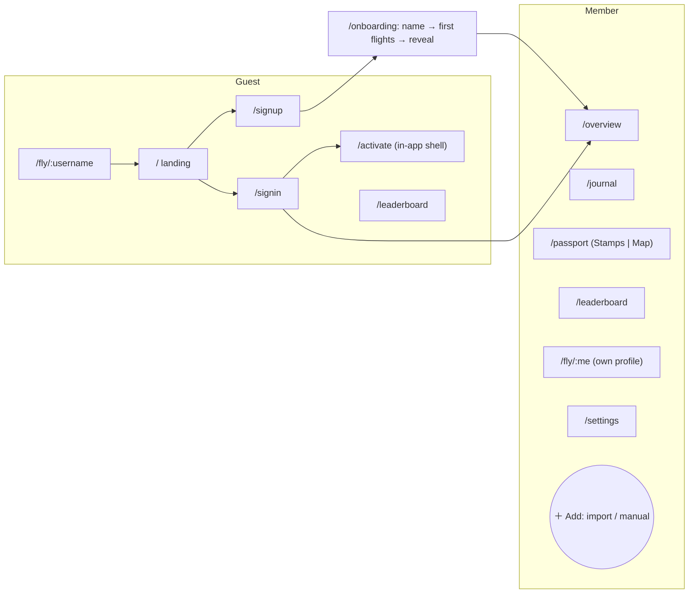

# Kuuki Redesign 2.0 — UX/UI plan

Date: 2026-10-04. Scope: experience and interface design only. This document is the design brief for the agent that will write the code implementation plan; it deliberately avoids code, file paths and component APIs. Values given here (colors, sizes, durations, curves) are design specifications, not implementation instructions.

Inputs:

- [User-journey atlas](../user-journeys/README.md): 184 states, 29 flows, captured 2026-10-03.
- [Interface audit](../user-journeys/2026-10-03/audit/AUDIT.md): 11/20, 113 findings (P1 34, P2 68, P3 11).
- `PRODUCT.md`, `DESIGN.md`, `docs/FRONTEND_GUIDELINES.md`, the brand-guidelines and glados-copy skills, the shipped token CSS.
- A fresh visual critique of ~140 atlas screenshots (public/social, dashboard/passport/journey, flights/import).
- Design-engineering principles from Emil Kowalski's practice and the "make interfaces feel better" checklist.

Atlas screenshot names are cited as evidence, e.g. `dashboard-populated-desktop.png`; audit finding IDs in backticks, e.g. `contrast-text-tokens-below-aa`.

---

## 1. Diagnosis: why the current UI reads as a draft

The audit lists 113 defects, but they come from a handful of root causes. Fixing findings one by one would leave the draft feeling intact.

1. **Three conflicting sources of truth.** `DESIGN.md` (cool near-white, terracotta/amber, no glass), the brand-guidelines skill (washi grain, warm glassmorphism, 16–32px radii, hex palette) and `FRONTEND_GUIDELINES` (washi neutrals, sidebar nav, bounce easing) disagree. The code follows none of them: a runtime red hex (`#E54D5A`) overrides the token primary in both themes, dark is the default, glass appears on auth, and 50 `transition-all` usages exist.
2. **At least two design languages on screen.** The public profile is editorial and calm: one huge number, small-caps labels, no boxes (`profile-public-test-traveler-desktop.png`). The dashboard is a wall of 13 equal cards, each with an icon disc, an English rank title, a Russian joke and a number (`dashboard-populated-desktop.png`). Journey uses boarding-pass tickets; `/activate` is a teal, unbranded island.
3. **No point of view per screen.** The dashboard has no hero insight; charts are chosen for decoration (radar with 2 non-zero axes, a screen-high waffle at n=1, a lone 100% bar over 500px of void). The map — the loudest element on two pages — colours countries in flag hues (Russia royal blue) and answers no question.
4. **The hero feature hides its trust signals.** AI import shows confidence only inside an expander, gives one generic error for quota, missing model and bad file, renders "no flights found" beneath errors, and breaks on 390px.
5. **Russian is a second-class locale.** No `_many` plurals, English strings in nearly every RU screen, DM Sans has no Cyrillic so RU renders in a system font, layouts are sized for EN string lengths.
6. **Tone in the wrong places.** GLaDOS-style quips appear on the trust line under sign-in ("Наверное."), in the irreversible account-deletion dialog, on error states and on every stat card; the voice switches between «ты» and «вы».
7. **Mobile is desktop collapsed, not recomposed.** 442px overflow on a 390px screen, popups under the tab bar, no route to the leaderboard or one's own profile, top-right CTA out of thumb reach.
8. **Decoration on working surfaces.** Floating plane glyphs behind the import form, a logo tile whose glyph changes between captures and reads as a back button, a permanent red dot on the theme button, a permanent pink glow on the map card.

What is genuinely strong and must survive is listed in §13.

---

## 2. North star

**Kuuki is a personal flight journal you are quietly proud of.** It turns flights into a collection — stamps, routes, a profile worth sharing — and makes capturing them fast and trustworthy.

Three jobs, in priority order, shape every screen:

| Job | User's question | Primary surfaces |
| --- | --- | --- |
| **Capture** | "Get my flights in, correctly, with minimum effort." | Add, Import, Journal |
| **Remember** | "Where have I been? What was notable? What's next?" | Overview, Passport, Country detail |
| **Share** | "Show it off; see where I stand." | Profile, Leaderboard |

Design principles for 2.0 (these replace the scattered principle lists):

1. **One language: editorial instrument.** Typography and whitespace carry hierarchy; boxes are the exception. The public profile is the reference screen.
2. **Every screen answers one question first.** One hero element per screen; everything else is secondary and visibly so.
3. **Trust before delight.** Capture, auth, privacy, errors and destructive flows are calm and precise. Delight is reserved for rare moments (first stamp, import done, first achievement).
4. **Collectible, not dashboard.** Stamps, tickets and the map are objects with craft; stats are sentences and ranked lists, not chart zoo.
5. **Russian and English are equal.** Every layout is designed at RU string length; plurals and dates are part of the design.
6. **Light and dark are equal.** Both are reviewed with the same rigour; neither is a token afterthought.
7. **Motion is earned.** Frequency decides: high-frequency interactions get no animation; rare moments get careful motion.
8. **Nothing is stamped without you.** A flight becomes part of the passport when its owner confirms it. Confirmation is the stamp press: the one place trust and delight are the same gesture (§5.4, §6.12).

---

## 3. Foundations: Design System 2.0

**The design deliverable here is a single rewritten `DESIGN.md` (v2) that supersedes the brand-guidelines skill's glass/grain guidance and the conflicting parts of `FRONTEND_GUIDELINES`.** Everything below should land in it.

### 3.1 Color

Principles:

- **Text tokens are separate from fill tokens.** Every status color has a text grade that passes 4.5:1 and a fill grade for backgrounds/icons.
- **No opacity-modified text.** Hierarchy comes from size, weight and the two text tokens, never `/40–/80` alpha (`contrast-text-tokens-below-aa`).
- **Control borders are separate from structural hairlines.** Inputs, checkboxes and selects get a ≥3:1 border; card and divider hairlines stay soft (`control-borders-below-3-to-1`).
- **No literals.** No hex, no Tailwind palette classes, no white/rgba literals on map, journey, ranks or auth (`hardcoded-color-literals`, `map-overlays-white-on-light-theme`, `aura-auth-inputs-broken-light-theme`).

Proposed palette (values are targets; the implementation agent verifies each pair with a contrast tool):

| Role | Light | Dark | Rule |
| --- | --- | --- | --- |
| `background` | paper, L 0.985, C ≤ 0.005, warm hue ~80 | ink, L 0.18–0.20, C ≤ 0.006 | Reads as white/charcoal, never cream or navy |
| `surface` (cards, sheets) | L 0.995 | L 0.23 | One step from background |
| `surface-inset` | L 0.965 | L 0.26 | Wells, table headers, code |
| `text` | L 0.22 | L 0.94 | Body and headings |
| `text-muted` | L 0.48–0.50 | L 0.72 | ≥ 4.5:1 on background and surface |
| `hairline` | L 0.91 | L 0.30 | Structure only (dividers, card edge) |
| `control-border` | L 0.60 | L 0.52 | ≥ 3:1 on its surface |
| `accent` (fill) | terracotta, ~oklch(0.55 0.13 35) | lighter terracotta, ~oklch(0.72 0.12 40) | Same hue family in both themes |
| `accent-foreground` | near-white | near-ink | ≥ 4.5:1 on accent |
| `accent-text` | L ≤ 0.52 | L ≥ 0.74 | Links, active nav, ≥ 4.5:1 |
| `focus-ring` | accent at full strength, 2px + 2px offset | same | ≥ 3:1 against adjacent colors (`focus-ring-half-opacity-below-3-to-1`) |
| `success / warning / danger / info` text | L 0.45–0.50 each | L 0.74–0.78 each | ≥ 4.5:1; fills may be lighter |
| `rank-gold / silver / bronze` | text-grade tokens | text-grade tokens | Always paired with the rank number (`leaderboard-top3-rank-icon-only-no-text`) |

**Accent.** Terracotta returns as the brand default, one hue family across both themes. Today light is terracotta and dark is amber, which splits the identity.

- If the user-selectable accent stays (decision D2), it becomes a curated set of 6 named pairs. Suggested names are drawn from traditional Japanese colors: Terracotta (default), Ai (indigo), Matcha, Kincha (gold), Sakura and Sumi (ink, monochrome).
- Each pair is designed separately for light and dark, with its own foreground that passes AA.
- Gold and Sakura use dark foreground text.
- The accent never overrides semantic tokens (`accent-picker-overrides-tokens-fails-contrast`).

**Country color system** (`country-dominant-colors-hex-low-contrast-dark`, `heatmap-legend-invisible-and-scale-mismatch`):

- Flag-derived colors are demoted to **stamp ink** only. Each is normalized in OKLCH: lightness and chroma are clamped per theme so the ink passes 3:1 against the surface while keeping its hue. Black and near-white flags get a neutral ink.
- **The map never uses flag colors.** Visited countries use one sequential ramp built from the accent hue, in 4 quantile buckets (1, 2–3, 4–9, 10+). A visible titled legend ("Визиты") always uses the same ramp.
- Information is never carried by color alone. Claim-only countries use a dashed ring plus the text label "без перелётов"; manufacturers and categories get labels.

### 3.2 Typography

- **One Cyrillic-capable brand sans for UI and display.** DM Sans has no Cyrillic (`dm-sans-has-no-cyrillic-fallback-system-font`).
  - Candidates are Onest, Golos Text and Manrope. Decision D5: pick after a specimen test with real RU and EN strings, numerals, and IATA codes beside city names.
  - Tracking and OpenType features are retuned for the chosen face.
- **Mono is the "ticket voice", not a default.** JetBrains Mono (it has Cyrillic) is used only for IATA codes, flight numbers, times and dates inside tables or tickets, and @handles.
  - Never for placeholders, labels, section eyebrows or uppercase helper text. Today mono placeholders ("JFK", «ПОИСК ПО КОДУ…») look like real values (`flight-add-form-desktop.png`, `import-review-expanded.png`).
- **Numbers.** All changing or aligned numbers use tabular figures. Large stat numerals use the brand sans in tabular mode. The profile's mono hero number is the one place mono display figures stay, as a signature.
- **Scale.** RU-tuned with a 4pt baseline; line heights in px.

| Style | Size / line | Weight | Use |
| --- | --- | --- | --- |
| Display | 44 / 48, tracking −0.02em | 600 | Stat heroes, profile name, landing |
| H1 | 30 / 36 | 600 | One per page |
| H2 | 22 / 28 | 600 | Page sections |
| H3 | 17 / 24 | 600 | Card and list titles |
| Body | 15 / 24 | 400 | Default |
| Small | 13 / 20 | 400–500 | Secondary text, table cells |
| Caption | 12 / 16 | 500 | Floor for any text (`micro-text-9-10px-and-stamp-svg-text`) |
| Eyebrow | 12 / 16, uppercase, +0.06em | 600 | At most one per section, `text-muted` |

- **Text wrapping.** Headings use balanced wrapping; body text uses "pretty" wrapping to avoid orphans. Long RU words such as «Авиакомпании» must never clip; cards size to content.
- **Smoothing.** Antialiased text rendering on macOS across the app.
- **Locale-aware formats everywhere.** Dates follow the app language, e.g. «с октября 2026», not «с October 2026» (`locale-less-dates-and-units-in-ru-profile`). Numbers use locale grouping, e.g. «141 255 км». Real one/few/many/other plural forms are written for RU (`i18n-ru-plural-many-missing`).

### 3.3 Space, grid, radius

- **Grid.** One 12-column container, max 1200px content width, shared by header and page content. Today the header is 1240px and content columns are 620/720px, so edges don't align.
- **Gutters.** 24px desktop, 16px mobile. Page padding is fluid, 16–48px.
- **Spacing.** 4pt base. Section gaps are 48px desktop and 32px mobile. Card padding is 20px desktop and 16px mobile. Content sets card height; never stretch unlike cards to equal height (the Fleet card with 500px of void).
- **Radius scale.**

| Token | Value | Use |
| --- | --- | --- |
| xs | 6px | Chips inside inputs, small badges |
| sm | 10px | Buttons, inputs, menu items |
| md | 14px | Cards, popovers, menus |
| lg | 20px | Dialogs, sheets, auth card |
| full | 9999px | Pills, avatars, segmented thumbs |

- **Concentric rule.** Outer radius = inner radius + padding. A menu at 14px with 4px inner padding has 10px items. A dialog at 20px with 10px padding hosts 10px controls. This fixes the 8px menu inside 16px cards mismatch.

### 3.4 Surfaces and elevation (one material at a time)

| Level | Light | Dark | Used by |
| --- | --- | --- | --- |
| 0 Page | `background` | `background` | Page |
| 1 In-flow | `surface` + 1px `hairline` border, **no shadow** | `surface`, no border; 1px inner top highlight at white 4–6% | Cards, tables, list groups |
| 2 Floating | `surface`, **layered transparent shadow, no border** (tight 1–2px contact shadow + soft 8–24px ambient, black 6–12%) | `surface` one step lighter + 1px white 8% ring | Popovers, menus, toasts, sticky bars |
| 3 Modal | Level 2 shadow, stronger; scrim black 40% | scrim black 60% | Dialogs, sheets |

- **No glow halos.** Remove the pink map halo, teal avatar glow, badge glow and `perimeter-glow` (`one-material-border-plus-shadow`, `rank-improvement-celebration-repeats-every-visit`).
- **No backdrop blur anywhere**, including the import overlay, auth, mini header and private card. Blur is reconsidered only for toasts if the solid version tests poorly.
- **No gradient buttons.** The auth gradient is removed. Primary is one flat accent fill everywhere.
- **Images and avatars** get a 1px outline: pure black at 10% in light, pure white at 10% in dark, never a tinted neutral.

### 3.5 Iconography

- **One set: Lucide.** Stroke 1.5 beside regular text and 2 beside semibold (nav labels, buttons). The current blanket stroke of 2 reads heavy beside 15px body text.
- **One SVG per icon, colored with `currentColor`.** States come from color and opacity. Outline is the default; the active tab gets a filled or heavier variant plus the accent color plus label weight 600, so the active state never relies on color alone (`nav-landmarks-missing-aria-current-and-labels`).
- **Decorative icon discs are removed from stat displays.** The colored circles on dashboard cards carry no meaning.
- **Logo.** One stable mark (pick one glyph tile, recommended く). The glyph crossfade lives only on the boot screen. The mark is never a back button; back navigation gets its own chevron control where needed.

### 3.6 Interaction primitives

- **Hit areas.** 44×44px on touch, 40×40px minimum on dense desktop, built into the primitives rather than a global coarse-pointer patch. Small visible controls extend their hit area invisibly, and hit areas never overlap (`touch-targets-below-44px`).
- **Press feedback.** Every pressable gets `scale(0.96)` on press, 120ms. A "static" variant disables it for large surfaces such as rows and cards.
- **Hover** applies only on devices with hover and a fine pointer, so touch never shows sticky hover states.
- **Focus.** A visible 2px ring with offset on every interactive element, solid, never 50% alpha.
- **Disabled controls always say why.** Inline helper text, never a `title` tooltip only (`settings-visibility-leaderboard-disabled-reason-hidden`).

---

## 4. Information architecture and navigation

**Routes:**

- **Guest `/` becomes the landing page**, and auth moves to `/signin` and `/signup` (decision D1). Mode lives in the URL, so back and refresh behave (`focus-lost-on-mode-and-step-switch`).
- **Signed-in redirect.** A signed-in visitor to `/`, `/signin` or `/signup` goes to Overview, including PWA start (`authpage-no-redirect-for-signed-in-user`).
- **`/activate` moves inside the app shell**, using the same auth layout, tokens, theme and language (`activate-page-off-system-theme-tokens`, `activate-page-english-only`).
- **The public profile URL stays `/fly/:username`.** Onboarding previews exactly this URL (`onboarding-profile-url-preview-wrong`).
- **`/journey` leaves the product for 2.0** (decision D7). Its ticket card and single-accent route map become seeds for the design system (§6.2).
- **Every route and mode sets a page title**, e.g. «Журнал — Kuuki» (`spa-route-change-no-title-no-focus`).
- **Naming.** "Dashboard" becomes **Overview / Обзор** and "Flights" becomes **Journal / Журнал**, which matches the journal positioning in `PRODUCT.md`.

**Desktop header** (56px, solid background, no blur):

- **Left.** Logo mark, then Обзор · Журнал · Паспорт · Рейтинг.
- **Right.** A primary **split button «＋ Добавить»**: the main click opens manual add; the chevron menu holds «Импорт из документа» and «Вставить текст».
- **Avatar menu.** The avatar uses the same blob avatar as the profile, not initials. The menu holds:
  - Мой профиль, with a visibility status line such as «Публичный» or «Скрыт».
  - Настройки.
  - Тема: radio items Светлая / Тёмная / Системная.
  - Язык: radio items.
  - Выйти.

  Theme and accent controls are real menu radio items reachable by keyboard (`appearance-menu-controls-unreachable-by-keyboard`).
- **The standalone theme button with its permanent red dot is removed.**

**Mobile:**

- **Top bar** (48px): page title plus at most one contextual action.
- **Bottom tab bar**: **Обзор · Журнал · ＋ · Паспорт · Я**.
  - **＋** opens an action sheet: «Загрузить посадочный или PDF», «Вставить текст», «Ввести вручную».
  - **Я** is the user's own profile, with header actions Поделиться and ⚙ Настройки, and a «Рейтинг» row inside the profile's ranking section. This fixes the missing leaderboard and own-profile entries (`mobile-nav-missing-leaderboard-and-own-profile`).
  - Settings leaves the tab bar.
  - When flights are waiting for confirmation (§6.12), the ＋ sheet gets a top row «Ждут отметки · 3», and the Журнал tab shows a number badge (never a dot). The accessible name becomes «Журнал, 3 ждут отметки». The desktop Журнал link shows the same number. With no items, there is no badge.
- **Content and floating elements never sit under the tab bar.** Content has bottom padding equal to the tab bar plus the safe area. Toasts and popups sit above it.

**Language and theme on auth.** Language and theme toggles are present on auth on both desktop and mobile (`auth-mobile-no-language-toggle`).

---

## 5. Cross-cutting patterns

### 5.1 State design (every data surface specifies all five)

| State | Pattern | Rules |
| --- | --- | --- |
| Loading | Skeleton that mirrors final layout | Never show "empty" or "not eligible" while loading (`rank-card-eligibility-flash-and-silent-hidden-state`, `data-export-disabled-looks-empty-while-stats-load`); under reduced motion skeletons are static, not erased |
| Empty (first-run) | Title + one-sentence why + primary action (+ optional secondary) | Every empty state names the next step; wit allowed here only as a second line |
| Empty (filtered) | "Nothing matches" + "Reset filters" | Distinct from first-run |
| Error | Icon + plain cause + recovery action | Never rendered as empty (`fetch-errors-shown-as-empty-state`, `import-parse-error-shows-empty-state`); distinct causes get distinct copy: offline, rate-limit/quota (with when-to-retry), service unavailable, timeout, invalid input; never raw strings like "Failed to fetch" |
| Success / partial | Summary of what changed + next action | Partial results are honest ("Saved 10 of 12 — retry 2") |

**Disabled-with-reason** and **dirty-state** (unsaved changes) are explicit patterns, not ad-hoc text.

### 5.2 Component patterns design must specify (with all states, light/dark, RU/EN, desktop/mobile)

- **Button.** Variants are primary, secondary, ghost and danger. Sizes are sm 32 (desktop dense only), md 40 and lg 48 (mobile primary). There is a loading state that keeps the button width. Icon-only buttons always have a name. The split button is a variant.
- **Field system.**
  - Label above the field. Optional fields are marked «необязательно» instead of starring required ones.
  - Helper text appears before the user types; for example, the password rule shows up front.
  - Inline errors appear on blur, in the product style, never as native browser bubbles (`dashboard-add-flight-validation-desktop.png`). A show-password toggle is available. Autocomplete hints are set.
- **Combobox** for airports, airlines, aircraft and countries (`flight-form-combobox-aria-missing`, `country-picker-search-double-filter`):
  - Each row shows the code in mono, then the name, then city or country in `text-muted`. The matched substring is highlighted.
  - Search matches code, English name, native name and RU name. Recents appear first.
  - Arrow keys and Enter work. A live "N found" count is announced. The list never covers the next field's label; it opens as an overlay with a max height.
  - On mobile it opens as a full-height sheet with the search field pinned at the top.
- **Segmented control** for all single-choice, 2–4 options (theme, language, period, entry type). It always has text labels: icon plus text, or text only, never icon-only (`leaderboard-category-tabs-icon-only-unnamed-on-mobile`). It must fit its container at RU length at 320px and wrap to a vertical radio list otherwise (`settings-segmented-theme-control-overflows-card-on-mobile`).
- **Swatch picker** (accent). 44px targets; the selected swatch shows a check icon plus a ring; the name is visible on hover or focus and is always announced.
- **Switch row** for privacy toggles: title, consequence sentence, switch, and a disabled reason inline.
- **Dialog.**
  - Centered, max-height of the viewport minus 48px, with a pinned header and footer and a scrolling body (`dialog-no-max-height-no-scroll`).
  - Always a visible title. Close is a 44px target.
  - Multi-step dialogs show a step indicator, e.g. «Шаг 2 из 3», and animate height between steps instead of jumping.
- **Sheet.** Bottom sheet on mobile with a drag handle, velocity-based dismiss and a sticky action footer that stays above the keyboard. Side sheet on desktop (420–480px) for detail views: flight detail and country detail.
- **Popover and menu.** Origin-aware, i.e. it scales from its trigger; collision-aware, so it never goes off-screen or under the tab bar; 14px radius with concentric items.
- **Disclosure.** For "More details" on forms, mobile filters and import rows. Collapsed content is removed from tab order. Height animates smoothly, with no jump (`collapsible-uses-accordion-keyframes-height-jump`).
- **Table.**
  - Sortable headers are always buttons with a direction indicator, not only in select mode. Numbers are right-aligned and tabular.
  - Row actions sit in an always-reachable ⋯ menu, visible on touch and keyboard focus.
  - Select mode reserves the checkbox space in advance, so columns don't shift (`flights-bulk-select-mode.png`).
- **Floating action bar** for bulk selection and import confirmation. It shows the count, the primary action and Cancel, sits at the bottom, and doesn't push content.
- **Toast.**
  - Themed for both modes. Placed bottom-center on mobile above the tab bar, and bottom-right on desktop.
  - It states an outcome: «Ссылка скопирована», «CSV скачан», not the action name.
  - Dismiss is named. It pauses on hover, focus and hidden tab. It is announced politely.
  - Achievements are aggregated into a single toast, «Новые достижения: 3 · Посмотреть», never a 6-second queue per badge (`badge-toast-queue-floods-on-new-device-and-global-seen-state`). No infinite pulse, glow or sparkle.
- **Destructive confirm.**
  - Names the object and its consequence, e.g. «Удалить рейс JFK → BOS, 3 янв 2026?».
  - The danger button carries a verb plus the object, e.g. «Удалить рейс». Cancel is the default focus.
  - Delete is never drawn as × (`upcoming-banner-semantics-and-delete-icon`) and is never hover-only (`ground-visit-delete-hidden-until-hover`).
- **Ticket** (new signature component, from Journey). Route codes in large mono, cities in muted text, date and time, airline and flight number, a perforation divider, and a status chip (Завтра · Через 12 дней · Вылетел). It is used for the upcoming flight, the arrival card (§6.12), the import review card on mobile and the flight detail header.
  - **States:** upcoming (countdown chip), today («Сегодня»), landed-awaiting (arrival question + actions, §6.12), logged (perforated stub carries the pressed stamp, if the flight added a new country).
- **Stamp** (signature component). See §6.4.
- **Data-viz kit.** Ranked bar list, month strip, continent chips, progress ring, mini map. Every chart has a text equivalent, and tooltips work by touch and keyboard (`charts-lack-text-alternative-and-keyboard`).

### 5.3 Voice and copy

| Context | Voice | Wit allowed? |
| --- | --- | --- |
| Auth, activation, privacy, settings, errors, validation, destructive flows | Calm, precise, «вы» | **Never** |
| Empty states (non-critical), loading flavour (one line max), achievements, profile insights, landing | Calm + one dry line | Yes, as a secondary line; never replacing the instruction |
| Data labels, buttons, menus | Plain nouns/verbs | No |

- **Address form.** One form across the app; «вы» is recommended (decision D6). Remove «ты» copy («скопируй», «скорми», «Присылай посадочный») and English-only literals.
- **Voice belongs in a few places, not everywhere.** Witty lines move off stat cards into a single "insight" slot per screen. The trust line under sign-in becomes a plain fact, e.g. «Мы не продаём и не показываем ваши перелёты без вашего согласия», if true. The delete dialog loses its joke.
- **Owner and visitor voice split** on profiles. The owner sees «Ваше место» and «Добавьте рейсы»; a visitor sees «Место в рейтинге» and gets no instructions (`profile-section-wrong-voice-for-visitors`).
- **Gamified rank titles** («High Orbit», «Apollo») leave the stat displays. They move into Achievements (§6.5) as localized badge names (decision D10).
- **Writing process.**
  - Every string is written in RU and EN together, with plural forms, and laid out at RU length.
  - Any element whose label can grow is checked at 320px width and at 200% text size.

### 5.4 Flight lifecycle: nothing is stamped without you

Today a booked flight silently becomes "flown" once its date passes, and every origin and destination airport becomes a visit, so connections stamp countries the user never entered. In 2.0 every flight has a visible lifecycle:

| State | Created by | Counts in stats? | Passport | Where it is shown |
| --- | --- | --- | --- | --- |
| **Черновик** (draft) | Import found it; review not finished | No | Nothing | Import, Journal → «Ждут отметки» |
| **Предстоящий** (upcoming) | Saved with a future date | No | Nothing | Next-flight Ticket, Journal → «Предстоящие» |
| **Ждёт отметки** (awaiting confirmation) | Departure date has passed | Yes (nothing regresses for people who ignore the queue) | For a new country: an **unpressed slot** (outline + «Ждёт отметки»); existing countries unchanged | Overview hero slot, Journal → «Ждут отметки» |
| **В журнале** (logged) | User confirmed, or auto-confirmed after 7 days (D11) | Yes | Stamp pressed; auto-confirmed stamps appear without animation | Everywhere |

- **Past-dated flights skip «Ждёт отметки».** Saving through manual add or import *is* the confirmation; Import Stage 4 already presses stamps, so the rule is the same everywhere.
- **Transit rule (D12).** A leg that arrives and connects onward within 24 hours (assumption, tunable) in a country that is neither the trip's origin nor its final destination is marked «Пересадка» at confirmation. The airport counts in «Аэропорты» but adds no stamp or country, unless the user picks «Выходил в город».
- **Cancelled flights are discarded**, not kept as a status, in 2.0.

---

## 6. Screen designs

Each screen lists: purpose → hero → structure → mobile → states → what's removed. Desktop reference width 1440, mobile 390.

### 6.1 Auth (`/signin`, `/signup`) and activation

- **Purpose.** Get in quickly and trust the product.
- **Hero.** The split card is kept as the brand moment, rebuilt in the new language (`auth-register-desktop.png`).
  - **Left panel.** Solid surface, no glass. The vertical くうき glyph in accent at low contrast, with a slow, static-by-default plane path. The panel has a single short product line, e.g. «Ваши перелёты, страны и штампы — в одном журнале».
  - **Right panel.** One logo only (today it appears twice). The H1 is per mode: «Создать аккаунт» or «С возвращением».
    - Standard fields. Password has a show/hide toggle and the 8-character rule shown up front.
    - One flat primary button. A mode switch link.
    - Below, a quiet «Переносите аккаунт из старой версии?» link starts activation in the same shell.
- **Top corner.** Language and theme controls, on desktop and mobile.
- **Session check.** The form is never disabled while the session is being checked. If a session exists, redirect; if the API is down, the form still works and errors explain what happened (`auth-form-disabled-during-session-bootstrap`).
- **Validation.** Inline, localized, and it doesn't shift the layout: error lines reserve space or appear below with height animation.
- **Mobile.** Form-first. The brand panel collapses into a 120px top band with the glyph.
- **Activation steps.** The link is checked, the user sets a password (rules shown, show toggle, matching validated inline), then a success screen offers «Войти» with the email prefilled, or signs in directly. "Link expired" offers «Отправить новую ссылку» as a button, not a paragraph.
- **Removed.** `.aura` glass inputs, the gradient button, the rotating tagline (`rotating-tagline-no-pause`), the "What is Kuuki?" dialog (its content moves to the landing page), and the red dot on the theme icon.

### 6.2 Landing (guest `/`)

- **Purpose.** Show what the product *looks like* and convert.
- **Hero.** H1 plus one subline, primary «Создать аккаунт» (→ `/signup`) and secondary «Войти». Today «Войти» is primary, which is wrong for visitors.
- **Product proof.** Three real-looking product vignettes, made from the actual components with sample data, not icon tiles:
  1. A ticket being recognized from a boarding pass (import).
  2. A grid of stamps in native scripts (passport).
  3. A profile stats strip («3,5 раза вокруг Земли»).
- **Supporting content.** Short feature list; privacy facts; the "What is Kuuki" content as an FAQ.
- **Mobile.** Hero, primary CTA, then the vignettes stacked. The first fold must show at least part of a vignette.
- **Showcase modal.** Removed; the vignettes replace it.
- **Decision D1.** If the user prefers auth at `/`, the vignettes move into the auth left panel and `/landing` is deleted.

### 6.3 Onboarding (3 steps, progress at top with labels)

1. **Имя.**
   - The reactive blob avatar is kept; it's delightful.
   - Username field with live availability.
   - Preview of the real URL «kuuki.app/fly/имя».
   - Normalization explained once, inline.
2. **Первые перелёты.** Three choice cards:
   - «Загрузить посадочные или PDF»
   - «Вставить текст из письма»
   - «Ввести вручную»

   Plus «Сделаю позже», styled as a normal secondary action, not a grey "failure" link. Choosing a card embeds the same import or add component used in the app. The "export from email with an AI prompt" helper is a collapsed disclosure, not the first thing seen (`onboarding-import-prompt-desktop.png`).
3. **Паспорт открыт** (reveal). After the first save, new stamps press onto an empty passport page one by one. This is the onboarding's delight moment (§8). It shows counts, then «Перейти к обзору». If the user skipped, it lands on the Overview empty state.
- **Boot and loading screen.** Static logo mark and a localized one-line status, no all-caps English joke (`loading-screen-english-and-silent`), with side padding on mobile.

### 6.4 Passport (`/passport`) — the signature screen

- **Purpose.** "Where have I been?" as a collection.
- **Header** (passport "cover"): H1 «Паспорт», then a stats strip with no boxes:
  - **Страны.** Display number, plus «из 195» and a thin world-progress bar. Decide the denominator once: 195 UN states, or 246 territories with that wording.
  - **Континенты.** 6 chips, filled or empty. Antarctica is either addable or excluded everywhere; one continent model across the app (`continent-model-inconsistent-totals-and-labels`).
  - **Новые в этом году.**
  - **Последний штамп**, with a mini stamp.
  - When a new country is awaiting confirmation, the Страны figure carries a caption «· 1 ждёт отметки», and the unpressed slot sorts first under «Недавние». Tapping it opens the arrival card (§6.12).
  - The header's primary action is «＋ Добавить страну».
- **View switch.** A segmented control: **Штампы | Карта**. The page no longer shows a map next to the stamps, and the Overview shows only a mini map that links here. This ends the map duplication.

**Stamp design:**

- **One family** with two documented variants by entry type: round for air, rectangular for land/sea. A small key sits under the view switch. Today the round vs rectangular difference is unexplained (`passport-populated-full.png`).
- **Stamp face.** Native-script name (kept, it's the best detail in the product), localized name in small caps, and the year of first visit on the arc. No "9MO AGO" English arc text.
- **Below the stamp, in real text at 12px or larger:** «×12 · 2 мес. назад», localized. This replaces the 5.5–7px SVG text (`micro-text-9-10px-and-stamp-svg-text`).
- **Ink.** Normalized country ink (§3.1). Claim-only countries use a dashed ring plus «без перелётов».
- **Size** stays uniform for grid rhythm. Visit count is shown as ink density: one ring for 1 visit, double ring for 2–9, triple ring for 10+. It's subtle, collectible, and readable at a glance.
- **Grouping and sorting.** Grouped by continent with localized H2s and counts. Sort options: Недавние / По числу визитов / А–Я.
- **Desktop grid** is 6 columns; mobile is 3 columns with stamps at least 104px wide.

**Country detail.** Desktop side sheet, mobile bottom sheet (`stamp-popup-semantics-focus-and-position`). Contents:

1. A large stamp at the top.
2. First and last visit.
3. A visits list: flights link to the journal; land and sea visits have a ⋯ menu with «Удалить визит» and confirm.
4. Airports used.
5. «＋ Добавить визит».
6. A danger section at the bottom: «Удалить страну из паспорта».

**Add country:**

- Combobox sheet with the search pinned at the top. Suggestions: neighbors of visited countries and recent ones.
- Claim form: year and entry type as a segmented control with a sensible default.
- On save, the stamp presses onto the grid at its position (the delight moment).

**Map view:**

- Neutral land; visited countries in the 4-bucket accent ramp; titled legend.
- Layers as a labelled segmented control: Страны / Маршруты / Частота. Not unlabeled icon toggles.
- Clicking a country opens its detail sheet. Hovering a stamp highlights the country.
- **No scroll hijack.** Zoom with the +/− buttons, or Ctrl/⌘ + wheel on desktop, or a two-finger gesture on mobile. Page scroll always passes through (`map-touch-scroll-and-wheel-hijack`).
- Projection fits the world without clipping (`map-viewbox-clips-world-edges`). Airport labels appear only at zoom levels where they don't collide.

**Empty state.** A blank passport page with 6 ghost stamp outlines (dashed). Headline «246 стран ждут вас» (kept hook). Primary «Добавить страну», secondary «Импортировать перелёты».

### 6.5 Overview (`/overview`, was Dashboard)

- **Purpose.** "What's the shape of my flying, what's next, what's notable?"
- **Header.** «Привет, Имя» at H1 size, not a giant two-line greeting. The **period** segmented control sits on the right: Всё время / 2026 / 2025 / … with older years in a menu.

**Filters move to the Journal.** Origin, destination, airline, aircraft and status filters leave the Overview (decision D8). The Overview keeps only the period, which removes:

- the map-vs-filter mismatches (`dashboard-filters-vs-map-and-persistence`)
- the 6-control toolbar
- the mobile filter disclosure problems (`mobile-filters-toggle-not-disclosure`)

**Structure, top to bottom:**

1. **Hero slot: awaiting, then next.** If a flight is awaiting confirmation, the arrival card (§6.12) takes this slot from the morning after departure (user's local date). Otherwise, the next flight as a Ticket component with a countdown chip («Завтра», «Через 12 дней»). The ⋯ menu holds Изменить and Удалить; there is no × icon.
2. **Hero strip.** Four figures, unboxed, editorial (profile language):
   - Полёты
   - Расстояние, with the human comparison «3,5 раза вокруг Земли» as its caption
   - Страны
   - Время в воздухе

   Display numerals, captions in `text-muted`. Year-over-year deltas appear as small text, e.g. «−85% к 2025», only when the period is a year.
3. **Map band.** Full-width, 16:7 desktop, 16:10 mobile. A static mini map in the passport ramp with routes as thin arcs and a visible legend line («42 маршрута · 29 аэропортов · 16 стран»). Clicking opens Passport → Map. It follows the selected period.
4. **Заметное** (insights). 3–4 text-first rows, for example:
   - самый длинный перелёт
   - самый частый маршрут
   - новые страны за период
   - любимая авиакомпания

   The single witty line per screen, if any, lives here.
5. **Rankings.** Ranked bar lists for Авиакомпании, Аэропорты and Самолёты, with manufacturers as a sub-grouping inside aircraft. Top 5 each, and «Все» opens the Journal filtered.
6. **Rhythm.** A month strip of flights per month for the period, plus the continent chips.

**Designing for data volume.** Every module is designed for n=0, 1, 10 and 500:

- With fewer than 3 entries, a ranked list collapses to a sentence, e.g. «Все 12 перелётов — American Airlines».
- A missing aircraft type shows an actionable line, «У 69 рейсов не указан самолёт — Найти автоматически», which opens the aircraft-lookup dialog. It replaces "Нет данных" and the «0 Воздушные суда» card.

**Removed:** the 13 stat cards, icon discs, English rank titles, per-card jokes, radar, waffle, ridge chart, the pink halo on the map card and the dashboard filter toolbar.

**Mobile.** Same order, single column. The hero strip becomes a 2×2 grid; nothing is wider than the viewport (`dashboard-mobile-horizontal-overflow-442px`).

**Empty state.** The example-data preview idea is kept, separated from the CTA: a clear empty panel at the top with «Импортировать перелёты» primary and «Добавить вручную» secondary, and below it a clearly labelled, de-emphasized «Так будет выглядеть ваш обзор» preview. Text never overlaps ghost content.

### 6.6 Journal (`/journal`, was Flights)

- **Purpose.** Find, review and fix flights.
- **Header.** H1 «Журнал», with the count in `text-muted` («69 перелётов») and the split «＋ Добавить» button on the right.
- **Toolbar.**
  - One search field covering route, city, code and flight number.
  - Filter chips: Период, Статус, Авиакомпания, Самолёт. Each opens a popover; an active chip shows its value and a ×.
  - «Сбросить» sits at the end in reserved space, so nothing shifts.
  - «Выбрать» and «Найти самолёты» go in a ⋯ menu.
  - On mobile: search plus «Фильтры · 2», which opens a bottom sheet with an apply button.

**List:**

- **Sections.** A pinned «Ждут отметки · 3» section (only when non-empty; drafts grouped by source, e.g. «boarding-pass.pdf · 2»; §6.12), then «Предстоящие», then sticky year headers.
- **Desktop row columns:**

  | Column | Content |
  | --- | --- |
  | Date | Mono, tabular, «03 янв» |
  | Route | JFK → BOS, codes semibold, cities muted |
  | Flight | AA 100, airline name |
  | Aircraft | Type |
  | Duration | |
  | Distance | Right-aligned |

  All cells share one baseline; today the airline pill hangs low (`flights-populated-desktop.png`).
- **Upcoming rows** show the countdown chip in `accent-text`. There is no fourth teal color.
- **Interaction.** Clicking a row opens the flight detail side sheet: a Ticket header plus all fields, with «Изменить» inline and «Удалить» in a danger section.
- **Mobile card**, two lines:
  1. Route codes large, date on the right.
  2. Airline · flight · aircraft · distance on one line with defined truncation priority.

  A missing aircraft shows a small «＋ самолёт» chip. The floating add button is gone; the ＋ tab replaces it.

**Selection.** «Выбрать» enters select mode. The checkbox takes a reserved leading slot, and a floating action bar shows «Выбрано 3 · Удалить · Отмена». Confirmation names the count and lists up to 3 routes.

**Aircraft lookup.** Shown as a contextual banner when flights lack a type. The current dialog's pattern is kept: per-item checkbox, confidence pill, bulk deselect (`flights-aircraft-enrichment-results.png`). Its errors attach to the affected rows.

**States:**

- **First-run empty:** «Журнал пуст», with «Импортировать» primary and «Добавить вручную» secondary. Today it's English and has no CTA.
- **Filtered empty:** a "nothing matches" message with reset.
- **Fetch error:** distinct, with retry.

### 6.7 Add / edit flight

**Container:**

- **Desktop:** 560px dialog for add; the side sheet for edit from the Journal.
- **Mobile:** full-height sheet; the action footer is sticky above the keyboard.

**Structure:**

1. **Маршрут.** Откуда ⇄ Куда, with the swap button kept, as airport comboboxes.
2. **Дата.** Typeable, with a calendar popover. The calendar is fully localized; today it mixes an English month dropdown with Russian weekdays.
3. **«＋ Подробности»** disclosure: Авиакомпания, Номер рейса, Самолёт, Вылет, Прилёт, each marked «необязательно». It replaces the ghost dashed fields that look disabled and grow the dialog unannounced (`flight-add-optional-fields.png`). Remember the open/closed preference.

Section eyebrows are localized («Маршрут», not «ROUTE»).

**Duplicate warning:**

- Inline under the route, as a readable warning-text sentence, with actions «Открыть существующий» and «Всё равно сохранить».
- Never triggered by the flight being edited (`flight-edit-form.png`).

**Footer.** «Сохранить» primary and «Отмена». The keyboard hint (⌘/Ctrl + Enter) shows on desktop only. Delete is never in the title row.

### 6.8 Import (`/import`) — the hero feature

- **Purpose.** Turn a document into correct flights, and earn trust while doing it.
- **One page, three labelled stages:** **Источник → Проверка → Готово**, with a named stepper, not bare dots.

**Stage 1 — Источник:**

- **Primary: a large drop area that behaves as a button.** «Перетащите посадочный, PDF или скриншот · Выбрать файл». It is keyboard-operable (`import-dropzone-keyboard-inaccessible`). Today the dropzone is the smallest element on the page.
- **Secondary:** a «Вставить текст» tab with a labelled textarea.
- **Tertiary:** the «Как выгрузить перелёты из почты» disclosure with the AI prompt, collapsed by default and with a single «Скопировать промпт» button.
- **Privacy line**, stating what happens to the document. Must be true; verify with the backend.
- **Removed:** the floating plane decoration and the pink coach card as the first element.

**Stage 2 — Распознавание** (inline, not a fake modal):

- The source collapses into a summary chip, e.g. «boarding-pass.pdf».
- Real stages show pending, active or done, with a clear running indicator.
- **Found flights stream in as rows as they are detected.** This is the best trust cue in the current flow; it becomes the main content.
- «Отменить» is inline.
- **Leaving is safe.** A line reads «Можно закрыть страницу — найденное появится в Журнале». Found rows persist as drafts (§5.4): extracted fields only, never the document (verify against the privacy line). No leave-warning dialog is needed. Drafts never count in stats and expire after 30 days with a calm notice.
- No artificial delays, fun facts or backdrop blur (`import-progress-modal-forced-delay-blur`, `windloader-animates-left-infinite`). Under reduced motion the indicator is a static «Распознаём…» with step text.

**Stage 3 — Проверка:**

- **Each flight is a row (desktop) or a ticket card (mobile).** It has a labelled checkbox, route, date, airline and flight, aircraft and times.
- **Per-row confidence is visible collapsed.** Rows with any uncertain field show a «Проверьте» chip. Uncertain fields are highlighted with a warning dot and tint, both collapsed and expanded, with the reason on hover, focus or tap, e.g. «год не указан в документе — подставлен 2026».
- **Expanding shows the edit form**, plus a «Найдено в документе» snippet if the parser returns it (verify availability). Collapsed rows are removed from tab order (`import-row-collapsed-form-focusable`).
- **Duplicates are grouped at the end** under «Уже в журнале · 1», collapsed and unselected by default. The safe default is kept.
- **Header.** A select-all checkbox plus «Выбрано 3 из 4». That's all. Today there are 7 controls above one row.
- **The list ends with «＋ Добавить рейс вручную»**, which adds an inline editable row instead of a separate dialog.
- **Sticky floating action bar:** «Импортировать 3» primary and «Отмена».
- **Mobile:** ticket cards; tapping one opens an edit sheet; the same sticky bar. No fixed-width columns (`import-row-mobile-overflow`).

**Errors replace the review, never stack on an empty state:**

| Cause | Message | Actions |
| --- | --- | --- |
| Quota | «Лимит распознавания на сегодня исчерпан» + when it resets | Ввести вручную |
| Model or service unavailable | «Сервис распознавания недоступен» | Повторить · Ввести вручную |
| Timeout | | Повторить |
| Unreadable file | | Другой файл · Вставить текст |
| Nothing found | Short tips on what documents work | Ввести вручную |

Cause separation is `import-error-quota-vs-model-indistinguishable`.

**Stage 4 — Готово:**

- A compact, real summary: «Добавлено 12 перелётов · 3 новые страны · 18 400 км». The count appears at its final value immediately, with no count-up from 0 (`import-success-counter-starts-at-zero`).
- **If new countries were added**, their stamps press in (delight moment, once).
- Actions: «Открыть паспорт», «В журнал», «Импортировать ещё».
- **Partial save:** «Сохранено 10 из 12», with the failed rows listed and «Повторить для 2». The current idempotent-retry logic is good; it only needs this presentation (`import-save-error-retry.png`).

### 6.9 Profile (`/fly/:username`)

The current profile is the reference screen. It is refined, not replaced.

**Layout and identity:**

- **Centered 720px column**, aligned to the global grid.
- **Avatar** with a 1px outline and no glow. Today the teal glow comes from the wrong variable.
- **Identity block:** name (Display), @handle in mono, bio, «С нами с октября 2026» and the Founding crew pill. The pill is static, with no 5-second auto-collapse (`profile-founding-pill-reveal-hover-only-and-auto-collapse`).
- **The くうき watermark** stays, but sits behind empty space, not behind the name.

**Sections, as real headings on all sizes:**

1. **Статистика.** Hero number plus a grid of 4–6 stats. Stats that are 0 because data is missing are hidden for visitors and explained to the owner, e.g. «Типы самолётов — добавьте самолёты к рейсам». The «облетели Землю 3 раза» line becomes a visible caption.
2. **Достижения.** A badge grid with visible names. Tier is shown by text and shape, not color only. Tapping or focusing opens a detail popover with description and date (`profile-badges-tooltip-only-details-and-color-tier`).
3. **Рейтинг.** «Ваше место» for the owner, «Место в рейтинге» for visitors, and a link to the leaderboard.

**Owner view:**

- **Action row:** «Скопировать ссылку», labelled honestly with a toast «Ссылка скопирована» and a fallback when the clipboard fails; the visibility status chip, which links to Settings; «Редактировать профиль».
- **Private owner:** a banner «Профиль скрыт — так его видите только вы · Сделать публичным». It replaces the empty Статистика section (`own-private-profile-stats-section-empty-without-explanation`).

**Visitor view:**

- **Guest on a public profile:** a footer CTA «Заведите свой паспорт перелётов», so a shared link becomes a funnel.
- **Private profile:** one calm message, not two (`profile-private-badge-detached-and-privacy-message-duplicated`).
- **Not found:** the existing state is kept; add «На главную» for guests.

**Mobile.** Sections stack as headed blocks, not collapsibles. The avatar is never clipped.

### 6.10 Leaderboard (`/leaderboard`)

- **Layout.** Centered, max 720px. Today it spans 1240px with rank and value about 900px apart.
- **Category tabs** with icon plus text labels; on mobile, a horizontally scrollable chip row.
- **"Your place" card** (member). One clear eligibility state: «Ещё 5 перелётов до участия» with progress, or «Включите участие в настройках» with a link, or the rank with a period delta. The «+N мест» celebration shows once per change per account (`rank-improvement-celebration-repeats-every-visit`).
- **Table.**
  - The rank number is always present, with the medal glyph added for the top 3.
  - Then avatar, name and @handle, and the value right-aligned with its unit.
  - The current user's row is highlighted, and pinned to the bottom when scrolled out of view.
  - The table has a visible caption, e.g. «Рейтинг по числу перелётов».
- **Category change.** The content crossfades (opacity only); the skeleton keeps the layout.
- **One empty state at a time.** Guest: «Войдите, чтобы участвовать». A fetch error is distinct and never shown as «Станьте первым!».

### 6.11 Settings (`/settings`)

- **Layout.** Single column, max 640px, with H2 sections: **Профиль · Приватность · Внешний вид · Данные · Аккаунт**. On desktop at lg and wider, a sticky section index sits on the left.
- **Профиль.** Display name, bio, avatar preview. A contextual sticky bar «Есть несохранённые изменения · Отменить · Сохранить» appears only when dirty. Results are announced and localized (`settings-save-result-and-form-errors-not-announced-or-localized`).
- **Приватность.** Switch rows:
  - «Публичный профиль», with a consequence line.
  - «Участвовать в рейтинге». When unavailable, the reason is inline: «Сначала сделайте профиль публичным» or «Нужно ещё 5 перелётов».
  - Turning off public explains that leaderboard participation also turns off, before it happens.
  - Leaving with unsaved changes warns.
- **Внешний вид.** Тема and Язык as segmented controls; the accent swatch picker if D2 keeps it.
- **Данные.** Export rows with counts, a disabled reason, and the daily limit in readable text.
- **Аккаунт.** «Выйти», then «Удалить аккаунт» as an outline danger button at the end. No red-bordered "Danger Zone" card is needed beyond a heading.
- **Delete flow.** A dialog with a step indicator:
  1. **Что будет удалено.** Counts, sober copy, no joke.
  2. **Сохранить данные?** «Скачать архив» / «Пропустить». Labels are unambiguous; «Нет, продолжить» is replaced.
  3. **Подтвердите паролем.** A real form: Enter submits. Errors are distinct: wrong password, too many attempts, network (`verify-password-collapses-all-errors-to-wrong-password`). Progress is announced.
  4. **Success.** A dedicated «Аккаунт удалён» screen in the auth shell, then landing.

### 6.12 Passport control («Ждут отметки»)

- **Purpose.** Keep the passport true without data entry: Kuuki asks, the user answers, and the answer presses the stamp.
- **No new navigation item.** The queue surfaces where the user already is:
  1. Overview hero slot (§6.5).
  2. Journal, a pinned section (§6.6).
  3. A number badge on the Журнал tab and desktop link, and a top row in the ＋ sheet (§4).

**Arrival card** (Ticket, landed-awaiting state):

- Title «Вы долетели до Бостона?», then the route codes, date and airline as on the Ticket.
- **«Отметить»** (primary). The flight moves to the journal. If the country is new, the stamp presses onto the ticket stub, then the card collapses out.
- **«Изменилось»** opens the edit sheet with date or route focused (rebooked, retimed).
- **«Не летал»** discards the flight with an undo toast «Рейс удалён · Вернуть». No confirm dialog: the action is reversible and it answers a question; it is not a deletion the user initiated.
- **Transit row**, only when a leg qualifies (§5.4): switch row «Пересадка в Стамбуле — без штампа Турции», on by default, with the secondary choice «Выходил в город».
- **Bulk.** With 3 or more items, «Отметить все · 3». Stamps press with the existing stagger, at most 8 animated.
- **Long trip.** Many legs within a short window (e.g. 12 legs in 9 days) collapse into one card «12 перелётов за 9 дней» with «Отметить все» and an expandable list.

**One-time transit cleanup.** On the first run after release, if existing data has connections stamped as countries: «Мы нашли 4 пересадки, которые сейчас стоят в паспорте как страны · Проверить». It opens a list using the same transit rows. Nothing changes without the user's action.

**States:**

- **Empty.** The section, badge and ＋ row are hidden. No "all clear" message.
- **Loading.** A skeleton Ticket in the Overview slot only if the queue was non-empty last session; otherwise nothing is reserved.
- **Error.** If confirming fails, the card stays with an inline cause and «Повторить». The stamp never presses before the server confirms.
- **Offline.** Actions are disabled with the reason inline.

**Accessibility.** Card actions are real buttons in the order Отметить, Изменилось, Не летал. The stamp result is announced politely («Штамп: Соединённые Штаты»). After an action, focus moves to the next card, or to the section heading when the queue empties. The transit switch shows its consequence as visible text.

**No push notifications in 2.0.** The queue is in-app only; auto-confirm (D11) keeps it from turning into a backlog.

---

## 7. Data visualization rules

1. **Choose the encoding for a personal log.** Ranked bar lists (categorical, small n), a month strip (time), chips and progress (completion), a map (geography). Radar, waffle and ridgeline are retired.
2. **Design every chart for n=0, 1, 10 and 500.** Below the threshold, switch to a sentence.
3. **Charts use the neutral and accent ramp.** Category colors only when categories must be told apart, always with labels. No standalone teal chart palette.
4. **Every chart has a text equivalent** (a visible list or a summary sentence). Tooltips open on hover, focus and tap.
5. **Numbers in charts** are tabular and localized, with units.
6. **The map follows the screen's period and filters, or says it doesn't.** Never silently disagree.

---

## 8. Motion system

Motion here follows Emil Kowalski's decision order: should it animate at all, what is the purpose, which easing, and how fast. It adds the make-interfaces-feel-better rules: interruptible transitions, soft exits, icon swaps by scale, opacity and blur, and no `transition: all`.

### 8.1 Tokens

| Token | Value | Use |
| --- | --- | --- |
| `ease-out` | cubic-bezier(0.23, 1, 0.32, 1) | Enter/exit, press, popovers, dialogs |
| `ease-in-out` | cubic-bezier(0.77, 0, 0.175, 1) | On-screen movement/morph (height, segmented thumb) |
| `ease-drawer` | cubic-bezier(0.32, 0.72, 0, 1) | Sheets |
| `ease-icon` | cubic-bezier(0.2, 0, 0, 1) | Icon cross-fades (CSS, no motion library installed) |
| `dur-press` | 120ms | Press scale |
| `dur-fast` | 150ms | Hover color, tooltips, menus, crossfades |
| `dur-base` | 200ms | Popovers, dialogs enter |
| `dur-sheet` | 300ms | Sheets, height disclosure |
| `dur-moment` | 400–600ms | Rare delight moments only |

- **Ease-in is banned** for UI. Exits use ease-out and run about 20% faster than enters.
- **Never `transition: all`.** Specify properties. Animate only transform, opacity and, sparingly, filter (`layout-property-animations`). Height disclosure uses the grid-rows technique, not max-height.

### 8.2 Decision table

| Interaction | Frequency | Animate? | Spec |
| --- | --- | --- | --- |
| Route/page change, tab bar, header nav | 100+/day | **No** | Instant; focus moves to H1 |
| Keyboard actions (shortcuts, arrowing in lists/combobox) | 100+/day | **No** | Instant |
| Filter/sort change, period switch, journal list updates | Tens/day | **No** layout motion | Content swaps instantly; optional 150ms opacity crossfade on chart values only |
| Hover on rows/buttons | Tens/day | Color only | 150ms `ease`; gated to hover-capable pointers |
| Button press | Tens/day | Yes | scale 0.96, 120ms `ease-out`; release snaps back |
| Segmented control thumb | Tens/day | Yes | thumb translate 200ms `ease-in-out`, interruptible |
| Tooltip | Tens/day | Yes | 150ms opacity + scale 0.97→1 from trigger; after first tooltip, adjacent ones open instantly with no animation |
| Popover/menu/combobox list | Occasional | Yes | 150ms opacity + scale 0.96→1, origin = trigger; exit 120ms |
| Dialog | Occasional | Yes | 200ms opacity + scale 0.96→1 centered; scrim fade 200ms; exit 150ms |
| Sheet (mobile/desktop side) | Occasional | Yes | translate 100%→0, 300ms `ease-drawer`; drag follows finger; velocity > ~0.11 px/ms dismisses regardless of distance; rubber-band damping past bounds |
| Disclosure (details, import row) | Occasional | Yes | height via grid-rows 0fr→1fr 300ms `ease-in-out` + content opacity 150ms |
| Toast | Occasional | Yes | enter from its edge 300ms `ease-out`, exit same direction 200ms; stack via transitions (interruptible) |
| Multi-step dialog step change | Occasional | Yes | height 250ms `ease-in-out`; content crossfade 150ms with 2px blur to mask the swap |
| Icon swap (copy→check, play→pause, theme icon) | Occasional | Yes | both icons in DOM; scale 0.25→1, opacity 0→1, blur 4px→0, `ease-icon` 200ms |
| Import: found flight row appears | Per import | Yes | opacity + translateY 6px→0, 200ms; stagger 40ms; never blocks interaction |
| Skeleton → content | Per load | Yes | 150ms opacity |
| **Stamp press** (first stamp, new countries after import, claim) | Rare | **Delight** | stamp starts at scale 1.06, opacity 0, blur 2px → settles to 1 with a 1-frame "ink" darkening; 450ms `ease-out`; multiple stamps stagger 80ms, max 8 animated then the rest appear instantly |
| **Arrival confirm** («Отметить», §6.12) | Per trip | **Delight** | the stamp press as above, landing on the ticket stub, then the card collapses (height 250ms `ease-in-out`); auto-confirmed and bulk beyond 8 appear instantly; reduced motion: 200ms fade |
| Onboarding reveal / import done | Rare | **Delight** | staggered entrance of summary chunks by ~100ms (title → numbers → stamps → actions) |
| First-ever achievement | Rare | **Delight** | single toast with a one-time 600ms badge tilt-in; no loops |
| Auth brand panel planes | Ambient | Restrained | one slow path, ≤ 3 planes, paused when tab hidden; static under reduced motion |
| Logo glyph crossfade | Boot only | Yes | only on boot screen |

**Removed:**

- **Infinite and repeating loops:** WindLoader, badge toast pulse and sparkle, `perimeter-glow`, the duplicated plane layer (`plane-animation-mounted-twice-always-running`).
- **Rotating and timed reveals:** the rotating tagline, the founding pill auto-collapse.
- **Count-up from zero.**
- **The `status-pop` overshoot.** No bounce on routine UI. Spring bounce is allowed only on drag-release of sheets, at 0.1–0.2 at most.
- **Enter animations on first page load.** Content present on initial render does not animate in.

### 8.3 Reduced motion

Reduced motion means gentler motion, not none (`reduced-motion-global-kill-no-loader-alternative`):

- **Remove all translate and scale motion.** Keep opacity and color transitions at 150ms.
- **Loading indicators become static,** with text such as «Загрузка…» or step labels. They never disappear without a replacement.
- **Delight moments become a 200ms opacity fade.** Stamps appear without the press.
- **Sheets** fade instead of slide; drag still works.
- **No ambient loops at all.**

---

## 9. Accessibility as design requirements

These are design decisions, not engineering afterthoughts; each screen spec above already embeds them:

- **Contrast.** Text ≥ 4.5:1; large text, icons, control borders and focus rings ≥ 3:1, in both themes, for every accent option.
- **Keyboard.** Every interaction has a keyboard path: combobox, dropzone, map (via a country list alternative and detail sheet, not 177 unnamed tab stops: `map-geographies-177-tab-stops-no-keyboard-action`), sort, reorder, swatches.
- **Focus.** Moves to the H1 on route change, to the dialog title on open, and back to the trigger on close, and to the new step's heading in multi-step flows.
- **Live announcements** for async results: import progress and found count, save results, copy link, leaderboard category change, delete progress and errors.
- **Heading structure.** One H1 per page and mode, then H2 and H3 in order (`heading-structure-gaps`).
- **Meaning never by color alone:** ranks, tiers, claim-only, active nav, selection.
- **Language.** The document language follows the UI language (`html-lang-static-en`).

---

## 10. Polish acceptance checklist (applies to every screen)

Derived from the make-interfaces-feel-better principles; the implementation plan should treat these as definition-of-done items:

- [ ] Nested radii are concentric (outer = inner + padding).
- [ ] Icons beside text are optically aligned (play triangles, chevrons, icon+label buttons adjusted by eye, not geometry).
- [ ] Shadows for elevation, borders for structure; never border + shadow + glow on one surface.
- [ ] Interactive state changes use interruptible transitions; keyframes only for one-shot staged sequences.
- [ ] Exits are softer and faster than enters; small fixed translate, not full height.
- [ ] Icon swaps use scale 0.25→1, opacity, blur 4px→0.
- [ ] Antialiased text rendering on macOS.
- [ ] All changing or aligned numbers use tabular figures.
- [ ] Headings use balanced wrapping; body uses pretty wrapping.
- [ ] Images and avatars have a 1px pure black/white 10% outline.
- [ ] Press scale 0.96 on pressables; static variant for large surfaces.
- [ ] No enter animation on initial page load.
- [ ] No `transition: all`; only transform/opacity/filter animated.
- [ ] `will-change` only where first-frame stutter is observed.
- [ ] Hit areas 44px touch / 40px desktop, non-overlapping.
- [ ] Icon stroke matches adjacent text weight; one icon library per surface.
- [ ] One SVG per icon, states via color; outline default, filled = active.
- [ ] No motion on high-frequency interactions; every animated change also has a static cue.
- [ ] Every screen reviewed in light and dark, RU and EN, 390 and 1440 widths, and at 10% animation speed.

---

## 11. Audit coverage

How the 113 findings are absorbed by this design (engineering-only findings stay with the implementation plan as-is).

| Redesign section | Absorbs (examples, not exhaustive) |
| --- | --- |
| §3.1 Color | `contrast-text-tokens-below-aa`, `amber-literal-rank-text-fails-contrast-light`, `control-borders-below-3-to-1`, `focus-ring-half-opacity-below-3-to-1`, `accent-picker-overrides-tokens-fails-contrast`, `country-dominant-colors-hex-low-contrast-dark`, `heatmap-legend-invisible-and-scale-mismatch`, `hardcoded-color-literals`, `map-overlays-white-on-light-theme`, `selected-option-contrast-light`, `toast-sonner-styles-unlayered-theme-not-set` |
| §3.2 Type | `dm-sans-has-no-cyrillic-fallback-system-font`, `micro-text-9-10px-and-stamp-svg-text`, `locale-less-dates-and-units-in-ru-profile`, `i18n-ru-plural-many-missing` |
| §3.4 Surfaces | `one-material-border-plus-shadow`, `aura-auth-inputs-broken-light-theme`, `profile-mini-header-design-drift-and-landmark` |
| §3.6 / §5.2 Patterns | `touch-targets-below-44px`, `flight-form-combobox-aria-missing`, `import-dropzone-keyboard-inaccessible`, `import-progress-modal-not-a-dialog`, `stamp-popup-semantics-focus-and-position`, `settings-segmented-control-radio-keyboard-and-label`, `mobile-filters-toggle-not-disclosure`, `dialog-no-max-height-no-scroll`, `badge-toast-*`, `flight-table-edit-and-sort-keyboard`, `ground-visit-delete-hidden-until-hover`, `appearance-menu-controls-unreachable-by-keyboard`, `collapsible-uses-accordion-keyframes-height-jump` |
| §4 IA | `mobile-nav-missing-leaderboard-and-own-profile`, `authpage-no-redirect-for-signed-in-user`, `focus-lost-on-mode-and-step-switch`, `onboarding-profile-url-preview-wrong`, `activate-page-*`, `auth-mobile-no-language-toggle`, `journey-*`, `orphaned-components-and-dead-css`, `spa-route-change-no-title-no-focus` |
| §5.1 States | `fetch-errors-shown-as-empty-state`, `import-parse-error-shows-empty-state`, `import-error-quota-vs-model-indistinguishable`, `verify-password-collapses-all-errors-to-wrong-password`, `rank-card-eligibility-flash-and-silent-hidden-state`, `data-export-disabled-looks-empty-while-stats-load`, `auth-form-disabled-during-session-bootstrap`, `settings-visibility-leaderboard-disabled-reason-hidden` |
| §5.3 Voice | `i18n-hardcoded-english-and-missing-keys`, `loading-screen-english-and-silent`, `profile-section-wrong-voice-for-visitors`, `share-button-feedback-silent-and-unhandled-clipboard-failure` |
| §6 Screens | `dashboard-mobile-horizontal-overflow-442px`, `import-row-mobile-overflow`, `dashboard-filters-vs-map-and-persistence`, `continent-model-inconsistent-totals-and-labels`, `map-viewbox-clips-world-edges`, `map-touch-scroll-and-wheel-hijack`, `own-private-profile-stats-section-empty-without-explanation`, `profile-private-badge-detached-and-privacy-message-duplicated`, `import-success-counter-starts-at-zero`, `upcoming-banner-semantics-and-delete-icon`, `settings-segmented-theme-control-overflows-card-on-mobile` |
| §8 Motion | `reduced-motion-global-kill-no-loader-alternative`, `rotating-tagline-no-pause`, `import-progress-modal-forced-delay-blur`, `windloader-animates-left-infinite`, `layout-property-animations`, `rank-improvement-celebration-repeats-every-visit`, `profile-founding-pill-reveal-hover-only-and-auto-collapse`, `plane-animation-mounted-twice-always-running` |
| §9 A11y | `map-geographies-177-tab-stops-no-keyboard-action`, `heading-structure-gaps`, `html-lang-static-en`, `charts-lack-text-alternative-and-keyboard`, `leaderboard-top3-rank-icon-only-no-text`, `nav-landmarks-missing-aria-current-and-labels` |

Engineering-only, outside this plan's scope (carry over unchanged): `i18n-first-paint-english-until-rerender`, `progress-bar-value-not-exposed`, `header-appearance-state-stale-duplicate-hooks`, `flight-date-utc-shift`, `lazy-chunk-retry-flag-cleared-before-use-reload-loop`, `eager-bundle-and-dev-tool-in-prod-chunk`, `flights-list-no-virtualization`, `map-rerenders-on-every-filter-keystroke`, `map-topojson-third-party-cdn-no-fallback`, `no-root-error-boundary-outside-routes`, `google-fonts-onload-inline-handler-breaks-under-csp`, `profile-duplicate-content-rendered-for-mobile-and-desktop`, `import-review-index-keys-and-dup-actions`, `theme-bootstrap-theme-color-color-scheme-flash`.

---

## 12. Suggested delivery order (for the implementation planner)

The order matters more than the dates: foundations first, so screens are built once.

| Phase | Content | Exit criteria |
| --- | --- | --- |
| 0. Decisions + DESIGN.md v2 | Resolve D1–D10; rewrite DESIGN.md; retire conflicting guidance in brand-guidelines/FRONTEND_GUIDELINES; choose typeface via specimen | One source of truth; typeface chosen |
| 1. Foundations | Tokens (color, type, radius, elevation, motion), primitives (button, field, combobox, segmented, switch, dialog, sheet, popover, toast, table, disclosure, floating action bar), icon rules | Primitive gallery in light/dark/RU/EN passes contrast and hit-area checks |
| 2. Shell + IA | Header, mobile tab bar with ＋ and Я, routes/redirects, page titles, focus management, boot screen | Every route reachable on mobile; no auth flash for signed-in users |
| 3. Capture | Add/edit flight, Journal, Import (all stages and errors), aircraft lookup, flight lifecycle and passport control (§5.4, §6.12), import drafts, transit rule | Import and manual add usable at 390px; error causes distinct; no stamp exists without a confirmation or an auto-confirm record |
| 4. Remember | Passport (stamps, map view, country detail, add country), Overview, Ticket and Stamp components, data-viz kit | No horizontal overflow; map legend/ramp correct; n=0/1/10/500 states designed |
| 5. Share + entry | Profile, Leaderboard, Settings, Delete flow, Auth, Activation, Landing, Onboarding | Owner/visitor voices split; activation on-brand |
| 6. Polish + verify | §10 checklist pass; motion review at 10% speed; recapture the atlas in light **and dark** (dark was never captured); rerun the interface audit | Audit ≥ 16/20, zero P1; no screen fails the §10 checklist |

---

## 13. What survives (do not redesign away)

- **Passport stamps.** Native-script names, postal rings, per-country ink: the product's signature.
- **The public profile's editorial language.** Hero number, small-caps labels, generous space, the くうき watermark.
- **The split auth card** as a brand moment, rebuilt without glass.
- **Reactive blob avatars**, including the one that reacts while choosing a username.
- **Journey's ticket cards and single-accent route map**, promoted to system components.
- **Import's live "found flights" stream, duplicate-unselected default, idempotent retry and honest partial states.**
- **The aircraft-lookup dialog pattern:** per-item checkbox, confidence, bulk deselect.
- **The add-flight structure:** route then details, swap button.
- **The delete-account safety model:** export offer, password, blocked close while deleting.
- **The mobile country picker as a bottom sheet**, and the «246 стран ждут вас» hook.
- **The OKLCH token architecture, the skip link and landmarks, and the Radix primitives.**

---

## 14. Decisions to confirm (recommendation first)

| # | Decision | Recommendation | Alternative |
| --- | --- | --- | --- |
| D1 | What guests see at `/` | Landing with product vignettes; auth at `/signin`, `/signup` | Keep auth at `/`, delete `/landing`, move vignettes into auth panel |
| D2 | User-selectable accent | Keep, as 6 curated named OKLCH pairs; terracotta default | Single brand accent, no picker |
| D3 | Default theme | System; light is the review reference, dark reviewed equally | Dark default (current) |
| D4 | Light neutrals | Barely-warm paper (C ≤ 0.005) to pair with terracotta | Cool near-white per current DESIGN.md |
| D5 | Brand typeface with Cyrillic | Specimen test of Onest vs Golos Text (Manrope as third) | Keep DM Sans + matched Cyrillic fallback |
| D6 | RU form of address | «вы» everywhere | «ты» everywhere (must still be consistent) |
| D7 | `/journey` planner | Remove from 2.0; reuse ticket + map styles | Build it properly as a 2.x feature |
| D8 | Overview filters | Period only on Overview; full filters in Journal | Keep filters on Overview and make the map obey them |
| D9 | Public profile URL | Keep `/fly/:username` | Move to `/@username` (needs redirects) |
| D10 | Gamified rank titles ("High Orbit"…) | Move into Achievements as localized badge names | Remove entirely |
| D11 | Auto-confirm window for awaiting flights | 7 days, then logged silently (no animation) | Never auto-confirm |
| D12 | Transit counting | Connections within 24h through a third country add no stamp or country; airport still counts; «Выходил в город» overrides | Stamp every endpoint (current behaviour) |

## 15. Known gaps in the evidence

- **Dark theme never captured.** No dark-theme screenshots exist for dashboard, passport, flights or import; dark contrast in the audit is computed from tokens.
- **States not captured.** Toasts, badge toasts, the founding pill, the sticky mini header and filled leaderboard/rank states were not captured. Their designs above follow from source-level findings.
- **Parser capabilities unconfirmed.** Whether it returns per-field confidence and source snippets is unverified. The import review design assumes per-field confidence; if only per-flight confidence exists, the "Проверьте" chip works per row and field highlighting is dropped.
- **Privacy claims need backend confirmation.** For example, whether uploaded documents are stored.
- **Lifecycle dependencies (verified in code 2026-10-04).** The upcoming-sync endpoint flips past upcoming flights to completed and derives visits without asking; visit derivation counts every origin and destination airport, so connections create stamps. There is no cancelled status, no transit flag and no persisted import draft. §5.4 and §6.12 need all three changed. How often post-date edits or deletions happen is unmeasured; a read-only production query for transit-only countries and post-date corrections is the cheapest validation.
