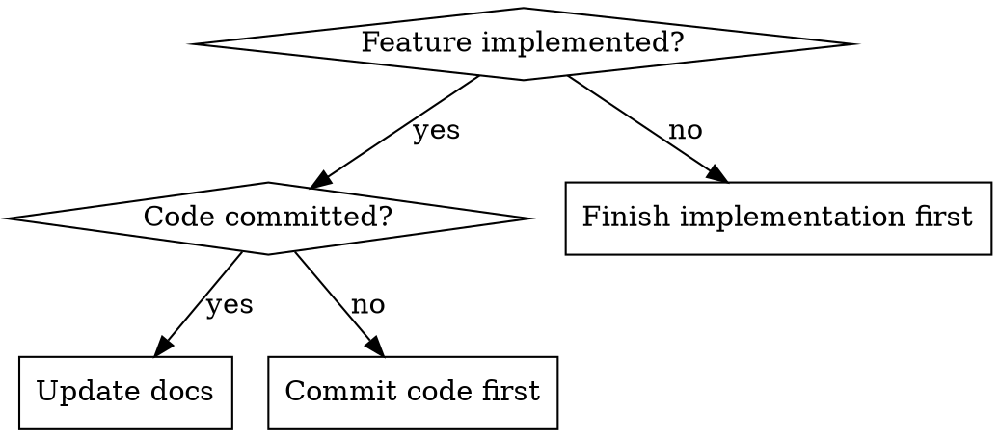

# Update Docs After Feature

## Overview

After implementing a feature, documentation must be updated to reflect the current state. This skill ensures docs stay in sync with code.

## When to Use



**Trigger after:**
- Feature implementation complete
- Code committed (not just staged)
- Before moving to next task

**Skip if:**
- Just a bug fix (no feature change)
- Documentation-only change
- Refactor with no user-facing change

## Quick Reference

| Doc File | What to Update |
|----------|----------------|
| `docs/PLAN.md` | Phase status (⏳→✅), enhancement details |
| `docs/README.md` | Current status section, "Next" phase |
| `docs/tasks/phase-X-*.md` | Task status, implementation details |
| `CLAUDE.md` | Only if new patterns/tools introduced |

## Workflow

### 1. Find docs directory

```bash
ls docs/*.md docs/tasks/*.md 2>/dev/null
```

### 2. Update in order

**PLAN.md:**
- Change phase status: `⏳ Pending` → `✅ Done`
- Add enhancement notes under phase section
- Keep concise (1-3 bullet points max)

**README.md:**
- Update "Current Status" section
- Update "Next" phase pointer

**Task file (docs/tasks/phase-X-*.md):**
- Change `**Status:** Pending` → `**Status:** ✅ Complete`
- Add implementation details to relevant section
- Document any deviations from original plan

### 3. Commit docs separately

```bash
git add docs/
git commit -m "docs: Update [Phase X] status and [feature] details"
```

Keep docs commit separate from code commit for clean history.

## Status Markers

| Status | Marker |
|--------|--------|
| Not started | `⏳ Pending` |
| In progress | `🔄 In Progress` |
| Complete | `✅ Done` or `✅ Complete` |
| Blocked | `🚫 Blocked` |

## Common Mistakes

| Mistake | Fix |
|---------|-----|
| Forgetting to update docs | Use this skill after every feature commit |
| Updating wrong phase | Check phase number in task file name |
| Too verbose updates | Keep changes to 1-3 bullet points |
| Missing "Next" update | Always update what comes next in README |

## Example Update

**Before (PLAN.md):**
```markdown
### Phase 3: AI Import ✅

Cloudflare Pages Function proxy for Gemini...
```

**After (PLAN.md):**
```markdown
### Phase 3: AI Import ✅

Cloudflare Pages Function proxy for Gemini...

**Enhancement (v2):** Smart context-aware Import flow
- New users: Text mode with Gemini prompt helper
- Returning users: File upload mode
```

## Red Flags - STOP

- About to start new feature without updating docs for previous one
- Docs say "Pending" but code is already merged
- README "Next" points to completed phase
- Task file has no implementation details after completion

**All of these mean: Update docs before proceeding.**
