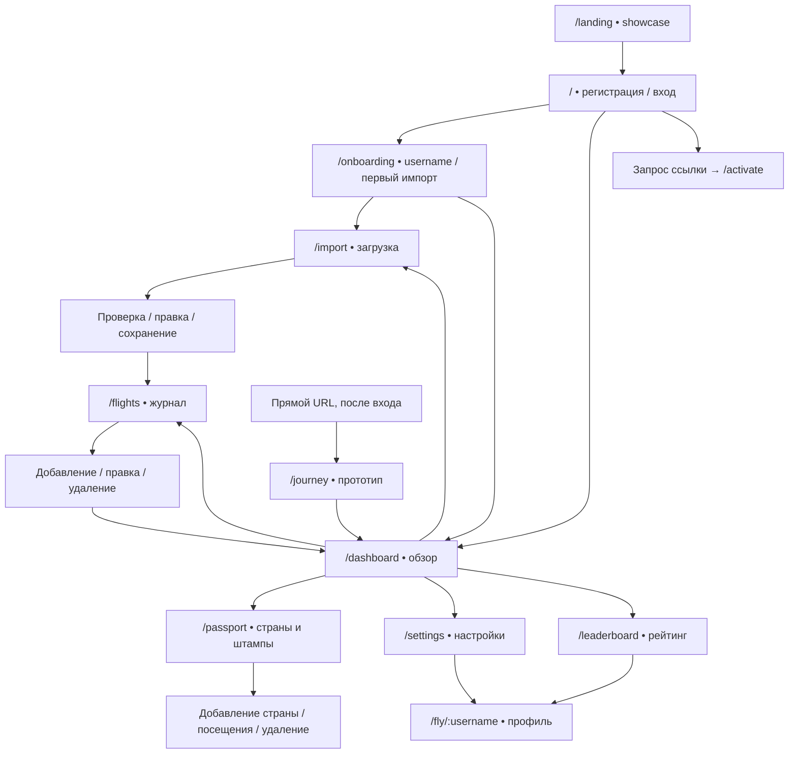

# Карта экранов и пользовательских путей Kuuki

Съёмка начата 2026-10-03. Скриншотов: 178. Состояний в индексе: 184. Пользовательских сценариев: 29. Статусы: captured=169, simulated=9, source-only=6.

[Галерея с поиском](gallery.html) · [JSON для агентов](manifest.json) · [Версия и окружение](environment.json) · [Проверки](verification.json) · [Как пользоваться](../README.md) · [Тестовый пользователь](test-user/README.md)

Снята локальная fixture с реальными компонентами и API, тестовыми аккаунтами и подменённым провайдером распознавания. Это снимок изменённого рабочего дерева. Доступность в production и качество настоящего OCR этим обходом не проверены.

## Навигация

Защищённые маршруты отправляют гостя на `/`; аккаунт с `username === null` отправляется на `/onboarding`. Пустая строка username в проверенной версии этот редирект не вызывает. `/leaderboard` и `/fly/:username` публичны. Планировщик скрыт из основной навигации; его неработающие кнопки описаны в разделе путей.

| Маршрут          | Назначение                                             | Путь и состояния                                                  |
| ---------------- | ------------------------------------------------------ | ----------------------------------------------------------------- |
| `/`              | Регистрация, переключение на вход и запрос активации   | [public-social](public-social/flows.md)                           |
| `/?mode=signin`  | Вход                                                   | [public-social](public-social/flows.md)                           |
| `/landing`       | Описание приложения и showcase                         | [public-social](public-social/flows.md)                           |
| `/onboarding`    | Username, первый импорт или пропуск                    | [public-social](public-social/flows.md)                           |
| `/dashboard`     | Обзор, карта, фильтры и статистика                     | [dashboard-passport-journey](dashboard-passport-journey/flows.md) |
| `/flights`       | Журнал, формы, фильтры и удаление рейса                | [flights-import](flights-import/flows.md)                         |
| `/import`        | Загрузка, распознавание, проверка и сохранение         | [flights-import](flights-import/flows.md)                         |
| `/passport`      | Страны, штампы и посещения                             | [dashboard-passport-journey](dashboard-passport-journey/flows.md) |
| `/settings`      | Профиль, видимость, настройки и выход                  | [public-social](public-social/flows.md)                           |
| `/leaderboard`   | Публичные рейтинги                                     | [public-social](public-social/flows.md)                           |
| `/fly/:username` | Профиль: собственный, публичный, приватный и не найден | [public-social](public-social/flows.md)                           |
| `/journey`       | Прототип планировщика, вход по прямому URL             | [dashboard-passport-journey](dashboard-passport-journey/flows.md) |
| `/activate`      | Отдельная страница установки пароля, вне SPA           | [public-social](public-social/flows.md)                           |

## Пользовательские сценарии

| ID                                          | Сценарий                                                                           | Шаги                                                                                                                                                                                                                                                                                                                                                                                                                                                                                                                                                                                                              | Результат                                                                                                                                                                                                                 |
| ------------------------------------------- | ---------------------------------------------------------------------------------- | ----------------------------------------------------------------------------------------------------------------------------------------------------------------------------------------------------------------------------------------------------------------------------------------------------------------------------------------------------------------------------------------------------------------------------------------------------------------------------------------------------------------------------------------------------------------------------------------------------------------- | ------------------------------------------------------------------------------------------------------------------------------------------------------------------------------------------------------------------------- |
| `public-social-landing-showcase`            | [Изучить стартовую страницу и showcase](public-social/flows.md)                    | Гость открывает /landing.; На desktop пролистывает три showcase-примера и знакомится с возможностями.; На mobile проверяет вертикальную компоновку.; Действие создания аккаунта ведёт на /.                                                                                                                                                                                                                                                                                                                                                                                                                       | Представлены hero, showcase и описание возможностей; регистрационная воронка начинается на /.                                                                                                                             |
| `public-social-registration-onboarding`     | [Создать аккаунт и пройти первые шаги](public-social/flows.md)                     | На / заполнить email и пароль; client validation показывает ошибки до отправки.; При успехе AuthPage ведёт на /dashboard, а маршрут без username перенаправляет на /onboarding.; Ввести username; имя короче трёх символов блокирует продолжение, пробелы нормализуются в дефисы.; На шаге импорта открыть/скрыть AI prompt, подготовить текст и при распознавании перейти на /import с initial text; продолжение описано в sibling flights-import atlas.                                                                                                                                                         | Username сохранён и доступен как URL профиля; шаг импорта необязателен. Распознавание текста в onboarding передаёт его в /import; там продолжается основной import journey.                                               |
| `public-social-sign-in`                     | [Войти, обработать валидацию и ошибку данных](public-social/flows.md)              | Открыть /?mode=signin.; Пустые/невалидные поля показывают клиентские сообщения.; Неверная тестовая пара email/password оставляет пользователя гостем и показывает API ошибку.; Корректная пара открывает защищённую часть.                                                                                                                                                                                                                                                                                                                                                                                        | Успешный экран находится в соседней dashboard зоне; переход зафиксирован по AuthPage и guard.                                                                                                                             |
| `public-social-activation`                  | [Запросить ссылку и активировать прежний аккаунт](public-social/flows.md)          | Из входа открыть режим запроса ссылки для прежнего аккаунта.; В живой локальной fixture request и complete отвечают 503; это временная недоступность, не доказательство invalid token. Request/complete success-renderers показаны только с браузерным mock 200.; На /activate без fragment token UI сообщает о пропущенной ссылке; синтетический token открывает форму установки пароля.; Несовпадение паролей блокирует submit на клиенте; правильная пара отправляется на fixture endpoint и получает 503.; Отдельный UI success после mock 200 остаётся simulated; письмо или реальная ссылка не создавались. | Полный реальный цикл email/token нельзя проверить в локальной fixture: endpoint временно отвечает 503 и не доставляет письма. Invalid token не подтверждён; success UI для request и complete отдельно помечен simulated. |
| `public-social-shared-header`               | [Пользоваться меню общей шапки](public-social/flows.md)                            | На публичном профиле открыть пользовательское меню.; Переходить в настройки, менять язык или завершить сессию.; Открыть панель темы/акцента и выбрать вариант.                                                                                                                                                                                                                                                                                                                                                                                                                                                    | Меню пользователя и панель внешнего вида доступны поверх публичного профиля.                                                                                                                                              |
| `public-social-settings`                    | [Настроить внешний вид и публичность профиля](public-social/flows.md)              | Открыть /settings; desktop показывает секции настроек, а mobile добавляет нижнюю навигацию.; Переключить светлую, тёмную или системную тему; проверить язык, accent color и видимость профиля.; С account a показать disabled экспорт при нулевых данных; отдельно войти в atlas-user и проверить активные выгрузки для 69 полётов/16 стран.; Скачать CSV полётов и зафиксировать success toast; claims export остаётся лишь визуально включённым и не запускается.                                                                                                                                               | Настройки, видимость и выгрузка полётов/посещённых стран задокументированы. Экспорт 69 полётов и двух country claims UI-проверен; у результата claims нет PNG и он помечен source-only.                                   |
| `public-social-account-deletion`            | [Проверить защитные шаги удаления аккаунта](public-social/flows.md)                | Просмотреть число полётов/стран и предупреждение.; На вопрос об экспорте выбрать «Нет, продолжить»; disabled «Скачать мои данные» не ведёт к паролю.; Ввести неверный пароль и отправить «Удалить всё»; fixture возвращает ошибку.                                                                                                                                                                                                                                                                                                                                                                                | Неверный пароль возвращает ошибку; account a не удалялся и не менялся.                                                                                                                                                    |
| `public-social-disposable-account-deletion` | [Удалить только временный пустой аккаунт](public-social/flows.md)                  | Создать одноразовый local fixture account через UI без полётов.; Пройти disposable preview, выбрать «Нет, продолжить» (download disabled) и перейти к password step.; Ввести правильный пароль и подтвердить удаление disposable account; локальные verify-password и DELETE вернули 200.                                                                                                                                                                                                                                                                                                                         | Disposable account удалён; отображается экран регистрации после redirect. Account a и богатый профиль test-traveler не затронуты.                                                                                         |
| `public-social-profile-visibility`          | [Открыть профили с разными уровнями видимости](public-social/flows.md)             | Владелец journey-demo видит статус «Приватный» и Share; Share копирует текущий URL /fly/journey-demo и не меняет видимость.; Гость видит приватный профиль journey-demo с минимальным сообщением без секций и Share; неизвестный username открывает not-found.; Публичный test-traveler доступен гостю и авторизованному viewer; на mobile секции раскрываются кнопками.; Сравнить dark-theme состояние и страницу профиля после прокрутки.                                                                                                                                                                       | Публичный, приватный и отсутствующий профиль различимы; текущий экран профиля не содержит control сравнения.                                                                                                              |
| `public-social-leaderboard`                 | [Просмотреть категории рейтинга гостем и участником](public-social/flows.md)       | Авторизованный account a и гость открывают все пять категорий; live API возвращает пустые таблицы.; Проверить причину: локальный leaderboard_cache не заполнен cron rebuild; test-traveler имеет 69 полётов и opt-in=true.; Для изображения наполненного состояния подменить ответ GET /api/leaderboard в браузере DTO-совместимым локальным набором и пометить его simulated.                                                                                                                                                                                                                                    | Все пять реальных категорий и гостевой экран пусты в fixture из-за отсутствия cache rebuild; DTO-совместимая таблица показана отдельно как simulated.                                                                     |
| `flights-create-manual`                     | [Добавить полёт вручную и проверить дубликат](flights-import/flows.md)             | Открыть форму из журнала.; Выбрать дату и маршрут из автоподсказок.; Раскрыть поля номера, самолёта и времени.; Заполнить рейс и сохранить.; При совпадении даты/маршрута увидеть предупреждение и решить, сохранять ли запись.                                                                                                                                                                                                                                                                                                                                                                                   | Создан будущий JFK→BOS; отдельный дубль из предупреждения не сохранялся.                                                                                                                                                  |
| `flights-browse-filter`                     | [Просмотреть журнал и фильтровать записи](flights-import/flows.md)                 | Загрузить записи журнала.; Отфильтровать предстоящие и прошедшие рейсы.; Выбрать год, авиакомпанию и тип самолёта.                                                                                                                                                                                                                                                                                                                                                                                                                                                                                                | Фильтры комбинируются; для 2027/AA/B738 остаётся будущая запись.                                                                                                                                                          |
| `flights-edit-delete`                       | [Править один полёт или выбрать пакетное удаление](flights-import/flows.md)        | Открыть строку и форму редактирования.; Открыть подтверждение удаления записи; отменить действие.; Перейти в режим выбора, выбрать запись и открыть пакетное подтверждение.                                                                                                                                                                                                                                                                                                                                                                                                                                       | Подтверждения и количество выбранных записей видны; тестовые записи очищены после съёмки.                                                                                                                                 |
| `flights-mobile-layout`                     | [Просмотреть журнал и добавить полёт на мобильном экране](flights-import/flows.md) | Открыть пустой список.; Загрузить синтетические рейсы и проверить карточную раскладку.; Открыть мобильную форму добавления.                                                                                                                                                                                                                                                                                                                                                                                                                                                                                       | Подтверждён мобильный layout списка и формы при 390×844.                                                                                                                                                                  |
| `import-text-review-save`                   | [Распознать текст, проверить и сохранить рейс](flights-import/flows.md)            | Показать инструкции и ввести текст подтверждения.; Запустить распознавание.; Проверить и раскрыть поля результата, менять выбор/удалять строки.; Сохранить выбранный рейс или добавить вручную.                                                                                                                                                                                                                                                                                                                                                                                                                   | Синтетический JFK→BOS AA100 появился в журнале; success counter показал 0 вопреки toast и записи в журнале.                                                                                                               |
| `import-file-pdf-image`                     | [Загрузить PDF или изображение](flights-import/flows.md)                           | Выбрать синтетический PDF или PNG.; Запустить парсер и проверить результат.; Дубликат автоматически снят с выбора; пользователь может выбрать его сам.                                                                                                                                                                                                                                                                                                                                                                                                                                                            | Оба типа файлов проходят в fake parser; результат детерминированный и совпадает с сохранённым рейсом.                                                                                                                     |
| `import-provider-errors`                    | [Увидеть общую ошибку распознавания](flights-import/flows.md)                      | Ввести маркер fake quota или fake missing model.; Запустить распознавание и прочитать сообщение ошибки.                                                                                                                                                                                                                                                                                                                                                                                                                                                                                                           | Обе причины отображаются одной общей ошибкой чтения документа; детали причины не раскрываются.                                                                                                                            |
| `import-retry-save`                         | [Повторить сбой сохранения](flights-import/flows.md)                               | Явно выбрать найденный дубль.; Тестовый перехват прерывает POST /api/flights; UI предлагает повторить неудачное сохранение.; Снять перехват и повторить сохранение.                                                                                                                                                                                                                                                                                                                                                                                                                                               | Retry реально сохранил запись в локальном fixture; начальный отказ помечен simulated.                                                                                                                                     |
| `import-mobile-layout`                      | [Распознать рейс на мобильном экране](flights-import/flows.md)                     | Открыть загрузку на ширине 390 px.; Ввести тестовый текст и перейти к проверке.                                                                                                                                                                                                                                                                                                                                                                                                                                                                                                                                   | Зафиксированы мобильные состояния загрузки и редактирования результата.                                                                                                                                                   |
| `flights-aircraft`                          | [Искать самолёт и выбрать тип вручную](flights-import/flows.md)                    | Запустить пакетный поиск самолётов для записей без типа.; Fake provider вызов завершился 502; диалог empty/results повторно воспроизведён контрактными payload.; Прервать PATCH, увидеть ошибку сохранения, затем повторить и сохранить B738.                                                                                                                                                                                                                                                                                                                                                                     | Пустой и непустой диалоги подтверждены по source contract; успешный PATCH обновил локальный журнал. Настоящий внешний provider не проверен.                                                                               |
| `import-review-selection`                   | [Исключить и снова выбрать распознанный рейс](flights-import/flows.md)             |                                                                                                                                                                                                                                                                                                                                                                                                                                                                                                                                                                                                                   |                                                                                                                                                                                                                           |
| `import-review-manual-add`                  | [Открыть ручное добавление из пустой проверки](flights-import/flows.md)            |                                                                                                                                                                                                                                                                                                                                                                                                                                                                                                                                                                                                                   |                                                                                                                                                                                                                           |
| `dashboard-first-flight`                    | [Первый полёт и обзор статистики](dashboard-passport-journey/flows.md)             | На пустой главной выберите «Добавить полёт».; Введите аэропорт — появляются подсказки; незаполненная форма показывает валидацию.; Для демонстрационных данных заполните JFK—LAX, AA 100, B738, дата 03.01.2026.; После сохранения обзор показывает карту и карточки анализа; синтетический аккаунт также содержит будущий TBS—DOH от 05.10.2026.                                                                                                                                                                                                                                                                  | Один завершённый полёт в статистике; fleet и manufacturer показывают 737-800 / Boeing. Синтетический аккаунт локальный.                                                                                                   |
| `dashboard-filters-map`                     | [Фильтры и карта главной](dashboard-passport-journey/flows.md)                     | Раскройте фильтр года, авиакомпании, самолёта или статуса; поиск аэропорта применяется по коду или городу.; Можно ограничить маршруты отправлением TBS и направлением DOH; очистка возвращает все данные.; Раскройте карту или скройте её линии маршрутов. На телефоне фильтры раскрываются отдельной кнопкой.                                                                                                                                                                                                                                                                                                    | Фильтры влияют на выборку и маршруты карты; screenshots с тестовым путешественником сделаны в read-only контексте.                                                                                                        |
| `dashboard-upcoming-flight`                 | [Предстоящий полёт](dashboard-passport-journey/flows.md)                           | Добавьте будущий рейс TBS—DOH, QR, 05.10.2026.; Проверьте баннер — при дате приложения 04.10 он обозначен как «завтра».; Откройте редактирование либо удаление. Удаление требует подтверждения.                                                                                                                                                                                                                                                                                                                                                                                                                   | Будущий полёт виден отдельно от завершённой статистики; destructive confirmation в атласе не подтверждалось.                                                                                                              |
| `passport-first-country`                    | [Добавить первую страну в паспорт](dashboard-passport-journey/flows.md)            | На пустом паспорте выберите добавление страны. На телефоне откроется сгруппированный список; найдите Spain.; Выберите страну и добавьте штамп, выбрав год и тип наземный/морской при необходимости.; Откройте штамп, чтобы увидеть карточку деталей страны.                                                                                                                                                                                                                                                                                                                                                       | Spain появляется в секции Europe; профиль используется только для локального атласа.                                                                                                                                      |
| `passport-visits-and-delete`                | [Детали страны, визиты и удаление](dashboard-passport-journey/flows.md)            | Откройте ранее добавленный штамп и выберите добавление визита.; Пример формы заполнен годом 2025, морским въездом и демонстрационной заметкой.; В деталях страны проверьте визиты, аэропорты и действие удаления страны или отдельного наземного визита.; Подтверждения показаны, но не активированы.                                                                                                                                                                                                                                                                                                             | Добавление визита наблюдалось в локальном синтетическом аккаунте; удаления оставлены в стадии подтверждения.                                                                                                              |
| `passport-map`                              | [Слои и масштаб карты паспорта](dashboard-passport-journey/flows.md)               | В обычном паспорте доступны слои маршрутов, добавленных стран и тепловой карты.; Разверните карту для крупного вида; нажмите штамп/страну для подробностей.                                                                                                                                                                                                                                                                                                                                                                                                                                                       | Показаны отдельные состояния слоёв и карта на двух viewport; заполненный паспорт тестового путешественника открыт только для чтения.                                                                                      |
| `journey-reorder-prototype`                 | [Переставить сегменты Journey](dashboard-passport-journey/flows.md)                | Откройте /journey: прототип содержит TBS—DOH и DOH—NRT.; Перетащите блоки временной шкалы: их порядок меняется в локальном состоянии React.; Кнопки Save Trip, Add Segment и + не имеют обработчиков.                                                                                                                                                                                                                                                                                                                                                                                                             | Можно увидеть порядок сегментов до и после drag; добавление и постоянное сохранение не реализованы.                                                                                                                       |

## Аудит интерфейса

Аудит `$impeccable audit` от 2026-10-04 по исходникам `1303485`: **11/20** (Acceptable). P0=0, P1=34, P2=68, P3=11. Скриншоты атласа служат визуальным доказательством; источник истины для находок — код на указанном коммите. [Полный отчёт](audit/AUDIT.md) · [JSON находок](audit/findings.json). В индексе экранов колонка «Аудит» показывает находки, видимые в состоянии.

| Измерение              | Оценка | Главное                                                                                                                                                                                |
| ---------------------- | ------ | -------------------------------------------------------------------------------------------------------------------------------------------------------------------------------------- |
| Доступность            | 2/4    | Есть skip-link, landmarks, Radix-диалоги и связанные метки, но контраст текста и границ ниже AA системно, combobox/дропзона/карта без клавиатуры, lang и title статичны.               |
| Производительность     | 3/4    | Ленивые маршруты, ручные чанки, IntersectionObserver в Passport; минусы — topojson со стороннего CDN, немемоизированная карта, бесконечные left-анимации, dev-инструмент в прод-чанке. |
| Адаптивность           | 2/4    | Мобильные раскладки и таб-бар есть, но Dashboard (442px) и строка ревью импорта (~580px) переполняют 390px, нет пути в рейтинг, цели <44px.                                            |
| Темы и токены          | 2/4    | OKLCH-токены покрывают ~98% цветов, но акцент перекрывает их hex-ом, .aura-* и белые литералы карты ломают светлую тему, легенда тепловой карты невалидна.                             |
| Целостность реализации | 2/4    | Целостная система токенов и тон, но русская локаль системно смешана с английским, обещан несуществующий URL профиля, ошибки маскируются под пустые данные, мёртвые контролы Journey.   |

| ID                                                                                                                                                  | P   | Измерение              | Проблема                                                                                                                                                              | Состояний |
| --------------------------------------------------------------------------------------------------------------------------------------------------- | --- | ---------------------- | --------------------------------------------------------------------------------------------------------------------------------------------------------------------- | --------- |
| [`amber-literal-rank-text-fails-contrast-light`](audit/AUDIT.md#amber-literal-rank-text-fails-contrast-light)                                       | P1  | Доступность            | Номера мест в «Вашем месте» окрашены Tailwind amber-500: 1.99:1 в светлой теме                                                                                        | 1         |
| [`contrast-text-tokens-below-aa`](audit/AUDIT.md#contrast-text-tokens-below-aa)                                                                     | P1  | Доступность            | Текстовые цвета ниже 4.5:1: destructive, success, warning и muted-foreground с opacity /40–/80                                                                        | 25        |
| [`control-borders-below-3-to-1`](audit/AUDIT.md#control-borders-below-3-to-1)                                                                       | P1  | Доступность            | Границы полей, select и чекбоксов 1.2–1.4:1 вместо 3:1                                                                                                                | 7         |
| [`flight-form-combobox-aria-missing`](audit/AUDIT.md#flight-form-combobox-aria-missing)                                                             | P1  | Доступность            | Автокомплиты (аэропорт, авиакомпания, самолёт) — не combobox: нет role/aria-expanded/activedescendant, li с onClick                                                   | 2         |
| [`focus-ring-half-opacity-below-3-to-1`](audit/AUDIT.md#focus-ring-half-opacity-below-3-to-1)                                                       | P1  | Доступность            | Кольцо фокуса ring-ring/50 у Button/Input/Select/Checkbox даёт 1.2-2.0:1 на светлом фоне                                                                              | 2         |
| [`html-lang-static-en`](audit/AUDIT.md#html-lang-static-en)                                                                                         | P1  | Доступность            | `<html lang>` всегда «en», даже когда интерфейс русский                                                                                                               | 6         |
| [`map-geographies-177-tab-stops-no-keyboard-action`](audit/AUDIT.md#map-geographies-177-tab-stops-no-keyboard-action)                               | P1  | Доступность            | Каждая страна на карте — безымянная tab-остановка (177 шт.), а Enter ничего не делает                                                                                 | 12        |
| [`map-overlays-white-on-light-theme`](audit/AUDIT.md#map-overlays-white-on-light-theme)                                                             | P1  | Доступность            | Маркеры аэропортов, подписи, счётчики и кнопка «развернуть» на карте захардкожены белым и невидимы в светлой теме                                                     | 11        |
| [`spa-route-change-no-title-no-focus`](audit/AUDIT.md#spa-route-change-no-title-no-focus)                                                           | P1  | Доступность            | Смена маршрута и режима не меняет document.title и не переносит фокус                                                                                                 | 8         |
| [`i18n-first-paint-english-until-rerender`](audit/AUDIT.md#i18n-first-paint-english-until-rerender)                                                 | P1  | Целостность реализации | При первой загрузке в RU части экрана остаются на английском до случайного ре-рендера                                                                                 | 8         |
| [`i18n-hardcoded-english-and-missing-keys`](audit/AUDIT.md#i18n-hardcoded-english-and-missing-keys)                                                 | P1  | Целостность реализации | В русском интерфейсе остаются английские строки: зашитые литералы, отсутствующие ключи, ошибки валидации и сервера                                                    | 27        |
| [`i18n-ru-plural-many-missing`](audit/AUDIT.md#i18n-ru-plural-many-missing)                                                                         | P1  | Целостность реализации | В ru.json нет plural-форм `_many`: 0, 5–20, 25–30… показываются по-английски                                                                                          | 5         |
| [`mobile-nav-missing-leaderboard-and-own-profile`](audit/AUDIT.md#mobile-nav-missing-leaderboard-and-own-profile)                                   | P1  | Целостность реализации | На mobile нет пути в рейтинг, а ссылки на собственный публичный профиль нет нигде                                                                                     | 5         |
| [`accent-picker-overrides-tokens-fails-contrast`](audit/AUDIT.md#accent-picker-overrides-tokens-fails-contrast)                                     | P1  | Темы и токены          | Акцент перекрывает OKLCH-токены одним hex для обеих тем; дефолтный red не проходит AA                                                                                 | 13        |
| [`aura-auth-inputs-broken-light-theme`](audit/AUDIT.md#aura-auth-inputs-broken-light-theme)                                                         | P1  | Темы и токены          | `.aura-input` / `.aura-button` на входе и регистрации ломаются в светлой теме: rgba-литералы, стекло, градиент                                                        | 4         |
| [`badge-toast-no-live-region-unnamed-dismiss`](audit/AUDIT.md#badge-toast-no-live-region-unnamed-dismiss)                                           | P1  | Доступность            | Toast нового достижения не озвучивается, кнопка закрытия без имени, автозакрытие 6 с                                                                                  | 0         |
| [`delete-flow-error-and-progress-not-announced`](audit/AUDIT.md#delete-flow-error-and-progress-not-announced)                                       | P1  | Доступность            | В диалоге удаления аккаунта ошибка пароля и шаг «Удаляем…» не озвучиваются                                                                                            | 3         |
| [`flight-table-edit-and-sort-keyboard`](audit/AUDIT.md#flight-table-edit-and-sort-keyboard)                                                         | P1  | Доступность            | В таблице рейсов кнопка редактирования без имени, сортировка по заголовкам недоступна с клавиатуры                                                                    | 2         |
| [`ground-visit-delete-hidden-until-hover`](audit/AUDIT.md#ground-visit-delete-hidden-until-hover)                                                   | P1  | Доступность            | Кнопка удаления наземного визита видна только при hover; подтверждающие кнопки без имён                                                                               | 4         |
| [`import-dropzone-keyboard-inaccessible`](audit/AUDIT.md#import-dropzone-keyboard-inaccessible)                                                     | P1  | Доступность            | Дропзона загрузки — Card с onClick: недоступна с клавиатуры, input скрыт, поле текста без метки                                                                       | 2         |
| [`import-progress-modal-not-a-dialog`](audit/AUDIT.md#import-progress-modal-not-a-dialog)                                                           | P1  | Доступность            | FlightProgressModal — самописная «модалка» без role=dialog, фокус-ловушки и aria-live                                                                                 | 1         |
| [`import-row-checkbox-and-icon-buttons-unlabeled`](audit/AUDIT.md#import-row-checkbox-and-icon-buttons-unlabeled)                                   | P1  | Доступность            | В строках ревью импорта чекбокс, раскрытие и удаление не имеют доступных имён                                                                                         | 2         |
| [`import-row-collapsed-form-focusable`](audit/AUDIT.md#import-row-collapsed-form-focusable)                                                         | P1  | Доступность            | Свернутая форма редактирования строки остаётся в порядке Tab и дереве доступности                                                                                     | 2         |
| [`leaderboard-category-tabs-icon-only-unnamed-on-mobile`](audit/AUDIT.md#leaderboard-category-tabs-icon-only-unnamed-on-mobile)                     | P1  | Доступность            | Вкладки категорий рейтинга на mobile — безымянные кнопки без состояния                                                                                                | 2         |
| [`leaderboard-top3-rank-icon-only-no-text`](audit/AUDIT.md#leaderboard-top3-rank-icon-only-no-text)                                                 | P1  | Доступность            | Места 1–3 в таблице рейтинга выражены только иконкой без текста                                                                                                       | 1         |
| [`mobile-filters-toggle-not-disclosure`](audit/AUDIT.md#mobile-filters-toggle-not-disclosure)                                                       | P1  | Доступность            | Мобильный переключатель фильтров без aria-expanded, нельзя свернуть при активных фильтрах, а скрытые контролы остаются в tab-порядке                                  | 3         |
| [`auth-form-disabled-during-session-bootstrap`](audit/AUDIT.md#auth-form-disabled-during-session-bootstrap)                                         | P1  | Целостность реализации | Поля и кнопка входа блокируются на время проверки сессии; при недоступном API форма заблокирована бессрочно                                                           | 3         |
| [`authpage-no-redirect-for-signed-in-user`](audit/AUDIT.md#authpage-no-redirect-for-signed-in-user)                                                 | P1  | Целостность реализации | Авторизованный пользователь на «/» видит форму регистрации (в том числе при старте PWA)                                                                               | 2         |
| [`import-error-quota-vs-model-indistinguishable`](audit/AUDIT.md#import-error-quota-vs-model-indistinguishable)                                     | P1  | Целостность реализации | Ошибки парсинга (квота ИИ, модель недоступна, таймаут сервера) сводятся к одному общему сообщению                                                                     | 1         |
| [`import-parse-error-shows-empty-state`](audit/AUDIT.md#import-parse-error-shows-empty-state)                                                       | P1  | Целостность реализации | После ошибки парсинга показывается «Рейсов не найдено» вместе с алертом об ошибке                                                                                     | 1         |
| [`onboarding-profile-url-preview-wrong`](audit/AUDIT.md#onboarding-profile-url-preview-wrong)                                                       | P1  | Целостность реализации | Шаг имени пользователя обещает адрес kuuki.app/@имя, которого в приложении нет                                                                                        | 2         |
| [`dashboard-mobile-horizontal-overflow-442px`](audit/AUDIT.md#dashboard-mobile-horizontal-overflow-442px)                                           | P1  | Адаптивность           | Мобильный Dashboard шире экрана: карточки статистики выпирают за правый край (442px при viewport 390)                                                                 | 2         |
| [`import-row-mobile-overflow`](audit/AUDIT.md#import-row-mobile-overflow)                                                                           | P1  | Адаптивность           | Строка ревью импорта на 390px: фиксированная ширина колонок (~580px) переполняет контейнер ~310px                                                                     | 1         |
| [`heatmap-legend-invisible-and-scale-mismatch`](audit/AUDIT.md#heatmap-legend-invisible-and-scale-mismatch)                                         | P1  | Темы и токены          | Легенда тепловой карты не рисуется, а сама тепловая карта кодирует частоту прозрачностью флагового цвета каждой страны                                                | 2         |
| [`heading-structure-gaps`](audit/AUDIT.md#heading-structure-gaps)                                                                                   | P2  | Доступность            | Иерархия заголовков: h4 без h2/h3 на Dashboard, нет h1 у пустого Passport, одинаковый h1 «Kuuki» у всех режимов входа                                                 | 8         |
| [`micro-text-9-10px-and-stamp-svg-text`](audit/AUDIT.md#micro-text-9-10px-and-stamp-svg-text)                                                       | P2  | Доступность            | Слишком мелкий текст: 9–10px в карточках статистики и 5.5–7px в SVG штампов на мобильном                                                                              | 5         |
| [`reduced-motion-global-kill-no-loader-alternative`](audit/AUDIT.md#reduced-motion-global-kill-no-loader-alternative)                               | P2  | Доступность            | Глобальный reduced-motion «0.01ms !important» продублирован и стирает индикаторы загрузки без замены                                                                  | 0         |
| [`dm-sans-has-no-cyrillic-fallback-system-font`](audit/AUDIT.md#dm-sans-has-no-cyrillic-fallback-system-font)                                       | P2  | Целостность реализации | DM Sans не содержит кириллицы: весь русский интерфейс рисуется системным шрифтом, а не брендовым                                                                      | 3         |
| [`fetch-errors-shown-as-empty-state`](audit/AUDIT.md#fetch-errors-shown-as-empty-state)                                                             | P2  | Целостность реализации | Сбой загрузки выглядит как пустые данные: журнал «нет рейсов», рейтинг «Станьте первым!»                                                                              | 3         |
| [`import-success-counter-starts-at-zero`](audit/AUDIT.md#import-success-counter-starts-at-zero)                                                     | P2  | Целостность реализации | Экран успеха импорта начинается с «0 flights added to your log» на английском                                                                                         | 2         |
| [`dialog-no-max-height-no-scroll`](audit/AUDIT.md#dialog-no-max-height-no-scroll)                                                                   | P2  | Адаптивность           | DialogContent без max-height и прокрутки: высокие диалоги («Что такое Kuuki?», удаление аккаунта) обрезаются на телефоне                                              | 2         |
| [`touch-targets-below-44px`](audit/AUDIT.md#touch-targets-below-44px)                                                                               | P2  | Адаптивность           | Касательные цели меньше 44×44: свотчи, вкладки, крестики, чекбоксы, слои карты, точки шоукейса, текстовые ссылки                                                      | 14        |
| [`country-dominant-colors-hex-low-contrast-dark`](audit/AUDIT.md#country-dominant-colors-hex-low-contrast-dark)                                     | P2  | Темы и токены          | Цвета стран (dominantColor) — хардкод-hex из countries.json; на тёмной теме 137 из 246 ниже 3:1, на светлой 25 ниже 3:1                                               | 4         |
| [`hardcoded-color-literals`](audit/AUDIT.md#hardcoded-color-literals)                                                                               | P2  | Темы и токены          | Цвета вне токенов: 36 hex, 27 классов палитры Tailwind (blue-500, amber-500…), rgba/white в карте и журнале                                                           | 3         |
| [`one-material-border-plus-shadow`](audit/AUDIT.md#one-material-border-plus-shadow)                                                                 | P2  | Темы и токены          | Карточки сочетают рамку и тень/ореол вопреки правилу «один материал», карта получает постоянный розовый ореол                                                         | 4         |
| [`activate-page-errors-not-associated-and-misleading`](audit/AUDIT.md#activate-page-errors-not-associated-and-misleading)                           | P2  | Доступность            | Страница /activate: ошибки не привязаны к полям, фокус теряется, подсказка в ошибке вводит в заблуждение                                                              | 3         |
| [`appearance-menu-controls-unreachable-by-keyboard`](audit/AUDIT.md#appearance-menu-controls-unreachable-by-keyboard)                               | P2  | Доступность            | Переключатели темы и акцента в шапке — обычные button внутри Radix DropdownMenu: Tab заблокирован, стрелки их не достигают                                            | 3         |
| [`charts-lack-text-alternative-and-keyboard`](audit/AUDIT.md#charts-lack-text-alternative-and-keyboard)                                             | P2  | Доступность            | Ридж-график, радар, полосы и вафля: нет текстового эквивалента, тултипы только по мыши, вложенные role="img" на 64 квадратах                                          | 4         |
| [`delete-dialog-focus-and-submit-semantics`](audit/AUDIT.md#delete-dialog-focus-and-submit-semantics)                                               | P2  | Доступность            | Диалог удаления: нет управления фокусом между шагами, нет <form>, Enter не подтверждает                                                                               | 3         |
| [`flight-form-required-validation-wiring`](audit/AUDIT.md#flight-form-required-validation-wiring)                                                   | P2  | Доступность            | Обязательность и ошибки формы рейса не связаны с полями: звёздочка без sr-текста, DatePicker и автокомплиты вне FormControl                                           | 1         |
| [`focus-lost-on-mode-and-step-switch`](audit/AUDIT.md#focus-lost-on-mode-and-step-switch)                                                           | P2  | Доступность            | Фокус теряется при переключении «вход / регистрация / активация» и шагов онбординга; режим не отражён в URL                                                           | 6         |
| [`form-controls-unlabeled-filters-claim-dialog`](audit/AUDIT.md#form-controls-unlabeled-filters-claim-dialog)                                       | P2  | Доступность            | Фильтры, форма добавления визита и подсказки: поля без программных подписей и переключатели без состояния                                                             | 5         |
| [`journey-reorder-mouse-only-dnd`](audit/AUDIT.md#journey-reorder-mouse-only-dnd)                                                                   | P2  | Доступность            | Перестановка сегментов Journey — только нативный HTML5 drag-and-drop: нет клавиатуры, на touch не работает; кнопка «Reorder segment» ничего не делает                 | 4         |
| [`leaderboard-table-unnamed-and-category-change-silent`](audit/AUDIT.md#leaderboard-table-unnamed-and-category-change-silent)                       | P2  | Доступность            | Таблица рейтинга без caption/имени; смена категории и загрузка не объявляются                                                                                         | 2         |
| [`loading-screen-english-and-silent`](audit/AUDIT.md#loading-screen-english-and-silent)                                                             | P2  | Доступность            | LoadingScreen: английский текст в RU и без объявления состояния загрузки                                                                                              | 1         |
| [`nav-landmarks-missing-aria-current-and-labels`](audit/AUDIT.md#nav-landmarks-missing-aria-current-and-labels)                                     | P2  | Доступность            | Навигация без aria-current и aria-label, кнопка пользователя подписана инициалами                                                                                     | 5         |
| [`profile-badges-tooltip-only-details-and-color-tier`](audit/AUDIT.md#profile-badges-tooltip-only-details-and-color-tier)                           | P2  | Доступность            | Бейджи профиля: описание и дата — только в title, тир — только цветом, лента не фокусируется                                                                          | 1         |
| [`profile-founding-pill-reveal-hover-only-and-auto-collapse`](audit/AUDIT.md#profile-founding-pill-reveal-hover-only-and-auto-collapse)             | P2  | Доступность            | Пилюля «Первый экипаж» через 5 с сворачивается в иконку и раскрывается только по :hover                                                                               | 0         |
| [`profile-mobile-section-triggers-not-headings`](audit/AUDIT.md#profile-mobile-section-triggers-not-headings)                                       | P2  | Доступность            | На mobile заголовки секций профиля — кнопки без heading-семантики                                                                                                     | 2         |
| [`progress-bar-value-not-exposed`](audit/AUDIT.md#progress-bar-value-not-exposed)                                                                   | P2  | Доступность            | Progress не передаёт value в Radix Root: прогресс-бары объявляются как indeterminate без aria-valuenow                                                                | 0         |
| [`register-form-autocomplete-and-password-affordances`](audit/AUDIT.md#register-form-autocomplete-and-password-affordances)                         | P2  | Доступность            | Регистрация: нет autocomplete=email/new-password, нет подсказки про 8 символов и показа пароля                                                                        | 3         |
| [`rotating-tagline-no-pause`](audit/AUDIT.md#rotating-tagline-no-pause)                                                                             | P2  | Доступность            | Слоган меняется каждые 6 секунд без возможности остановить; в reduced-motion продолжает меняться                                                                      | 3         |
| [`settings-save-result-and-form-errors-not-announced-or-localized`](audit/AUDIT.md#settings-save-result-and-form-errors-not-announced-or-localized) | P2  | Доступность            | Сохранение профиля: статус кнопки и ошибка не озвучиваются; «Failed to save» на английском                                                                            | 1         |
| [`settings-segmented-control-radio-keyboard-and-label`](audit/AUDIT.md#settings-segmented-control-radio-keyboard-and-label)                         | P2  | Доступность            | Переключатель темы: role=radio без стрелочной навигации; подписи <label> без связи; язык без aria-pressed                                                             | 3         |
| [`settings-visibility-leaderboard-disabled-reason-hidden`](audit/AUDIT.md#settings-visibility-leaderboard-disabled-reason-hidden)                   | P2  | Доступность            | Чекбокс «Показывать в рейтинге» отключён без объяснения причины; снятие «Публичный» молча снимает рейтинг                                                             | 2         |
| [`share-button-feedback-silent-and-unhandled-clipboard-failure`](audit/AUDIT.md#share-button-feedback-silent-and-unhandled-clipboard-failure)       | P2  | Доступность            | Кнопка «Share»: результат не озвучивается, сбой clipboard не обрабатывается                                                                                           | 1         |
| [`stamp-popup-semantics-focus-and-position`](audit/AUDIT.md#stamp-popup-semantics-focus-and-position)                                               | P2  | Доступность            | Попап штампа — не диалог: нет роли/имени, фокус не переносится, позиция не ограничена экраном и уходит под таб-бар                                                    | 4         |
| [`username-picker-errors-not-announced`](audit/AUDIT.md#username-picker-errors-not-announced)                                                       | P2  | Доступность            | Ошибки выбора имени пользователя не связаны с полем и не озвучиваются                                                                                                 | 2         |
| [`activate-page-english-only`](audit/AUDIT.md#activate-page-english-only)                                                                           | P2  | Целостность реализации | Страница /activate целиком на английском и не знает язык приложения                                                                                                   | 6         |
| [`badge-toast-queue-floods-on-new-device-and-global-seen-state`](audit/AUDIT.md#badge-toast-queue-floods-on-new-device-and-global-seen-state)       | P2  | Целостность реализации | На новом устройстве все накопленные награды показываются очередью по 6 секунд; seen-state общий для всех аккаунтов                                                    | 0         |
| [`continent-model-inconsistent-totals-and-labels`](audit/AUDIT.md#continent-model-inconsistent-totals-and-labels)                                   | P2  | Целостность реализации | Модель континентов расходится: хардкод-итоги радара, «/ 7», подписи «americas» и пропуск Антарктиды                                                                   | 4         |
| [`country-picker-search-double-filter`](audit/AUDIT.md#country-picker-search-double-filter)                                                         | P2  | Целостность реализации | Поиск страны: cmdk повторно фильтрует по имени, поэтому код (ES) и родное название (España) не находятся; русские запросы не работают нигде                           | 3         |
| [`dashboard-filters-vs-map-and-persistence`](audit/AUDIT.md#dashboard-filters-vs-map-and-persistence)                                               | P2  | Целостность реализации | Фильтры Dashboard и карта расходятся: aircraft-фильтр не применяется к карте, страны не фильтруются, а origin/destination из persist-стора стираются при монтировании | 4         |
| [`data-export-disabled-looks-empty-while-stats-load`](audit/AUDIT.md#data-export-disabled-looks-empty-while-stats-load)                             | P2  | Целостность реализации | Кнопки экспорта показывают «Нет полётов/стран» пока статистика грузится; экспорт стран может молча ничего не делать                                                   | 2         |
| [`flight-date-utc-shift`](audit/AUDIT.md#flight-date-utc-shift)                                                                                     | P2  | Целостность реализации | Даты рейсов парсятся как UTC и форматируются локальными геттерами — для UTC− сдвиг на день                                                                            | 2         |
| [`header-appearance-state-stale-duplicate-hooks`](audit/AUDIT.md#header-appearance-state-stale-duplicate-hooks)                                     | P2  | Целостность реализации | useTheme/useAccentColor хранят состояние локально в каждом экземпляре: иконка темы и точка акцента в шапке устаревают                                                 | 2         |
| [`journey-dead-controls-fake-data-unreachable-nav`](audit/AUDIT.md#journey-dead-controls-fake-data-unreachable-nav)                                 | P2  | Целостность реализации | Journey: Save Trip, «+» и Add Segment не подключены; шапка и итоги — статичный текст; прототип с жёсткими данными доступен по URL                                     | 4         |
| [`lazy-chunk-retry-flag-cleared-before-use-reload-loop`](audit/AUDIT.md#lazy-chunk-retry-flag-cleared-before-use-reload-loop)                       | P2  | Целостность реализации | Защита от повторной перезагрузки при сбое чанка сбрасывается при каждом старте и не работает                                                                          | 0         |
| [`map-viewbox-clips-world-edges`](audit/AUDIT.md#map-viewbox-clips-world-edges)                                                                     | P2  | Целостность реализации | Карта обрезается фиксированным viewBox 800×600: жёсткий вертикальный срез у России/Тихого океана, обрезан юг                                                          | 4         |
| [`own-private-profile-stats-section-empty-without-explanation`](audit/AUDIT.md#own-private-profile-stats-section-empty-without-explanation)         | P2  | Целостность реализации | У владельца приватного профиля секция «Статистика» пустая, без объяснения и следующего шага                                                                           | 1         |
| [`profile-section-wrong-voice-for-visitors`](audit/AUDIT.md#profile-section-wrong-voice-for-visitors)                                               | P2  | Целостность реализации | На чужом профиле секция названа «Ваше место», а пустое состояние советует «Добавьте больше рейсов»                                                                    | 3         |
| [`rank-card-eligibility-flash-and-silent-hidden-state`](audit/AUDIT.md#rank-card-eligibility-flash-and-silent-hidden-state)                         | P2  | Целостность реализации | Карточка «Ваше место»: ложное «Пока недоступно» во время загрузки и молчаливое исчезновение                                                                           | 1         |
| [`rank-improvement-celebration-repeats-every-visit`](audit/AUDIT.md#rank-improvement-celebration-repeats-every-visit)                               | P2  | Целостность реализации | Празднование «+N мест» повторяется при каждом открытии рейтинга                                                                                                       | 0         |
| [`verify-password-collapses-all-errors-to-wrong-password`](audit/AUDIT.md#verify-password-collapses-all-errors-to-wrong-password)                   | P2  | Целостность реализации | Любая ошибка verify-password показывается как «Неверный пароль»; сервер-ошибки — английскими строками                                                                 | 1         |
| [`collapsible-uses-accordion-keyframes-height-jump`](audit/AUDIT.md#collapsible-uses-accordion-keyframes-height-jump)                               | P2  | Производительность     | CollapsibleContent использует keyframes accordion-*: переменная высоты не определена, анимация height 0→auto прыгает                                                  | 1         |
| [`eager-bundle-and-dev-tool-in-prod-chunk`](audit/AUDIT.md#eager-bundle-and-dev-tool-in-prod-chunk)                                                 | P2  | Производительность     | Входной граф ≈270 KB gzip включает LandingPage/AuthPage/форму и dev-инструмент agentation                                                                             | 0         |
| [`flights-list-no-virtualization`](audit/AUDIT.md#flights-list-no-virtualization)                                                                   | P2  | Производительность     | Список рейсов рендерит все загруженные карточки/строки без виртуализации, подгрузка кнопкой                                                                           | 1         |
| [`import-progress-modal-forced-delay-blur`](audit/AUDIT.md#import-progress-modal-forced-delay-blur)                                                 | P2  | Производительность     | Искусственные задержки (300мс на рейс + 500 + 400) и backdrop-blur-lg вопреки DESIGN.md                                                                               | 1         |
| [`map-rerenders-on-every-filter-keystroke`](audit/AUDIT.md#map-rerenders-on-every-filter-keystroke)                                                 | P2  | Производительность     | Карта не мемоизирована: каждый ввод в поле фильтра перерисовывает 177 Geography                                                                                       | 2         |
| [`map-topojson-third-party-cdn-no-fallback`](audit/AUDIT.md#map-topojson-third-party-cdn-no-fallback)                                               | P2  | Производительность     | Геометрия карты тянется на каждый запуск со стороннего CDN без fallback и обработки ошибок                                                                            | 12        |
| [`windloader-animates-left-infinite`](audit/AUDIT.md#windloader-animates-left-infinite)                                                             | P2  | Производительность     | WindLoader бесконечно анимирует left у 6+3+2+8 элементов и использует Math.random в render                                                                            | 0         |
| [`auth-mobile-no-language-toggle`](audit/AUDIT.md#auth-mobile-no-language-toggle)                                                                   | P2  | Адаптивность           | На мобильном экране входа нет переключателя языка                                                                                                                     | 2         |
| [`badge-toast-motion-glow-and-overlaps-mobile-tab-bar`](audit/AUDIT.md#badge-toast-motion-glow-and-overlaps-mobile-tab-bar)                         | P2  | Адаптивность           | Toast наград: бесконечные pulse/sparkle, цветное свечение, перекрывает нижнюю панель на mobile                                                                        | 1         |
| [`journey-layout-timeline-offscreen-and-mobile-header-wrap`](audit/AUDIT.md#journey-layout-timeline-offscreen-and-mobile-header-wrap)               | P2  | Адаптивность           | Journey: на десктопе 1440×1000 таймлайн вытесняется за экран (h-screen + overflow-hidden), на мобильном шапка ломается                                                | 4         |
| [`map-touch-scroll-and-wheel-hijack`](audit/AUDIT.md#map-touch-scroll-and-wheel-hijack)                                                             | P2  | Адаптивность           | Карта перехватывает вертикальный свайп и колесо: прокрутка страницы застревает на карте                                                                               | 3         |
| [`profile-private-badge-detached-and-privacy-message-duplicated`](audit/AUDIT.md#profile-private-badge-detached-and-privacy-message-duplicated)     | P2  | Адаптивность           | Бейдж «Приватный» уплывает от аватара; сообщение о приватности показано дважды                                                                                        | 3         |
| [`settings-segmented-theme-control-overflows-card-on-mobile`](audit/AUDIT.md#settings-segmented-theme-control-overflows-card-on-mobile)             | P2  | Адаптивность           | На 390px сегмент «Светлая/Тёмная/Системная» вылезает за границу карточки                                                                                              | 1         |
| [`activate-page-off-system-theme-tokens`](audit/AUDIT.md#activate-page-off-system-theme-tokens)                                                     | P2  | Темы и токены          | Страница /activate выпадает из системы: hex-литералы, бирюзовый бренд, system-ui, игнорирует тему приложения                                                          | 4         |
| [`journey-timeline-white-literals-invisible`](audit/AUDIT.md#journey-timeline-white-literals-invisible)                                             | P2  | Темы и токены          | Коннекторы и кнопка добавления сегмента в таймлайне Journey захардкожены bg-white/10, border-white/20, text-white/30 — на светлой карточке их нет                     | 3         |
| [`selected-option-contrast-light`](audit/AUDIT.md#selected-option-contrast-light)                                                                   | P2  | Темы и токены          | Выбранная опция автокомплита: primary-foreground при opacity 60–75 даёт 2.8–3.6:1 в светлой теме                                                                      | 1         |
| [`theme-bootstrap-theme-color-color-scheme-flash`](audit/AUDIT.md#theme-bootstrap-theme-color-color-scheme-flash)                                   | P2  | Темы и токены          | Начальная инициализация темы: theme-color обновляется не тот meta, нет color-scheme и inline-скрипта до первой отрисовки                                              | 2         |
| [`toast-sonner-styles-unlayered-theme-not-set`](audit/AUDIT.md#toast-sonner-styles-unlayered-theme-not-set)                                         | P2  | Темы и токены          | Тосты sonner: Tailwind-классы проигрывают unlayered CSS sonner и не передан theme; статус-цвета ниже AA                                                               | 0         |
| [`orphaned-components-and-dead-css`](audit/AUDIT.md#orphaned-components-and-dead-css)                                                               | P3  | Целостность реализации | Осиротевший код: /landing без входящих ссылок, compare/*, legacy dashboard-компоненты, неиспользуемый CSS и AtmosphericCard                                           | 2         |
| [`layout-property-animations`](audit/AUDIT.md#layout-property-animations)                                                                           | P3  | Производительность     | Анимации max-height / bottom / height при раскрытии строк, карты Passport и шторки                                                                                    | 4         |
| [`upcoming-banner-semantics-and-delete-icon`](audit/AUDIT.md#upcoming-banner-semantics-and-delete-icon)                                             | P3  | Доступность            | Баннер предстоящего рейса: нет региона/имени, десятипиксельный бейдж, удаление под значком «×»                                                                        | 2         |
| [`what-is-kuuki-dialog-a11y-gaps`](audit/AUDIT.md#what-is-kuuki-dialog-a11y-gaps)                                                                   | P3  | Доступность            | WhatIsKuukiDialog: нет описания и видимого заголовка, кнопка закрытия 32px                                                                                            | 1         |
| [`import-review-index-keys-and-dup-actions`](audit/AUDIT.md#import-review-index-keys-and-dup-actions)                                               | P3  | Целостность реализации | Строки ревью используют key={index}; состояние раскрытия/годов привязано к позиции                                                                                    | 1         |
| [`locale-less-dates-and-units-in-ru-profile`](audit/AUDIT.md#locale-less-dates-and-units-in-ru-profile)                                             | P3  | Целостность реализации | Даты и единицы не следуют языку приложения: «Участник с October 2026», «141,255 km»                                                                                   | 2         |
| [`no-root-error-boundary-outside-routes`](audit/AUDIT.md#no-root-error-boundary-outside-routes)                                                     | P3  | Целостность реализации | ErrorBoundary есть только вокруг маршрутов: ToastProvider, BadgeNotificationManager и SkipLink остаются без защиты                                                    | 0         |
| [`google-fonts-onload-inline-handler-breaks-under-csp`](audit/AUDIT.md#google-fonts-onload-inline-handler-breaks-under-csp)                         | P3  | Производительность     | Загрузка шрифтов через media="print" onload="…" сломается, когда CSP из Report-Only станет принудительным                                                             | 0         |
| [`plane-animation-mounted-twice-always-running`](audit/AUDIT.md#plane-animation-mounted-twice-always-running)                                       | P3  | Производительность     | PlaneAnimation монтируется дважды на странице входа; на мобильном 30 бесконечных анимаций                                                                             | 2         |
| [`profile-duplicate-content-rendered-for-mobile-and-desktop`](audit/AUDIT.md#profile-duplicate-content-rendered-for-mobile-and-desktop)             | P3  | Производительность     | ProfileSection монтирует контент дважды (mobile-collapsible + desktop-блок)                                                                                           | 1         |
| [`profile-mini-header-design-drift-and-landmark`](audit/AUDIT.md#profile-mini-header-design-drift-and-landmark)                                     | P3  | Темы и токены          | Мини-шапка профиля: backdrop-blur, will-change в покое, второй banner, перекрывает MobileHeader                                                                       | 1         |

## Индекс экранов

Одному маршруту соответствует несколько состояний. Для выбора используй условия входа и признаки из JSON или `flows.md`; текстовый снимок содержит доступные подписи интерфейса.

| ID                                                 | Подпись                                                    | URL                             | Статус      | Скриншот / текст                                                                                                                                                                              | Аудит                                                                                                                                                                                                                                                                                                                                                                                                                                                                                                                                                                                                                                                                                                                                                                                                                                                                                                                 |
| -------------------------------------------------- | ---------------------------------------------------------- | ------------------------------- | ----------- | --------------------------------------------------------------------------------------------------------------------------------------------------------------------------------------------- | --------------------------------------------------------------------------------------------------------------------------------------------------------------------------------------------------------------------------------------------------------------------------------------------------------------------------------------------------------------------------------------------------------------------------------------------------------------------------------------------------------------------------------------------------------------------------------------------------------------------------------------------------------------------------------------------------------------------------------------------------------------------------------------------------------------------------------------------------------------------------------------------------------------------- |
| `activation-no-token-desktop`                      | Страница активации без токена — desktop                    | `/activate`                     | captured    | [PNG](public-social/images/activate-no-token-desktop.png) · [текст](public-social/images/activate-no-token-desktop.txt)                                                                       | [P2](audit/AUDIT.md#activate-page-english-only), [P2](audit/AUDIT.md#activate-page-off-system-theme-tokens)                                                                                                                                                                                                                                                                                                                                                                                                                                                                                                                                                                                                                                                                                                                                                                                                           |
| `activation-no-token-mobile`                       | Страница активации без токена — mobile                     | `/activate`                     | captured    | [PNG](public-social/images/activate-no-token-mobile.png) · [текст](public-social/images/activate-no-token-mobile.txt)                                                                         | [P2](audit/AUDIT.md#activate-page-english-only), [P2](audit/AUDIT.md#activate-page-off-system-theme-tokens)                                                                                                                                                                                                                                                                                                                                                                                                                                                                                                                                                                                                                                                                                                                                                                                                           |
| `activation-password-mismatch-desktop`             | Пароли при активации не совпадают                          | `/activate#token=<synthetic>`   | captured    | [PNG](public-social/images/activate-password-mismatch-desktop.png) · [текст](public-social/images/activate-password-mismatch-desktop.txt)                                                     | [P2](audit/AUDIT.md#activate-page-errors-not-associated-and-misleading), [P2](audit/AUDIT.md#activate-page-english-only), [P2](audit/AUDIT.md#activate-page-off-system-theme-tokens)                                                                                                                                                                                                                                                                                                                                                                                                                                                                                                                                                                                                                                                                                                                                  |
| `activation-request-success-simulated-desktop`     | Успешный экран запроса ссылки (симуляция)                  | `/?mode=signin`                 | simulated   | [PNG](public-social/images/activation-request-success-simulated-desktop.png) · [текст](public-social/images/activation-request-success-simulated-desktop.txt)                                 | [P2](audit/AUDIT.md#focus-lost-on-mode-and-step-switch)                                                                                                                                                                                                                                                                                                                                                                                                                                                                                                                                                                                                                                                                                                                                                                                                                                                               |
| `activation-server-unavailable-desktop`            | Сервер активации временно недоступен                       | `/activate#token=<synthetic>`   | captured    | [PNG](public-social/images/activate-server-unavailable-desktop.png) · [текст](public-social/images/activate-server-unavailable-desktop.txt)                                                   | [P2](audit/AUDIT.md#activate-page-errors-not-associated-and-misleading), [P2](audit/AUDIT.md#activate-page-english-only)                                                                                                                                                                                                                                                                                                                                                                                                                                                                                                                                                                                                                                                                                                                                                                                              |
| `activation-success-simulated-desktop`             | Активация аккаунта — успех (симуляция)                     | `/activate#token=<synthetic>`   | simulated   | [PNG](public-social/images/activation-success-simulated-desktop.png) · [текст](public-social/images/activation-success-simulated-desktop.txt)                                                 | [P2](audit/AUDIT.md#activate-page-errors-not-associated-and-misleading), [P2](audit/AUDIT.md#activate-page-english-only)                                                                                                                                                                                                                                                                                                                                                                                                                                                                                                                                                                                                                                                                                                                                                                                              |
| `activation-token-form-desktop`                    | Форма задания пароля по ссылке активации                   | `/activate#token=<synthetic>`   | captured    | [PNG](public-social/images/activate-token-form-desktop.png) · [текст](public-social/images/activate-token-form-desktop.txt)                                                                   | [P2](audit/AUDIT.md#activate-page-english-only), [P2](audit/AUDIT.md#activate-page-off-system-theme-tokens)                                                                                                                                                                                                                                                                                                                                                                                                                                                                                                                                                                                                                                                                                                                                                                                                           |
| `app-header-appearance-menu-desktop`               | Меню темы и акцентного цвета в шапке                       | `/fly/test-traveler`            | captured    | [PNG](public-social/images/app-header-appearance-menu-desktop.png) · [текст](public-social/images/app-header-appearance-menu-desktop.txt)                                                     | [P1](audit/AUDIT.md#accent-picker-overrides-tokens-fails-contrast), [P2](audit/AUDIT.md#appearance-menu-controls-unreachable-by-keyboard)                                                                                                                                                                                                                                                                                                                                                                                                                                                                                                                                                                                                                                                                                                                                                                             |
| `app-header-user-menu-desktop`                     | Меню пользователя в шапке                                  | `/fly/test-traveler`            | captured    | [PNG](public-social/images/app-header-user-menu-desktop.png) · [текст](public-social/images/app-header-user-menu-desktop.txt)                                                                 | [P1](audit/AUDIT.md#html-lang-static-en), [P2](audit/AUDIT.md#nav-landmarks-missing-aria-current-and-labels)                                                                                                                                                                                                                                                                                                                                                                                                                                                                                                                                                                                                                                                                                                                                                                                                          |
| `auth-about-dialog-desktop`                        | Диалог «Что такое Kuuki?»                                  | `/`                             | captured    | [PNG](public-social/images/auth-about-dialog-desktop.png) · [текст](public-social/images/auth-about-dialog-desktop.txt)                                                                       | [P1](audit/AUDIT.md#i18n-hardcoded-english-and-missing-keys), [P2](audit/AUDIT.md#dialog-no-max-height-no-scroll), [P3](audit/AUDIT.md#what-is-kuuki-dialog-a11y-gaps)                                                                                                                                                                                                                                                                                                                                                                                                                                                                                                                                                                                                                                                                                                                                                |
| `auth-activation-request-desktop`                  | Форма запроса ссылки для прежнего аккаунта                 | `/?mode=signin`                 | captured    | [PNG](public-social/images/auth-activation-request-desktop.png) · [текст](public-social/images/auth-activation-request-desktop.txt)                                                           | [P2](audit/AUDIT.md#heading-structure-gaps), [P2](audit/AUDIT.md#touch-targets-below-44px), [P2](audit/AUDIT.md#focus-lost-on-mode-and-step-switch)                                                                                                                                                                                                                                                                                                                                                                                                                                                                                                                                                                                                                                                                                                                                                                   |
| `auth-activation-unavailable-desktop`              | Запрос ссылки активации — fixture недоступен               | `/?mode=signin`                 | captured    | [PNG](public-social/images/auth-activation-unavailable-desktop.png) · [текст](public-social/images/auth-activation-unavailable-desktop.txt)                                                   | [P1](audit/AUDIT.md#i18n-hardcoded-english-and-missing-keys)                                                                                                                                                                                                                                                                                                                                                                                                                                                                                                                                                                                                                                                                                                                                                                                                                                                          |
| `auth-appearance-menu-desktop`                     | Меню темы на экране авторизации                            | `/`                             | captured    | [PNG](public-social/images/auth-appearance-menu-desktop.png) · [текст](public-social/images/auth-appearance-menu-desktop.txt)                                                                 | —                                                                                                                                                                                                                                                                                                                                                                                                                                                                                                                                                                                                                                                                                                                                                                                                                                                                                                                     |
| `auth-register-desktop`                            | Создание аккаунта — desktop                                | `/`                             | captured    | [PNG](public-social/images/auth-register-desktop.png) · [текст](public-social/images/auth-register-desktop.txt)                                                                               | [P1](audit/AUDIT.md#spa-route-change-no-title-no-focus), [P1](audit/AUDIT.md#aura-auth-inputs-broken-light-theme), [P1](audit/AUDIT.md#auth-form-disabled-during-session-bootstrap), [P1](audit/AUDIT.md#authpage-no-redirect-for-signed-in-user), [P2](audit/AUDIT.md#heading-structure-gaps), [P2](audit/AUDIT.md#focus-lost-on-mode-and-step-switch), [P2](audit/AUDIT.md#register-form-autocomplete-and-password-affordances)                                                                                                                                                                                                                                                                                                                                                                                                                                                                                     |
| `auth-register-mobile`                             | Создание аккаунта — mobile                                 | `/`                             | captured    | [PNG](public-social/images/auth-register-mobile.png) · [текст](public-social/images/auth-register-mobile.txt)                                                                                 | [P1](audit/AUDIT.md#i18n-hardcoded-english-and-missing-keys), [P1](audit/AUDIT.md#accent-picker-overrides-tokens-fails-contrast), [P1](audit/AUDIT.md#aura-auth-inputs-broken-light-theme), [P2](audit/AUDIT.md#register-form-autocomplete-and-password-affordances), [P2](audit/AUDIT.md#rotating-tagline-no-pause), [P2](audit/AUDIT.md#auth-mobile-no-language-toggle)                                                                                                                                                                                                                                                                                                                                                                                                                                                                                                                                             |
| `auth-register-success-source-only`                | Успешная регистрация перед onboarding                      | `/dashboard → /onboarding`      | source-only | См. причину ниже                                                                                                                                                                              | —                                                                                                                                                                                                                                                                                                                                                                                                                                                                                                                                                                                                                                                                                                                                                                                                                                                                                                                     |
| `auth-register-validation-desktop`                 | Валидация формы создания аккаунта                          | `/`                             | captured    | [PNG](public-social/images/auth-register-validation-desktop.png) · [текст](public-social/images/auth-register-validation-desktop.txt)                                                         | [P1](audit/AUDIT.md#contrast-text-tokens-below-aa), [P1](audit/AUDIT.md#i18n-first-paint-english-until-rerender), [P1](audit/AUDIT.md#i18n-hardcoded-english-and-missing-keys), [P2](audit/AUDIT.md#register-form-autocomplete-and-password-affordances)                                                                                                                                                                                                                                                                                                                                                                                                                                                                                                                                                                                                                                                              |
| `auth-signin-desktop`                              | Вход — desktop                                             | `/?mode=signin`                 | captured    | [PNG](public-social/images/auth-signin-desktop.png) · [текст](public-social/images/auth-signin-desktop.txt)                                                                                   | [P1](audit/AUDIT.md#html-lang-static-en), [P1](audit/AUDIT.md#spa-route-change-no-title-no-focus), [P1](audit/AUDIT.md#i18n-first-paint-english-until-rerender), [P1](audit/AUDIT.md#i18n-hardcoded-english-and-missing-keys), [P1](audit/AUDIT.md#accent-picker-overrides-tokens-fails-contrast), [P1](audit/AUDIT.md#aura-auth-inputs-broken-light-theme), [P1](audit/AUDIT.md#auth-form-disabled-during-session-bootstrap), [P2](audit/AUDIT.md#heading-structure-gaps), [P2](audit/AUDIT.md#focus-lost-on-mode-and-step-switch), [P2](audit/AUDIT.md#rotating-tagline-no-pause), [P3](audit/AUDIT.md#plane-animation-mounted-twice-always-running)                                                                                                                                                                                                                                                                |
| `auth-signin-invalid-credentials-desktop`          | Вход: неверные учётные данные                              | `/?mode=signin`                 | captured    | [PNG](public-social/images/auth-signin-invalid-credentials-desktop.png) · [текст](public-social/images/auth-signin-invalid-credentials-desktop.txt)                                           | [P1](audit/AUDIT.md#contrast-text-tokens-below-aa), [P1](audit/AUDIT.md#i18n-first-paint-english-until-rerender), [P1](audit/AUDIT.md#i18n-hardcoded-english-and-missing-keys)                                                                                                                                                                                                                                                                                                                                                                                                                                                                                                                                                                                                                                                                                                                                        |
| `auth-signin-mobile`                               | Вход — mobile                                              | `/?mode=signin`                 | captured    | [PNG](public-social/images/auth-signin-mobile.png) · [текст](public-social/images/auth-signin-mobile.txt)                                                                                     | [P1](audit/AUDIT.md#contrast-text-tokens-below-aa), [P1](audit/AUDIT.md#i18n-first-paint-english-until-rerender), [P1](audit/AUDIT.md#accent-picker-overrides-tokens-fails-contrast), [P1](audit/AUDIT.md#aura-auth-inputs-broken-light-theme), [P1](audit/AUDIT.md#auth-form-disabled-during-session-bootstrap), [P2](audit/AUDIT.md#touch-targets-below-44px), [P2](audit/AUDIT.md#rotating-tagline-no-pause), [P2](audit/AUDIT.md#auth-mobile-no-language-toggle), [P3](audit/AUDIT.md#plane-animation-mounted-twice-always-running)                                                                                                                                                                                                                                                                                                                                                                               |
| `auth-signin-success-source-only`                  | Успешный вход и защищённый раздел                          | `/dashboard`                    | source-only | См. причину ниже                                                                                                                                                                              | [P1](audit/AUDIT.md#authpage-no-redirect-for-signed-in-user)                                                                                                                                                                                                                                                                                                                                                                                                                                                                                                                                                                                                                                                                                                                                                                                                                                                          |
| `auth-signin-validation-desktop`                   | Вход: обязательные поля и формат email                     | `/?mode=signin`                 | captured    | [PNG](public-social/images/auth-signin-validation-desktop.png) · [текст](public-social/images/auth-signin-validation-desktop.txt)                                                             | [P1](audit/AUDIT.md#contrast-text-tokens-below-aa), [P1](audit/AUDIT.md#i18n-hardcoded-english-and-missing-keys)                                                                                                                                                                                                                                                                                                                                                                                                                                                                                                                                                                                                                                                                                                                                                                                                      |
| `landing-desktop`                                  | Стартовый экран и первый showcase-слайд                    | `/landing`                      | captured    | [PNG](public-social/images/landing-desktop.png) · [текст](public-social/images/landing-desktop.txt)                                                                                           | [P1](audit/AUDIT.md#html-lang-static-en), [P1](audit/AUDIT.md#spa-route-change-no-title-no-focus), [P1](audit/AUDIT.md#i18n-hardcoded-english-and-missing-keys), [P1](audit/AUDIT.md#accent-picker-overrides-tokens-fails-contrast), [P3](audit/AUDIT.md#orphaned-components-and-dead-css)                                                                                                                                                                                                                                                                                                                                                                                                                                                                                                                                                                                                                            |
| `landing-features-desktop`                         | Описание возможностей на стартовой странице                | `/landing`                      | captured    | [PNG](public-social/images/landing-features-desktop.png) · [текст](public-social/images/landing-features-desktop.txt)                                                                         | [P3](audit/AUDIT.md#orphaned-components-and-dead-css)                                                                                                                                                                                                                                                                                                                                                                                                                                                                                                                                                                                                                                                                                                                                                                                                                                                                 |
| `landing-mobile`                                   | Стартовая страница — mobile                                | `/landing`                      | captured    | [PNG](public-social/images/landing-mobile.png) · [текст](public-social/images/landing-mobile.txt)                                                                                             | [P1](audit/AUDIT.md#i18n-first-paint-english-until-rerender), [P1](audit/AUDIT.md#accent-picker-overrides-tokens-fails-contrast)                                                                                                                                                                                                                                                                                                                                                                                                                                                                                                                                                                                                                                                                                                                                                                                      |
| `landing-showcase-step1-desktop`                   | Showcase — шаг 1                                           | `/landing`                      | captured    | [PNG](public-social/images/landing-showcase-step1-desktop.png) · [текст](public-social/images/landing-showcase-step1-desktop.txt)                                                             | [P1](audit/AUDIT.md#i18n-first-paint-english-until-rerender), [P1](audit/AUDIT.md#i18n-hardcoded-english-and-missing-keys), [P2](audit/AUDIT.md#touch-targets-below-44px)                                                                                                                                                                                                                                                                                                                                                                                                                                                                                                                                                                                                                                                                                                                                             |
| `landing-showcase-step2-desktop`                   | Showcase — шаг 2                                           | `/landing`                      | captured    | [PNG](public-social/images/landing-showcase-step2-desktop.png) · [текст](public-social/images/landing-showcase-step2-desktop.txt)                                                             | [P1](audit/AUDIT.md#i18n-first-paint-english-until-rerender), [P1](audit/AUDIT.md#accent-picker-overrides-tokens-fails-contrast), [P2](audit/AUDIT.md#touch-targets-below-44px)                                                                                                                                                                                                                                                                                                                                                                                                                                                                                                                                                                                                                                                                                                                                       |
| `landing-showcase-step3-desktop`                   | Showcase — шаг 3                                           | `/landing`                      | captured    | [PNG](public-social/images/landing-showcase-step3-desktop.png) · [текст](public-social/images/landing-showcase-step3-desktop.txt)                                                             | [P1](audit/AUDIT.md#i18n-first-paint-english-until-rerender), [P2](audit/AUDIT.md#touch-targets-below-44px)                                                                                                                                                                                                                                                                                                                                                                                                                                                                                                                                                                                                                                                                                                                                                                                                           |
| `leaderboard-airlines-authenticated-desktop`       | Рейтинг: Авиакомпании — пустой cache в локальной fixture   | `/leaderboard`                  | captured    | [PNG](public-social/images/leaderboard-airlines-authenticated-desktop.png) · [текст](public-social/images/leaderboard-airlines-authenticated-desktop.txt)                                     | —                                                                                                                                                                                                                                                                                                                                                                                                                                                                                                                                                                                                                                                                                                                                                                                                                                                                                                                     |
| `leaderboard-cities-authenticated-desktop`         | Рейтинг: Города — пустой cache в локальной fixture         | `/leaderboard`                  | captured    | [PNG](public-social/images/leaderboard-cities-authenticated-desktop.png) · [текст](public-social/images/leaderboard-cities-authenticated-desktop.txt)                                         | —                                                                                                                                                                                                                                                                                                                                                                                                                                                                                                                                                                                                                                                                                                                                                                                                                                                                                                                     |
| `leaderboard-countries-authenticated-desktop`      | Рейтинг: Страны — пустой cache в локальной fixture         | `/leaderboard`                  | captured    | [PNG](public-social/images/leaderboard-countries-authenticated-desktop.png) · [текст](public-social/images/leaderboard-countries-authenticated-desktop.txt)                                   | —                                                                                                                                                                                                                                                                                                                                                                                                                                                                                                                                                                                                                                                                                                                                                                                                                                                                                                                     |
| `leaderboard-distance-authenticated-desktop`       | Рейтинг: Расстояние — пустой cache в локальной fixture     | `/leaderboard`                  | captured    | [PNG](public-social/images/leaderboard-distance-authenticated-desktop.png) · [текст](public-social/images/leaderboard-distance-authenticated-desktop.txt)                                     | [P2](audit/AUDIT.md#leaderboard-table-unnamed-and-category-change-silent)                                                                                                                                                                                                                                                                                                                                                                                                                                                                                                                                                                                                                                                                                                                                                                                                                                             |
| `leaderboard-flights-authenticated-desktop`        | Рейтинг: Полёты — пустой cache в локальной fixture         | `/leaderboard`                  | captured    | [PNG](public-social/images/leaderboard-flights-authenticated-desktop.png) · [текст](public-social/images/leaderboard-flights-authenticated-desktop.txt)                                       | [P1](audit/AUDIT.md#i18n-ru-plural-many-missing), [P1](audit/AUDIT.md#leaderboard-category-tabs-icon-only-unnamed-on-mobile), [P2](audit/AUDIT.md#fetch-errors-shown-as-empty-state), [P2](audit/AUDIT.md#rank-card-eligibility-flash-and-silent-hidden-state)                                                                                                                                                                                                                                                                                                                                                                                                                                                                                                                                                                                                                                                        |
| `leaderboard-flights-guest-desktop`                | Рейтинг полётов для гостя                                  | `/leaderboard`                  | captured    | [PNG](public-social/images/leaderboard-flights-guest-desktop.png) · [текст](public-social/images/leaderboard-flights-guest-desktop.txt)                                                       | [P2](audit/AUDIT.md#fetch-errors-shown-as-empty-state)                                                                                                                                                                                                                                                                                                                                                                                                                                                                                                                                                                                                                                                                                                                                                                                                                                                                |
| `leaderboard-flights-populated-simulated-desktop`  | Рейтинг полётов — заполненная таблица (симуляция)          | `/leaderboard`                  | simulated   | [PNG](public-social/images/leaderboard-flights-populated-simulated-desktop.png) · [текст](public-social/images/leaderboard-flights-populated-simulated-desktop.txt)                           | [P1](audit/AUDIT.md#leaderboard-top3-rank-icon-only-no-text), [P2](audit/AUDIT.md#heading-structure-gaps), [P2](audit/AUDIT.md#leaderboard-table-unnamed-and-category-change-silent)                                                                                                                                                                                                                                                                                                                                                                                                                                                                                                                                                                                                                                                                                                                                  |
| `leaderboard-guest-mobile`                         | Рейтинг для гостя — mobile                                 | `/leaderboard`                  | captured    | [PNG](public-social/images/leaderboard-guest-mobile.png) · [текст](public-social/images/leaderboard-guest-mobile.txt)                                                                         | [P1](audit/AUDIT.md#mobile-nav-missing-leaderboard-and-own-profile), [P1](audit/AUDIT.md#leaderboard-category-tabs-icon-only-unnamed-on-mobile), [P2](audit/AUDIT.md#touch-targets-below-44px)                                                                                                                                                                                                                                                                                                                                                                                                                                                                                                                                                                                                                                                                                                                        |
| `onboarding-import-empty-desktop`                  | Первый импорт: пустая форма и пример промпта               | `/onboarding`                   | captured    | [PNG](public-social/images/onboarding-import-empty-desktop.png) · [текст](public-social/images/onboarding-import-empty-desktop.txt)                                                           | [P2](audit/AUDIT.md#focus-lost-on-mode-and-step-switch)                                                                                                                                                                                                                                                                                                                                                                                                                                                                                                                                                                                                                                                                                                                                                                                                                                                               |
| `onboarding-import-mobile`                         | Первый импорт — mobile                                     | `/onboarding`                   | captured    | [PNG](public-social/images/onboarding-import-mobile.png) · [текст](public-social/images/onboarding-import-mobile.txt)                                                                         | [P2](audit/AUDIT.md#loading-screen-english-and-silent)                                                                                                                                                                                                                                                                                                                                                                                                                                                                                                                                                                                                                                                                                                                                                                                                                                                                |
| `onboarding-import-prompt-desktop`                 | Первый импорт: промпт раскрыт                              | `/onboarding`                   | captured    | [PNG](public-social/images/onboarding-import-prompt-desktop.png) · [текст](public-social/images/onboarding-import-prompt-desktop.txt)                                                         | —                                                                                                                                                                                                                                                                                                                                                                                                                                                                                                                                                                                                                                                                                                                                                                                                                                                                                                                     |
| `onboarding-import-ready-desktop`                  | Первый импорт: текст введён, распознавание доступно        | `/onboarding`                   | captured    | [PNG](public-social/images/onboarding-import-ready-desktop.png) · [текст](public-social/images/onboarding-import-ready-desktop.txt)                                                           | —                                                                                                                                                                                                                                                                                                                                                                                                                                                                                                                                                                                                                                                                                                                                                                                                                                                                                                                     |
| `onboarding-username-desktop`                      | Первый вход: выбор имени пользователя                      | `/onboarding`                   | captured    | [PNG](public-social/images/onboarding-username-desktop.png) · [текст](public-social/images/onboarding-username-desktop.txt)                                                                   | [P1](audit/AUDIT.md#html-lang-static-en), [P1](audit/AUDIT.md#spa-route-change-no-title-no-focus), [P1](audit/AUDIT.md#onboarding-profile-url-preview-wrong), [P2](audit/AUDIT.md#focus-lost-on-mode-and-step-switch)                                                                                                                                                                                                                                                                                                                                                                                                                                                                                                                                                                                                                                                                                                 |
| `onboarding-username-normalized-desktop`           | Имя пользователя нормализуется в URL-формат                | `/onboarding`                   | captured    | [PNG](public-social/images/onboarding-username-normalized-desktop.png) · [текст](public-social/images/onboarding-username-normalized-desktop.txt)                                             | [P1](audit/AUDIT.md#accent-picker-overrides-tokens-fails-contrast), [P1](audit/AUDIT.md#onboarding-profile-url-preview-wrong), [P2](audit/AUDIT.md#username-picker-errors-not-announced)                                                                                                                                                                                                                                                                                                                                                                                                                                                                                                                                                                                                                                                                                                                              |
| `onboarding-username-validation-desktop`           | Имя пользователя короче минимума                           | `/onboarding`                   | captured    | [PNG](public-social/images/onboarding-username-validation-desktop.png) · [текст](public-social/images/onboarding-username-validation-desktop.txt)                                             | [P1](audit/AUDIT.md#contrast-text-tokens-below-aa), [P1](audit/AUDIT.md#i18n-hardcoded-english-and-missing-keys), [P2](audit/AUDIT.md#username-picker-errors-not-announced)                                                                                                                                                                                                                                                                                                                                                                                                                                                                                                                                                                                                                                                                                                                                           |
| `profile-not-found-guest-desktop`                  | Профиль не найден — гость                                  | `/fly/user-that-does-not-exist` | captured    | [PNG](public-social/images/profile-not-found-guest-desktop.png) · [текст](public-social/images/profile-not-found-guest-desktop.txt)                                                           | —                                                                                                                                                                                                                                                                                                                                                                                                                                                                                                                                                                                                                                                                                                                                                                                                                                                                                                                     |
| `profile-own-private-desktop`                      | Собственный приватный профиль — авторизованный владелец    | `/fly/journey-demo`             | captured    | [PNG](public-social/images/profile-own-private-desktop.png) · [текст](public-social/images/profile-own-private-desktop.txt)                                                                   | [P1](audit/AUDIT.md#i18n-hardcoded-english-and-missing-keys), [P1](audit/AUDIT.md#mobile-nav-missing-leaderboard-and-own-profile), [P2](audit/AUDIT.md#touch-targets-below-44px), [P2](audit/AUDIT.md#share-button-feedback-silent-and-unhandled-clipboard-failure), [P2](audit/AUDIT.md#own-private-profile-stats-section-empty-without-explanation), [P2](audit/AUDIT.md#profile-private-badge-detached-and-privacy-message-duplicated), [P3](audit/AUDIT.md#locale-less-dates-and-units-in-ru-profile)                                                                                                                                                                                                                                                                                                                                                                                                             |
| `profile-private-guest-desktop`                    | Приватный профиль — гость desktop                          | `/fly/journey-demo`             | captured    | [PNG](public-social/images/profile-private-guest-desktop.png) · [текст](public-social/images/profile-private-guest-desktop.txt)                                                               | [P2](audit/AUDIT.md#profile-private-badge-detached-and-privacy-message-duplicated)                                                                                                                                                                                                                                                                                                                                                                                                                                                                                                                                                                                                                                                                                                                                                                                                                                    |
| `profile-private-guest-mobile`                     | Приватный профиль — гость mobile                           | `/fly/journey-demo`             | captured    | [PNG](public-social/images/profile-private-guest-mobile.png) · [текст](public-social/images/profile-private-guest-mobile.txt)                                                                 | [P2](audit/AUDIT.md#profile-private-badge-detached-and-privacy-message-duplicated)                                                                                                                                                                                                                                                                                                                                                                                                                                                                                                                                                                                                                                                                                                                                                                                                                                    |
| `profile-public-dark-theme-desktop`                | Публичный профиль в тёмной теме                            | `/fly/test-traveler`            | captured    | [PNG](public-social/images/profile-public-dark-theme-desktop.png) · [текст](public-social/images/profile-public-dark-theme-desktop.txt)                                                       | [P2](audit/AUDIT.md#dm-sans-has-no-cyrillic-fallback-system-font), [P2](audit/AUDIT.md#hardcoded-color-literals)                                                                                                                                                                                                                                                                                                                                                                                                                                                                                                                                                                                                                                                                                                                                                                                                      |
| `profile-public-guest-desktop`                     | Публичный профиль — гость desktop                          | `/fly/test-traveler`            | captured    | [PNG](public-social/images/profile-public-guest-desktop.png) · [текст](public-social/images/profile-public-guest-desktop.txt)                                                                 | —                                                                                                                                                                                                                                                                                                                                                                                                                                                                                                                                                                                                                                                                                                                                                                                                                                                                                                                     |
| `profile-public-guest-mobile`                      | Публичный профиль — гость mobile                           | `/fly/test-traveler`            | captured    | [PNG](public-social/images/profile-public-guest-mobile.png) · [текст](public-social/images/profile-public-guest-mobile.txt)                                                                   | [P2](audit/AUDIT.md#profile-section-wrong-voice-for-visitors)                                                                                                                                                                                                                                                                                                                                                                                                                                                                                                                                                                                                                                                                                                                                                                                                                                                         |
| `profile-public-test-traveler-desktop`             | Публичный профиль test-traveler с историей полётов         | `/fly/test-traveler`            | captured    | [PNG](public-social/images/profile-public-test-traveler-desktop.png) · [текст](public-social/images/profile-public-test-traveler-desktop.txt)                                                 | [P2](audit/AUDIT.md#profile-badges-tooltip-only-details-and-color-tier)                                                                                                                                                                                                                                                                                                                                                                                                                                                                                                                                                                                                                                                                                                                                                                                                                                               |
| `profile-public-test-traveler-mobile`              | Публичный профиль test-traveler — mobile                   | `/fly/test-traveler`            | captured    | [PNG](public-social/images/profile-public-test-traveler-mobile.png) · [текст](public-social/images/profile-public-test-traveler-mobile.txt)                                                   | [P1](audit/AUDIT.md#contrast-text-tokens-below-aa), [P2](audit/AUDIT.md#profile-mobile-section-triggers-not-headings), [P2](audit/AUDIT.md#profile-section-wrong-voice-for-visitors), [P3](audit/AUDIT.md#locale-less-dates-and-units-in-ru-profile), [P3](audit/AUDIT.md#profile-duplicate-content-rendered-for-mobile-and-desktop)                                                                                                                                                                                                                                                                                                                                                                                                                                                                                                                                                                                  |
| `profile-sections-expanded-mobile`                 | Развёрнутые разделы статистики и профиля — mobile          | `/fly/test-traveler`            | captured    | [PNG](public-social/images/profile-sections-expanded-mobile.png) · [текст](public-social/images/profile-sections-expanded-mobile.txt)                                                         | [P1](audit/AUDIT.md#amber-literal-rank-text-fails-contrast-light), [P1](audit/AUDIT.md#contrast-text-tokens-below-aa), [P2](audit/AUDIT.md#profile-mobile-section-triggers-not-headings), [P2](audit/AUDIT.md#profile-section-wrong-voice-for-visitors), [P2](audit/AUDIT.md#collapsible-uses-accordion-keyframes-height-jump)                                                                                                                                                                                                                                                                                                                                                                                                                                                                                                                                                                                        |
| `profile-sticky-header-mobile`                     | Публичный профиль после прокрутки — mobile                 | `/fly/test-traveler`            | captured    | [PNG](public-social/images/profile-sticky-header-mobile.png) · [текст](public-social/images/profile-sticky-header-mobile.txt)                                                                 | [P3](audit/AUDIT.md#profile-mini-header-design-drift-and-landmark)                                                                                                                                                                                                                                                                                                                                                                                                                                                                                                                                                                                                                                                                                                                                                                                                                                                    |
| `settings-dark-theme-desktop`                      | Настройки: выбрана тёмная тема                             | `/settings`                     | captured    | [PNG](public-social/images/settings-dark-theme-desktop.png) · [текст](public-social/images/settings-dark-theme-desktop.txt)                                                                   | [P1](audit/AUDIT.md#control-borders-below-3-to-1), [P1](audit/AUDIT.md#i18n-hardcoded-english-and-missing-keys), [P1](audit/AUDIT.md#accent-picker-overrides-tokens-fails-contrast), [P2](audit/AUDIT.md#appearance-menu-controls-unreachable-by-keyboard), [P2](audit/AUDIT.md#header-appearance-state-stale-duplicate-hooks), [P2](audit/AUDIT.md#theme-bootstrap-theme-color-color-scheme-flash)                                                                                                                                                                                                                                                                                                                                                                                                                                                                                                                   |
| `settings-data-export-populated-desktop`           | Экспорт: активны выгрузки 69 полётов и 16 стран            | `/settings`                     | captured    | [PNG](public-social/images/settings-data-export-populated-desktop.png) · [текст](public-social/images/settings-data-export-populated-desktop.txt)                                             | [P2](audit/AUDIT.md#data-export-disabled-looks-empty-while-stats-load)                                                                                                                                                                                                                                                                                                                                                                                                                                                                                                                                                                                                                                                                                                                                                                                                                                                |
| `settings-data-export-success-desktop`             | Экспорт полётов завершён успешно                           | `/settings`                     | captured    | [PNG](public-social/images/settings-data-export-success-desktop.png) · [текст](public-social/images/settings-data-export-success-desktop.txt)                                                 | [P1](audit/AUDIT.md#control-borders-below-3-to-1), [P2](audit/AUDIT.md#data-export-disabled-looks-empty-while-stats-load), [P2](audit/AUDIT.md#badge-toast-motion-glow-and-overlaps-mobile-tab-bar)                                                                                                                                                                                                                                                                                                                                                                                                                                                                                                                                                                                                                                                                                                                   |
| `settings-delete-export-prompt-desktop`            | Удаление аккаунта: предложение выгрузить данные            | `/settings`                     | captured    | [PNG](public-social/images/settings-delete-export-prompt-desktop.png) · [текст](public-social/images/settings-delete-export-prompt-desktop.txt)                                               | [P2](audit/AUDIT.md#delete-dialog-focus-and-submit-semantics)                                                                                                                                                                                                                                                                                                                                                                                                                                                                                                                                                                                                                                                                                                                                                                                                                                                         |
| `settings-delete-export-prompt-disposable-desktop` | Удаление disposable-аккаунта: предложение выгрузить данные | `/settings`                     | captured    | [PNG](public-social/images/settings-delete-export-prompt-disposable-desktop.png) · [текст](public-social/images/settings-delete-export-prompt-disposable-desktop.txt)                         | —                                                                                                                                                                                                                                                                                                                                                                                                                                                                                                                                                                                                                                                                                                                                                                                                                                                                                                                     |
| `settings-delete-password-desktop`                 | Удаление аккаунта: подтверждение паролем                   | `/settings`                     | captured    | [PNG](public-social/images/settings-delete-password-desktop.png) · [текст](public-social/images/settings-delete-password-desktop.txt)                                                         | [P1](audit/AUDIT.md#delete-flow-error-and-progress-not-announced), [P2](audit/AUDIT.md#delete-dialog-focus-and-submit-semantics)                                                                                                                                                                                                                                                                                                                                                                                                                                                                                                                                                                                                                                                                                                                                                                                      |
| `settings-delete-password-disposable-desktop`      | Удаление disposable-аккаунта: ввод пароля                  | `/settings`                     | captured    | [PNG](public-social/images/settings-delete-password-disposable-desktop.png) · [текст](public-social/images/settings-delete-password-disposable-desktop.txt)                                   | —                                                                                                                                                                                                                                                                                                                                                                                                                                                                                                                                                                                                                                                                                                                                                                                                                                                                                                                     |
| `settings-delete-preview-desktop`                  | Удаление аккаунта: предупреждение и сводка данных          | `/settings`                     | captured    | [PNG](public-social/images/settings-delete-preview-desktop.png) · [текст](public-social/images/settings-delete-preview-desktop.txt)                                                           | [P1](audit/AUDIT.md#contrast-text-tokens-below-aa), [P2](audit/AUDIT.md#delete-dialog-focus-and-submit-semantics)                                                                                                                                                                                                                                                                                                                                                                                                                                                                                                                                                                                                                                                                                                                                                                                                     |
| `settings-delete-preview-disposable-desktop`       | Удаление disposable-аккаунта: предупреждение и сводка      | `/settings`                     | captured    | [PNG](public-social/images/settings-delete-preview-disposable-desktop.png) · [текст](public-social/images/settings-delete-preview-disposable-desktop.txt)                                     | —                                                                                                                                                                                                                                                                                                                                                                                                                                                                                                                                                                                                                                                                                                                                                                                                                                                                                                                     |
| `settings-delete-success-disposable-desktop`       | После удаления disposable-аккаунта: возврат к регистрации  | `/settings`                     | captured    | [PNG](public-social/images/settings-delete-success-disposable-desktop.png) · [текст](public-social/images/settings-delete-success-disposable-desktop.txt)                                     | [P1](audit/AUDIT.md#delete-flow-error-and-progress-not-announced)                                                                                                                                                                                                                                                                                                                                                                                                                                                                                                                                                                                                                                                                                                                                                                                                                                                     |
| `settings-delete-wrong-password-desktop`           | Удаление аккаунта: неверный пароль                         | `/settings`                     | captured    | [PNG](public-social/images/settings-delete-wrong-password-desktop.png) · [текст](public-social/images/settings-delete-wrong-password-desktop.txt)                                             | [P1](audit/AUDIT.md#contrast-text-tokens-below-aa), [P1](audit/AUDIT.md#i18n-hardcoded-english-and-missing-keys), [P1](audit/AUDIT.md#i18n-ru-plural-many-missing), [P1](audit/AUDIT.md#delete-flow-error-and-progress-not-announced), [P2](audit/AUDIT.md#verify-password-collapses-all-errors-to-wrong-password)                                                                                                                                                                                                                                                                                                                                                                                                                                                                                                                                                                                                    |
| `settings-leaderboards-optin-enabled-desktop`      | Настройки: рейтинг разрешён и включён как цель профиля     | `/settings`                     | captured    | [PNG](public-social/images/settings-leaderboards-optin-enabled-desktop.png) · [текст](public-social/images/settings-leaderboards-optin-enabled-desktop.txt)                                   | —                                                                                                                                                                                                                                                                                                                                                                                                                                                                                                                                                                                                                                                                                                                                                                                                                                                                                                                     |
| `settings-main-desktop`                            | Настройки — desktop: светлая тема и пустые данные          | `/settings`                     | captured    | [PNG](public-social/images/settings-main-desktop.png) · [текст](public-social/images/settings-main-desktop.txt)                                                                               | [P1](audit/AUDIT.md#contrast-text-tokens-below-aa), [P1](audit/AUDIT.md#control-borders-below-3-to-1), [P2](audit/AUDIT.md#settings-save-result-and-form-errors-not-announced-or-localized), [P2](audit/AUDIT.md#settings-segmented-control-radio-keyboard-and-label), [P2](audit/AUDIT.md#settings-visibility-leaderboard-disabled-reason-hidden)                                                                                                                                                                                                                                                                                                                                                                                                                                                                                                                                                                    |
| `settings-main-mobile`                             | Настройки — mobile: нижняя навигация                       | `/settings`                     | captured    | [PNG](public-social/images/settings-main-mobile.png) · [текст](public-social/images/settings-main-mobile.txt)                                                                                 | [P1](audit/AUDIT.md#contrast-text-tokens-below-aa), [P1](audit/AUDIT.md#control-borders-below-3-to-1), [P1](audit/AUDIT.md#html-lang-static-en), [P1](audit/AUDIT.md#spa-route-change-no-title-no-focus), [P1](audit/AUDIT.md#i18n-hardcoded-english-and-missing-keys), [P1](audit/AUDIT.md#i18n-ru-plural-many-missing), [P1](audit/AUDIT.md#mobile-nav-missing-leaderboard-and-own-profile), [P1](audit/AUDIT.md#accent-picker-overrides-tokens-fails-contrast), [P2](audit/AUDIT.md#heading-structure-gaps), [P2](audit/AUDIT.md#dm-sans-has-no-cyrillic-fallback-system-font), [P2](audit/AUDIT.md#touch-targets-below-44px), [P2](audit/AUDIT.md#appearance-menu-controls-unreachable-by-keyboard), [P2](audit/AUDIT.md#settings-segmented-control-radio-keyboard-and-label), [P2](audit/AUDIT.md#settings-segmented-theme-control-overflows-card-on-mobile)                                                     |
| `settings-public-profile-enabled-desktop`          | Настройки: публичный профиль включён, без сохранения       | `/settings`                     | captured    | [PNG](public-social/images/settings-public-profile-enabled-desktop.png) · [текст](public-social/images/settings-public-profile-enabled-desktop.txt)                                           | [P1](audit/AUDIT.md#control-borders-below-3-to-1), [P2](audit/AUDIT.md#settings-visibility-leaderboard-disabled-reason-hidden)                                                                                                                                                                                                                                                                                                                                                                                                                                                                                                                                                                                                                                                                                                                                                                                        |
| `settings-system-theme-desktop`                    | Настройки: системная тема                                  | `/settings`                     | captured    | [PNG](public-social/images/settings-system-theme-desktop.png) · [текст](public-social/images/settings-system-theme-desktop.txt)                                                               | [P1](audit/AUDIT.md#i18n-hardcoded-english-and-missing-keys), [P2](audit/AUDIT.md#nav-landmarks-missing-aria-current-and-labels), [P2](audit/AUDIT.md#settings-segmented-control-radio-keyboard-and-label), [P2](audit/AUDIT.md#header-appearance-state-stale-duplicate-hooks), [P2](audit/AUDIT.md#theme-bootstrap-theme-color-color-scheme-flash)                                                                                                                                                                                                                                                                                                                                                                                                                                                                                                                                                                   |
| `settings-country-export-success-source-only`      | Экспорт двух посещённых стран — успех (source-only)        | `/settings`                     | source-only | [текст](public-social/images/settings-country-export-success-source-only.txt)                                                                                                                 | —                                                                                                                                                                                                                                                                                                                                                                                                                                                                                                                                                                                                                                                                                                                                                                                                                                                                                                                     |
| `flights-empty-desktop`                            | Пустой журнал полётов · desktop                            | `/flights`                      | captured    | [PNG](flights-import/images/flights-empty-desktop.png) · [текст](flights-import/images/flights-empty-desktop.txt)                                                                             | —                                                                                                                                                                                                                                                                                                                                                                                                                                                                                                                                                                                                                                                                                                                                                                                                                                                                                                                     |
| `flights-empty-mobile`                             | Пустой журнал полётов · mobile                             | `/flights`                      | captured    | [PNG](flights-import/images/flights-empty-mobile.png) · [текст](flights-import/images/flights-empty-mobile.txt)                                                                               | —                                                                                                                                                                                                                                                                                                                                                                                                                                                                                                                                                                                                                                                                                                                                                                                                                                                                                                                     |
| `import-upload-desktop`                            | Импорт · загрузка · desktop                                | `/import`                       | captured    | [PNG](flights-import/images/import-upload-desktop.png) · [текст](flights-import/images/import-upload-desktop.txt)                                                                             | [P1](audit/AUDIT.md#contrast-text-tokens-below-aa), [P1](audit/AUDIT.md#import-dropzone-keyboard-inaccessible)                                                                                                                                                                                                                                                                                                                                                                                                                                                                                                                                                                                                                                                                                                                                                                                                        |
| `import-prompt-expanded`                           | Импорт · промпт раскрыт                                    | `/import`                       | captured    | [PNG](flights-import/images/import-prompt-expanded.png) · [текст](flights-import/images/import-prompt-expanded.txt)                                                                           | —                                                                                                                                                                                                                                                                                                                                                                                                                                                                                                                                                                                                                                                                                                                                                                                                                                                                                                                     |
| `import-text-ready`                                | Импорт · текст готов                                       | `/import`                       | captured    | [PNG](flights-import/images/import-text-ready.png) · [текст](flights-import/images/import-text-ready.txt)                                                                                     | —                                                                                                                                                                                                                                                                                                                                                                                                                                                                                                                                                                                                                                                                                                                                                                                                                                                                                                                     |
| `import-parsing-text`                              | Импорт · распознавание текста                              | `/import`                       | captured    | [PNG](flights-import/images/import-parsing-text.png) · [текст](flights-import/images/import-parsing-text.txt)                                                                                 | [P1](audit/AUDIT.md#i18n-hardcoded-english-and-missing-keys), [P1](audit/AUDIT.md#import-progress-modal-not-a-dialog), [P2](audit/AUDIT.md#import-progress-modal-forced-delay-blur)                                                                                                                                                                                                                                                                                                                                                                                                                                                                                                                                                                                                                                                                                                                                   |
| `import-review-text`                               | Импорт · проверка распознанного рейса                      | `/import`                       | captured    | [PNG](flights-import/images/import-review-text.png) · [текст](flights-import/images/import-review-text.txt)                                                                                   | —                                                                                                                                                                                                                                                                                                                                                                                                                                                                                                                                                                                                                                                                                                                                                                                                                                                                                                                     |
| `import-review-expanded`                           | Импорт · поля найденного рейса                             | `/import`                       | captured    | [PNG](flights-import/images/import-review-expanded.png) · [текст](flights-import/images/import-review-expanded.txt)                                                                           | [P1](audit/AUDIT.md#contrast-text-tokens-below-aa), [P1](audit/AUDIT.md#import-row-checkbox-and-icon-buttons-unlabeled), [P1](audit/AUDIT.md#import-row-collapsed-form-focusable), [P3](audit/AUDIT.md#layout-property-animations), [P3](audit/AUDIT.md#import-review-index-keys-and-dup-actions)                                                                                                                                                                                                                                                                                                                                                                                                                                                                                                                                                                                                                     |
| `import-review-none-selected`                      | Импорт · снять выбор                                       | `/import`                       | captured    | [PNG](flights-import/images/import-review-none-selected.png) · [текст](flights-import/images/import-review-none-selected.txt)                                                                 | —                                                                                                                                                                                                                                                                                                                                                                                                                                                                                                                                                                                                                                                                                                                                                                                                                                                                                                                     |
| `import-review-removed-all`                        | Импорт · все рейсы удалены из проверки                     | `/import`                       | captured    | [PNG](flights-import/images/import-review-removed-all.png) · [текст](flights-import/images/import-review-removed-all.txt)                                                                     | —                                                                                                                                                                                                                                                                                                                                                                                                                                                                                                                                                                                                                                                                                                                                                                                                                                                                                                                     |
| `import-manual-add-form-desktop`                   | Импорт · ручное добавление рейса · desktop                 | `/import`                       | captured    | [PNG](flights-import/images/import-manual-add-form-desktop.png) · [текст](flights-import/images/import-manual-add-form-desktop.txt)                                                           | —                                                                                                                                                                                                                                                                                                                                                                                                                                                                                                                                                                                                                                                                                                                                                                                                                                                                                                                     |
| `import-success`                                   | Импорт · результат сохранения                              | `/import`                       | captured    | [PNG](flights-import/images/import-success.png) · [текст](flights-import/images/import-success.txt)                                                                                           | [P1](audit/AUDIT.md#i18n-ru-plural-many-missing), [P2](audit/AUDIT.md#import-success-counter-starts-at-zero)                                                                                                                                                                                                                                                                                                                                                                                                                                                                                                                                                                                                                                                                                                                                                                                                          |
| `flight-add-form-desktop`                          | Добавить полёт · форма desktop                             | `/flights`                      | captured    | [PNG](flights-import/images/flight-add-form-desktop.png) · [текст](flights-import/images/flight-add-form-desktop.txt)                                                                         | —                                                                                                                                                                                                                                                                                                                                                                                                                                                                                                                                                                                                                                                                                                                                                                                                                                                                                                                     |
| `flight-date-calendar`                             | Добавить полёт · календарь                                 | `/flights`                      | captured    | [PNG](flights-import/images/flight-date-calendar.png) · [текст](flights-import/images/flight-date-calendar.txt)                                                                               | —                                                                                                                                                                                                                                                                                                                                                                                                                                                                                                                                                                                                                                                                                                                                                                                                                                                                                                                     |
| `flight-origin-suggestions`                        | Добавить полёт · подсказки аэропорта                       | `/flights`                      | captured    | [PNG](flights-import/images/flight-origin-suggestions.png) · [текст](flights-import/images/flight-origin-suggestions.txt)                                                                     | [P1](audit/AUDIT.md#flight-form-combobox-aria-missing), [P2](audit/AUDIT.md#selected-option-contrast-light)                                                                                                                                                                                                                                                                                                                                                                                                                                                                                                                                                                                                                                                                                                                                                                                                           |
| `flight-airline-suggestions`                       | Добавить полёт · подсказки авиакомпании                    | `/flights`                      | captured    | [PNG](flights-import/images/flight-airline-suggestions.png) · [текст](flights-import/images/flight-airline-suggestions.txt)                                                                   | —                                                                                                                                                                                                                                                                                                                                                                                                                                                                                                                                                                                                                                                                                                                                                                                                                                                                                                                     |
| `flight-add-optional-fields`                       | Добавить полёт · необязательные поля                       | `/flights`                      | captured    | [PNG](flights-import/images/flight-add-optional-fields.png) · [текст](flights-import/images/flight-add-optional-fields.txt)                                                                   | —                                                                                                                                                                                                                                                                                                                                                                                                                                                                                                                                                                                                                                                                                                                                                                                                                                                                                                                     |
| `flight-aircraft-suggestions`                      | Добавить полёт · подсказки самолёта                        | `/flights`                      | captured    | [PNG](flights-import/images/flight-aircraft-suggestions.png) · [текст](flights-import/images/flight-aircraft-suggestions.txt)                                                                 | —                                                                                                                                                                                                                                                                                                                                                                                                                                                                                                                                                                                                                                                                                                                                                                                                                                                                                                                     |
| `flight-add-filled`                                | Добавить полёт · заполненная форма                         | `/flights`                      | captured    | [PNG](flights-import/images/flight-add-filled.png) · [текст](flights-import/images/flight-add-filled.txt)                                                                                     | —                                                                                                                                                                                                                                                                                                                                                                                                                                                                                                                                                                                                                                                                                                                                                                                                                                                                                                                     |
| `flight-manual-duplicate`                          | Добавить полёт · предупреждение о дубле                    | `/flights`                      | captured    | [PNG](flights-import/images/flight-manual-duplicate.png) · [текст](flights-import/images/flight-manual-duplicate.txt)                                                                         | —                                                                                                                                                                                                                                                                                                                                                                                                                                                                                                                                                                                                                                                                                                                                                                                                                                                                                                                     |
| `flights-populated-desktop`                        | Журнал с рейсами · desktop                                 | `/flights`                      | captured    | [PNG](flights-import/images/flights-populated-desktop.png) · [текст](flights-import/images/flights-populated-desktop.txt)                                                                     | [P1](audit/AUDIT.md#contrast-text-tokens-below-aa), [P1](audit/AUDIT.md#flight-table-edit-and-sort-keyboard), [P2](audit/AUDIT.md#fetch-errors-shown-as-empty-state), [P2](audit/AUDIT.md#flight-date-utc-shift), [P2](audit/AUDIT.md#flights-list-no-virtualization)                                                                                                                                                                                                                                                                                                                                                                                                                                                                                                                                                                                                                                                 |
| `flights-type-filter-open`                         | Журнал · фильтр предстоящих/прошедших                      | `/flights`                      | captured    | [PNG](flights-import/images/flights-type-filter-open.png) · [текст](flights-import/images/flights-type-filter-open.txt)                                                                       | —                                                                                                                                                                                                                                                                                                                                                                                                                                                                                                                                                                                                                                                                                                                                                                                                                                                                                                                     |
| `flights-filter-upcoming`                          | Журнал · предстоящие рейсы                                 | `/flights`                      | captured    | [PNG](flights-import/images/flights-filter-upcoming.png) · [текст](flights-import/images/flights-filter-upcoming.txt)                                                                         | —                                                                                                                                                                                                                                                                                                                                                                                                                                                                                                                                                                                                                                                                                                                                                                                                                                                                                                                     |
| `flights-filter-past`                              | Журнал · прошедшие рейсы                                   | `/flights`                      | captured    | [PNG](flights-import/images/flights-filter-past.png) · [текст](flights-import/images/flights-filter-past.txt)                                                                                 | —                                                                                                                                                                                                                                                                                                                                                                                                                                                                                                                                                                                                                                                                                                                                                                                                                                                                                                                     |
| `flights-year-filter-open`                         | Журнал · список годов                                      | `/flights`                      | captured    | [PNG](flights-import/images/flights-year-filter-open.png) · [текст](flights-import/images/flights-year-filter-open.txt)                                                                       | —                                                                                                                                                                                                                                                                                                                                                                                                                                                                                                                                                                                                                                                                                                                                                                                                                                                                                                                     |
| `flights-filter-year-2027`                         | Журнал · год 2027                                          | `/flights`                      | captured    | [PNG](flights-import/images/flights-filter-year-2027.png) · [текст](flights-import/images/flights-filter-year-2027.txt)                                                                       | —                                                                                                                                                                                                                                                                                                                                                                                                                                                                                                                                                                                                                                                                                                                                                                                                                                                                                                                     |
| `flights-airline-filter-open`                      | Журнал · список авиакомпаний                               | `/flights`                      | captured    | [PNG](flights-import/images/flights-airline-filter-open.png) · [текст](flights-import/images/flights-airline-filter-open.txt)                                                                 | —                                                                                                                                                                                                                                                                                                                                                                                                                                                                                                                                                                                                                                                                                                                                                                                                                                                                                                                     |
| `flights-filter-airline-aa`                        | Журнал · American Airlines                                 | `/flights`                      | captured    | [PNG](flights-import/images/flights-filter-airline-aa.png) · [текст](flights-import/images/flights-filter-airline-aa.txt)                                                                     | —                                                                                                                                                                                                                                                                                                                                                                                                                                                                                                                                                                                                                                                                                                                                                                                                                                                                                                                     |
| `flights-aircraft-filter-open`                     | Журнал · список типов самолёта                             | `/flights`                      | captured    | [PNG](flights-import/images/flights-aircraft-filter-open.png) · [текст](flights-import/images/flights-aircraft-filter-open.txt)                                                               | —                                                                                                                                                                                                                                                                                                                                                                                                                                                                                                                                                                                                                                                                                                                                                                                                                                                                                                                     |
| `flights-filter-aircraft-b738`                     | Журнал · B738                                              | `/flights`                      | captured    | [PNG](flights-import/images/flights-filter-aircraft-b738.png) · [текст](flights-import/images/flights-filter-aircraft-b738.txt)                                                               | —                                                                                                                                                                                                                                                                                                                                                                                                                                                                                                                                                                                                                                                                                                                                                                                                                                                                                                                     |
| `import-file-pdf`                                  | Импорт · PDF выбран                                        | `/import`                       | captured    | [PNG](flights-import/images/import-file-pdf.png) · [текст](flights-import/images/import-file-pdf.txt)                                                                                         | —                                                                                                                                                                                                                                                                                                                                                                                                                                                                                                                                                                                                                                                                                                                                                                                                                                                                                                                     |
| `import-review-duplicate`                          | Импорт · найден дубль                                      | `/import`                       | captured    | [PNG](flights-import/images/import-review-duplicate.png) · [текст](flights-import/images/import-review-duplicate.txt)                                                                         | —                                                                                                                                                                                                                                                                                                                                                                                                                                                                                                                                                                                                                                                                                                                                                                                                                                                                                                                     |
| `import-review-duplicate-selected`                 | Импорт · дубль выбран вручную                              | `/import`                       | captured    | [PNG](flights-import/images/import-review-duplicate-selected.png) · [текст](flights-import/images/import-review-duplicate-selected.txt)                                                       | —                                                                                                                                                                                                                                                                                                                                                                                                                                                                                                                                                                                                                                                                                                                                                                                                                                                                                                                     |
| `import-file-image`                                | Импорт · изображение выбрано                               | `/import`                       | captured    | [PNG](flights-import/images/import-file-image.png) · [текст](flights-import/images/import-file-image.txt)                                                                                     | —                                                                                                                                                                                                                                                                                                                                                                                                                                                                                                                                                                                                                                                                                                                                                                                                                                                                                                                     |
| `import-parsing-image`                             | Импорт · распознавание изображения                         | `/import`                       | captured    | [PNG](flights-import/images/import-parsing-image.png) · [текст](flights-import/images/import-parsing-image.txt)                                                                               | —                                                                                                                                                                                                                                                                                                                                                                                                                                                                                                                                                                                                                                                                                                                                                                                                                                                                                                                     |
| `import-error-provider-quota`                      | Импорт · ошибка лимита провайдера                          | `/import`                       | captured    | [PNG](flights-import/images/import-error-provider-quota.png) · [текст](flights-import/images/import-error-provider-quota.txt)                                                                 | [P1](audit/AUDIT.md#import-error-quota-vs-model-indistinguishable), [P1](audit/AUDIT.md#import-parse-error-shows-empty-state)                                                                                                                                                                                                                                                                                                                                                                                                                                                                                                                                                                                                                                                                                                                                                                                         |
| `import-error-model-missing`                       | Импорт · модель недоступна                                 | `/import`                       | captured    | [PNG](flights-import/images/import-error-model-missing.png) · [текст](flights-import/images/import-error-model-missing.txt)                                                                   | —                                                                                                                                                                                                                                                                                                                                                                                                                                                                                                                                                                                                                                                                                                                                                                                                                                                                                                                     |
| `import-save-error-retry`                          | Импорт · ошибка сохранения с повтором                      | `/import`                       | simulated   | [PNG](flights-import/images/import-save-error-retry.png) · [текст](flights-import/images/import-save-error-retry.txt)                                                                         | [P1](audit/AUDIT.md#contrast-text-tokens-below-aa)                                                                                                                                                                                                                                                                                                                                                                                                                                                                                                                                                                                                                                                                                                                                                                                                                                                                    |
| `import-save-retried`                              | Импорт · повторное сохранение                              | `/import`                       | simulated   | [PNG](flights-import/images/import-save-retried.png) · [текст](flights-import/images/import-save-retried.txt)                                                                                 | [P2](audit/AUDIT.md#import-success-counter-starts-at-zero)                                                                                                                                                                                                                                                                                                                                                                                                                                                                                                                                                                                                                                                                                                                                                                                                                                                            |
| `flights-populated-after-import`                   | Журнал после повтора импорта · desktop                     | `/flights`                      | captured    | [PNG](flights-import/images/flights-populated-after-import.png) · [текст](flights-import/images/flights-populated-after-import.txt)                                                           | —                                                                                                                                                                                                                                                                                                                                                                                                                                                                                                                                                                                                                                                                                                                                                                                                                                                                                                                     |
| `flight-edit-form`                                 | Редактировать полёт · форма                                | `/flights`                      | captured    | [PNG](flights-import/images/flight-edit-form.png) · [текст](flights-import/images/flight-edit-form.txt)                                                                                       | —                                                                                                                                                                                                                                                                                                                                                                                                                                                                                                                                                                                                                                                                                                                                                                                                                                                                                                                     |
| `flight-delete-confirm`                            | Редактировать полёт · подтверждение удаления               | `/flights`                      | captured    | [PNG](flights-import/images/flight-delete-confirm.png) · [текст](flights-import/images/flight-delete-confirm.txt)                                                                             | —                                                                                                                                                                                                                                                                                                                                                                                                                                                                                                                                                                                                                                                                                                                                                                                                                                                                                                                     |
| `flights-bulk-select-mode`                         | Журнал · режим пакетного выбора                            | `/flights`                      | captured    | [PNG](flights-import/images/flights-bulk-select-mode.png) · [текст](flights-import/images/flights-bulk-select-mode.txt)                                                                       | —                                                                                                                                                                                                                                                                                                                                                                                                                                                                                                                                                                                                                                                                                                                                                                                                                                                                                                                     |
| `flights-bulk-selected`                            | Журнал · выбран один рейс                                  | `/flights`                      | captured    | [PNG](flights-import/images/flights-bulk-selected.png) · [текст](flights-import/images/flights-bulk-selected.txt)                                                                             | [P1](audit/AUDIT.md#i18n-hardcoded-english-and-missing-keys), [P1](audit/AUDIT.md#i18n-ru-plural-many-missing), [P1](audit/AUDIT.md#flight-table-edit-and-sort-keyboard)                                                                                                                                                                                                                                                                                                                                                                                                                                                                                                                                                                                                                                                                                                                                              |
| `flights-bulk-delete-confirm`                      | Журнал · подтверждение пакетного удаления                  | `/flights`                      | captured    | [PNG](flights-import/images/flights-bulk-delete-confirm.png) · [текст](flights-import/images/flights-bulk-delete-confirm.txt)                                                                 | —                                                                                                                                                                                                                                                                                                                                                                                                                                                                                                                                                                                                                                                                                                                                                                                                                                                                                                                     |
| `flights-populated-mobile`                         | Журнал с рейсами · mobile                                  | `/flights`                      | captured    | [PNG](flights-import/images/flights-populated-mobile.png) · [текст](flights-import/images/flights-populated-mobile.txt)                                                                       | [P1](audit/AUDIT.md#spa-route-change-no-title-no-focus), [P1](audit/AUDIT.md#mobile-nav-missing-leaderboard-and-own-profile), [P1](audit/AUDIT.md#accent-picker-overrides-tokens-fails-contrast), [P2](audit/AUDIT.md#nav-landmarks-missing-aria-current-and-labels), [P2](audit/AUDIT.md#flight-date-utc-shift)                                                                                                                                                                                                                                                                                                                                                                                                                                                                                                                                                                                                      |
| `flight-add-form-mobile`                           | Добавить полёт · форма mobile                              | `/flights`                      | captured    | [PNG](flights-import/images/flight-add-form-mobile.png) · [текст](flights-import/images/flight-add-form-mobile.txt)                                                                           | [P1](audit/AUDIT.md#contrast-text-tokens-below-aa), [P1](audit/AUDIT.md#control-borders-below-3-to-1), [P1](audit/AUDIT.md#flight-form-combobox-aria-missing), [P1](audit/AUDIT.md#focus-ring-half-opacity-below-3-to-1), [P2](audit/AUDIT.md#touch-targets-below-44px), [P2](audit/AUDIT.md#flight-form-required-validation-wiring), [P3](audit/AUDIT.md#layout-property-animations)                                                                                                                                                                                                                                                                                                                                                                                                                                                                                                                                 |
| `import-upload-mobile`                             | Импорт · загрузка · mobile                                 | `/import`                       | captured    | [PNG](flights-import/images/import-upload-mobile.png) · [текст](flights-import/images/import-upload-mobile.txt)                                                                               | [P1](audit/AUDIT.md#contrast-text-tokens-below-aa), [P1](audit/AUDIT.md#control-borders-below-3-to-1), [P1](audit/AUDIT.md#spa-route-change-no-title-no-focus), [P1](audit/AUDIT.md#accent-picker-overrides-tokens-fails-contrast), [P1](audit/AUDIT.md#import-dropzone-keyboard-inaccessible), [P2](audit/AUDIT.md#touch-targets-below-44px), [P2](audit/AUDIT.md#nav-landmarks-missing-aria-current-and-labels)                                                                                                                                                                                                                                                                                                                                                                                                                                                                                                     |
| `import-review-mobile`                             | Импорт · проверка · mobile                                 | `/import`                       | captured    | [PNG](flights-import/images/import-review-mobile.png) · [текст](flights-import/images/import-review-mobile.txt)                                                                               | [P1](audit/AUDIT.md#import-row-checkbox-and-icon-buttons-unlabeled), [P1](audit/AUDIT.md#import-row-collapsed-form-focusable), [P1](audit/AUDIT.md#import-row-mobile-overflow), [P2](audit/AUDIT.md#touch-targets-below-44px), [P2](audit/AUDIT.md#hardcoded-color-literals)                                                                                                                                                                                                                                                                                                                                                                                                                                                                                                                                                                                                                                          |
| `flights-aircraft-enrich-error`                    | Журнал · ошибка поиска самолётов                           | `/flights`                      | captured    | [PNG](flights-import/images/flights-aircraft-enrich-error.png) · [текст](flights-import/images/flights-aircraft-enrich-error.txt)                                                             | —                                                                                                                                                                                                                                                                                                                                                                                                                                                                                                                                                                                                                                                                                                                                                                                                                                                                                                                     |
| `flights-aircraft-picker-suggestions`              | Указать самолёт · подсказки каталога                       | `/flights`                      | captured    | [PNG](flights-import/images/flights-aircraft-picker-suggestions.png) · [текст](flights-import/images/flights-aircraft-picker-suggestions.txt)                                                 | —                                                                                                                                                                                                                                                                                                                                                                                                                                                                                                                                                                                                                                                                                                                                                                                                                                                                                                                     |
| `flights-aircraft-enrichment-empty`                | Обогащение самолётов · пустой результат                    | `/flights`                      | simulated   | [PNG](flights-import/images/flights-aircraft-enrichment-empty.png) · [текст](flights-import/images/flights-aircraft-enrichment-empty.txt)                                                     | —                                                                                                                                                                                                                                                                                                                                                                                                                                                                                                                                                                                                                                                                                                                                                                                                                                                                                                                     |
| `flights-aircraft-enrichment-results`              | Обогащение самолётов · кандидат B738                       | `/flights`                      | simulated   | [PNG](flights-import/images/flights-aircraft-enrichment-results.png) · [текст](flights-import/images/flights-aircraft-enrichment-results.txt)                                                 | [P1](audit/AUDIT.md#contrast-text-tokens-below-aa)                                                                                                                                                                                                                                                                                                                                                                                                                                                                                                                                                                                                                                                                                                                                                                                                                                                                    |
| `flights-aircraft-enrichment-apply-error`          | Обогащение самолётов · ошибка сохранения                   | `/flights`                      | simulated   | [PNG](flights-import/images/flights-aircraft-enrichment-apply-error.png) · [текст](flights-import/images/flights-aircraft-enrichment-apply-error.txt)                                         | —                                                                                                                                                                                                                                                                                                                                                                                                                                                                                                                                                                                                                                                                                                                                                                                                                                                                                                                     |
| `flights-aircraft-enrichment-applied`              | Обогащение самолётов · результат применён                  | `/flights`                      | simulated   | [PNG](flights-import/images/flights-aircraft-enrichment-applied.png) · [текст](flights-import/images/flights-aircraft-enrichment-applied.txt)                                                 | —                                                                                                                                                                                                                                                                                                                                                                                                                                                                                                                                                                                                                                                                                                                                                                                                                                                                                                                     |
| `flights-filter-route-jfk-bos`                     | Журнал · маршрут JFK→BOS                                   | `/flights`                      | captured    | [PNG](flights-import/images/flights-filter-route-jfk-bos.png) · [текст](flights-import/images/flights-filter-route-jfk-bos.txt)                                                               | —                                                                                                                                                                                                                                                                                                                                                                                                                                                                                                                                                                                                                                                                                                                                                                                                                                                                                                                     |
| `dashboard-add-flight-form-desktop`                | Пустая форма добавления полёта                             | `/dashboard`                    | captured    | [PNG](dashboard-passport-journey/images/dashboard-add-flight-form-desktop.png) · [текст](dashboard-passport-journey/images/dashboard-add-flight-form-desktop.txt)                             | —                                                                                                                                                                                                                                                                                                                                                                                                                                                                                                                                                                                                                                                                                                                                                                                                                                                                                                                     |
| `dashboard-add-flight-origin-suggestions-desktop`  | Подсказки аэропорта отправления                            | `/dashboard`                    | captured    | [PNG](dashboard-passport-journey/images/dashboard-add-flight-origin-suggestions-desktop.png) · [текст](dashboard-passport-journey/images/dashboard-add-flight-origin-suggestions-desktop.txt) | [P2](audit/AUDIT.md#map-rerenders-on-every-filter-keystroke)                                                                                                                                                                                                                                                                                                                                                                                                                                                                                                                                                                                                                                                                                                                                                                                                                                                          |
| `dashboard-add-flight-validation-desktop`          | Проверка обязательных полей полёта                         | `/dashboard`                    | captured    | [PNG](dashboard-passport-journey/images/dashboard-add-flight-validation-desktop.png) · [текст](dashboard-passport-journey/images/dashboard-add-flight-validation-desktop.txt)                 | —                                                                                                                                                                                                                                                                                                                                                                                                                                                                                                                                                                                                                                                                                                                                                                                                                                                                                                                     |
| `dashboard-empty-desktop`                          | Главная без полётов — компьютер                            | `/dashboard`                    | captured    | [PNG](dashboard-passport-journey/images/dashboard-empty-desktop.png) · [текст](dashboard-passport-journey/images/dashboard-empty-desktop.txt)                                                 | —                                                                                                                                                                                                                                                                                                                                                                                                                                                                                                                                                                                                                                                                                                                                                                                                                                                                                                                     |
| `dashboard-empty-mobile`                           | Главная без полётов — телефон                              | `/dashboard`                    | captured    | [PNG](dashboard-passport-journey/images/dashboard-empty-mobile.png) · [текст](dashboard-passport-journey/images/dashboard-empty-mobile.txt)                                                   | —                                                                                                                                                                                                                                                                                                                                                                                                                                                                                                                                                                                                                                                                                                                                                                                                                                                                                                                     |
| `dashboard-filter-aircraft-menu-desktop`           | Фильтр по самолёту открыт                                  | `/dashboard`                    | captured    | [PNG](dashboard-passport-journey/images/dashboard-filter-aircraft-menu-desktop.png) · [текст](dashboard-passport-journey/images/dashboard-filter-aircraft-menu-desktop.txt)                   | [P2](audit/AUDIT.md#dashboard-filters-vs-map-and-persistence)                                                                                                                                                                                                                                                                                                                                                                                                                                                                                                                                                                                                                                                                                                                                                                                                                                                         |
| `dashboard-filter-airline-menu-desktop`            | Фильтр по авиакомпании открыт                              | `/dashboard`                    | captured    | [PNG](dashboard-passport-journey/images/dashboard-filter-airline-menu-desktop.png) · [текст](dashboard-passport-journey/images/dashboard-filter-airline-menu-desktop.txt)                     | —                                                                                                                                                                                                                                                                                                                                                                                                                                                                                                                                                                                                                                                                                                                                                                                                                                                                                                                     |
| `dashboard-filter-status-menu-desktop`             | Фильтр по статусу полёта открыт                            | `/dashboard`                    | captured    | [PNG](dashboard-passport-journey/images/dashboard-filter-status-menu-desktop.png) · [текст](dashboard-passport-journey/images/dashboard-filter-status-menu-desktop.txt)                       | —                                                                                                                                                                                                                                                                                                                                                                                                                                                                                                                                                                                                                                                                                                                                                                                                                                                                                                                     |
| `dashboard-filtered-2025-desktop`                  | Главная с фильтром по 2025 году                            | `/dashboard`                    | captured    | [PNG](dashboard-passport-journey/images/dashboard-filtered-2025-desktop.png) · [текст](dashboard-passport-journey/images/dashboard-filtered-2025-desktop.txt)                                 | [P1](audit/AUDIT.md#contrast-text-tokens-below-aa), [P1](audit/AUDIT.md#map-geographies-177-tab-stops-no-keyboard-action), [P1](audit/AUDIT.md#map-overlays-white-on-light-theme), [P1](audit/AUDIT.md#i18n-hardcoded-english-and-missing-keys), [P1](audit/AUDIT.md#mobile-filters-toggle-not-disclosure), [P2](audit/AUDIT.md#dashboard-filters-vs-map-and-persistence), [P2](audit/AUDIT.md#map-topojson-third-party-cdn-no-fallback)                                                                                                                                                                                                                                                                                                                                                                                                                                                                              |
| `dashboard-filters-expanded-mobile`                | Фильтры главной раскрыты — телефон                         | `/dashboard`                    | captured    | [PNG](dashboard-passport-journey/images/dashboard-filters-expanded-mobile.png) · [текст](dashboard-passport-journey/images/dashboard-filters-expanded-mobile.txt)                             | [P1](audit/AUDIT.md#i18n-hardcoded-english-and-missing-keys), [P1](audit/AUDIT.md#mobile-filters-toggle-not-disclosure), [P2](audit/AUDIT.md#touch-targets-below-44px), [P2](audit/AUDIT.md#form-controls-unlabeled-filters-claim-dialog), [P2](audit/AUDIT.md#map-touch-scroll-and-wheel-hijack)                                                                                                                                                                                                                                                                                                                                                                                                                                                                                                                                                                                                                     |
| `dashboard-map-expanded-desktop`                   | Карта главной развёрнута                                   | `/dashboard`                    | captured    | [PNG](dashboard-passport-journey/images/dashboard-map-expanded-desktop.png) · [текст](dashboard-passport-journey/images/dashboard-map-expanded-desktop.txt)                                   | [P1](audit/AUDIT.md#map-geographies-177-tab-stops-no-keyboard-action), [P1](audit/AUDIT.md#map-overlays-white-on-light-theme), [P2](audit/AUDIT.md#map-topojson-third-party-cdn-no-fallback)                                                                                                                                                                                                                                                                                                                                                                                                                                                                                                                                                                                                                                                                                                                          |
| `dashboard-map-routes-off-desktop`                 | Карта главной без маршрутов                                | `/dashboard`                    | captured    | [PNG](dashboard-passport-journey/images/dashboard-map-routes-off-desktop.png) · [текст](dashboard-passport-journey/images/dashboard-map-routes-off-desktop.txt)                               | [P1](audit/AUDIT.md#map-geographies-177-tab-stops-no-keyboard-action), [P1](audit/AUDIT.md#map-overlays-white-on-light-theme), [P2](audit/AUDIT.md#map-topojson-third-party-cdn-no-fallback)                                                                                                                                                                                                                                                                                                                                                                                                                                                                                                                                                                                                                                                                                                                          |
| `dashboard-origin-filter-tbs-desktop`              | Главная: аэропорт отправления TBS                          | `/dashboard`                    | captured    | [PNG](dashboard-passport-journey/images/dashboard-origin-filter-tbs-desktop.png) · [текст](dashboard-passport-journey/images/dashboard-origin-filter-tbs-desktop.txt)                         | [P2](audit/AUDIT.md#dashboard-filters-vs-map-and-persistence), [P2](audit/AUDIT.md#map-rerenders-on-every-filter-keystroke)                                                                                                                                                                                                                                                                                                                                                                                                                                                                                                                                                                                                                                                                                                                                                                                           |
| `dashboard-populated-desktop`                      | Главная с полётами — компьютер                             | `/dashboard`                    | captured    | [PNG](dashboard-passport-journey/images/dashboard-populated-desktop.png) · [текст](dashboard-passport-journey/images/dashboard-populated-desktop.txt)                                         | [P1](audit/AUDIT.md#contrast-text-tokens-below-aa), [P1](audit/AUDIT.md#map-geographies-177-tab-stops-no-keyboard-action), [P1](audit/AUDIT.md#map-overlays-white-on-light-theme), [P1](audit/AUDIT.md#i18n-hardcoded-english-and-missing-keys), [P2](audit/AUDIT.md#heading-structure-gaps), [P2](audit/AUDIT.md#micro-text-9-10px-and-stamp-svg-text), [P2](audit/AUDIT.md#country-dominant-colors-hex-low-contrast-dark), [P2](audit/AUDIT.md#one-material-border-plus-shadow), [P2](audit/AUDIT.md#form-controls-unlabeled-filters-claim-dialog), [P2](audit/AUDIT.md#map-viewbox-clips-world-edges), [P2](audit/AUDIT.md#map-topojson-third-party-cdn-no-fallback)                                                                                                                                                                                                                                               |
| `dashboard-populated-full-mobile`                  | Полная мобильная главная с полётами                        | `/dashboard`                    | captured    | [PNG](dashboard-passport-journey/images/dashboard-populated-full-mobile.png) · [текст](dashboard-passport-journey/images/dashboard-populated-full-mobile.txt)                                 | [P1](audit/AUDIT.md#dashboard-mobile-horizontal-overflow-442px), [P2](audit/AUDIT.md#charts-lack-text-alternative-and-keyboard), [P2](audit/AUDIT.md#continent-model-inconsistent-totals-and-labels)                                                                                                                                                                                                                                                                                                                                                                                                                                                                                                                                                                                                                                                                                                                  |
| `dashboard-populated-full`                         | Полная главная с полётами — компьютер                      | `/dashboard`                    | captured    | [PNG](dashboard-passport-journey/images/dashboard-populated-full.png) · [текст](dashboard-passport-journey/images/dashboard-populated-full.txt)                                               | [P2](audit/AUDIT.md#charts-lack-text-alternative-and-keyboard), [P2](audit/AUDIT.md#continent-model-inconsistent-totals-and-labels)                                                                                                                                                                                                                                                                                                                                                                                                                                                                                                                                                                                                                                                                                                                                                                                   |
| `dashboard-populated-mobile`                       | Главная с полётами — телефон                               | `/dashboard`                    | captured    | [PNG](dashboard-passport-journey/images/dashboard-populated-mobile.png) · [текст](dashboard-passport-journey/images/dashboard-populated-mobile.txt)                                           | [P1](audit/AUDIT.md#contrast-text-tokens-below-aa), [P1](audit/AUDIT.md#html-lang-static-en), [P1](audit/AUDIT.md#map-geographies-177-tab-stops-no-keyboard-action), [P1](audit/AUDIT.md#map-overlays-white-on-light-theme), [P1](audit/AUDIT.md#spa-route-change-no-title-no-focus), [P1](audit/AUDIT.md#mobile-nav-missing-leaderboard-and-own-profile), [P1](audit/AUDIT.md#accent-picker-overrides-tokens-fails-contrast), [P1](audit/AUDIT.md#mobile-filters-toggle-not-disclosure), [P1](audit/AUDIT.md#dashboard-mobile-horizontal-overflow-442px), [P2](audit/AUDIT.md#dm-sans-has-no-cyrillic-fallback-system-font), [P2](audit/AUDIT.md#touch-targets-below-44px), [P2](audit/AUDIT.md#hardcoded-color-literals), [P2](audit/AUDIT.md#nav-landmarks-missing-aria-current-and-labels), [P2](audit/AUDIT.md#map-topojson-third-party-cdn-no-fallback), [P2](audit/AUDIT.md#map-touch-scroll-and-wheel-hijack) |
| `dashboard-route-filter-tbs-doh-desktop`           | Главная: маршрут TBS—DOH                                   | `/dashboard`                    | captured    | [PNG](dashboard-passport-journey/images/dashboard-route-filter-tbs-doh-desktop.png) · [текст](dashboard-passport-journey/images/dashboard-route-filter-tbs-doh-desktop.txt)                   | [P2](audit/AUDIT.md#dashboard-filters-vs-map-and-persistence)                                                                                                                                                                                                                                                                                                                                                                                                                                                                                                                                                                                                                                                                                                                                                                                                                                                         |
| `dashboard-seed-b738-form-desktop`                 | Форма тестового полёта JFK—LAX на B738                     | `/dashboard`                    | captured    | [PNG](dashboard-passport-journey/images/dashboard-seed-b738-form-desktop.png) · [текст](dashboard-passport-journey/images/dashboard-seed-b738-form-desktop.txt)                               | —                                                                                                                                                                                                                                                                                                                                                                                                                                                                                                                                                                                                                                                                                                                                                                                                                                                                                                                     |
| `dashboard-seed-upcoming-form-desktop`             | Форма предстоящего полёта TBS—DOH                          | `/dashboard`                    | captured    | [PNG](dashboard-passport-journey/images/dashboard-seed-upcoming-form-desktop.png) · [текст](dashboard-passport-journey/images/dashboard-seed-upcoming-form-desktop.txt)                       | —                                                                                                                                                                                                                                                                                                                                                                                                                                                                                                                                                                                                                                                                                                                                                                                                                                                                                                                     |
| `dashboard-synthetic-fixture-full`                 | Полная главная синтетического аккаунта                     | `/dashboard`                    | captured    | [PNG](dashboard-passport-journey/images/dashboard-synthetic-fixture-full.png) · [текст](dashboard-passport-journey/images/dashboard-synthetic-fixture-full.txt)                               | [P2](audit/AUDIT.md#charts-lack-text-alternative-and-keyboard)                                                                                                                                                                                                                                                                                                                                                                                                                                                                                                                                                                                                                                                                                                                                                                                                                                                        |
| `dashboard-synthetic-fleet-manufacturer-desktop`   | Статистика парка и производителей                          | `/dashboard`                    | captured    | [PNG](dashboard-passport-journey/images/dashboard-synthetic-fleet-manufacturer-desktop.png) · [текст](dashboard-passport-journey/images/dashboard-synthetic-fleet-manufacturer-desktop.txt)   | [P1](audit/AUDIT.md#contrast-text-tokens-below-aa), [P2](audit/AUDIT.md#micro-text-9-10px-and-stamp-svg-text), [P2](audit/AUDIT.md#charts-lack-text-alternative-and-keyboard)                                                                                                                                                                                                                                                                                                                                                                                                                                                                                                                                                                                                                                                                                                                                         |
| `dashboard-upcoming-banner-desktop`                | Баннер предстоящего рейса                                  | `/dashboard`                    | captured    | [PNG](dashboard-passport-journey/images/dashboard-upcoming-banner-desktop.png) · [текст](dashboard-passport-journey/images/dashboard-upcoming-banner-desktop.txt)                             | [P1](audit/AUDIT.md#i18n-hardcoded-english-and-missing-keys), [P2](audit/AUDIT.md#micro-text-9-10px-and-stamp-svg-text), [P2](audit/AUDIT.md#one-material-border-plus-shadow), [P3](audit/AUDIT.md#upcoming-banner-semantics-and-delete-icon)                                                                                                                                                                                                                                                                                                                                                                                                                                                                                                                                                                                                                                                                         |
| `dashboard-upcoming-delete-confirm-desktop`        | Подтверждение удаления предстоящего рейса                  | `/dashboard`                    | captured    | [PNG](dashboard-passport-journey/images/dashboard-upcoming-delete-confirm-desktop.png) · [текст](dashboard-passport-journey/images/dashboard-upcoming-delete-confirm-desktop.txt)             | [P3](audit/AUDIT.md#upcoming-banner-semantics-and-delete-icon)                                                                                                                                                                                                                                                                                                                                                                                                                                                                                                                                                                                                                                                                                                                                                                                                                                                        |
| `dashboard-upcoming-edit-form-desktop`             | Редактирование предстоящего рейса                          | `/dashboard`                    | captured    | [PNG](dashboard-passport-journey/images/dashboard-upcoming-edit-form-desktop.png) · [текст](dashboard-passport-journey/images/dashboard-upcoming-edit-form-desktop.txt)                       | —                                                                                                                                                                                                                                                                                                                                                                                                                                                                                                                                                                                                                                                                                                                                                                                                                                                                                                                     |
| `dashboard-year-filter-open-desktop`               | Список годов фильтра открыт                                | `/dashboard`                    | captured    | [PNG](dashboard-passport-journey/images/dashboard-year-filter-open-desktop.png) · [текст](dashboard-passport-journey/images/dashboard-year-filter-open-desktop.txt)                           | —                                                                                                                                                                                                                                                                                                                                                                                                                                                                                                                                                                                                                                                                                                                                                                                                                                                                                                                     |
| `journey-full-mobile`                              | Планировщик Journey целиком — телефон                      | `/journey`                      | captured    | [PNG](dashboard-passport-journey/images/journey-full-mobile.png) · [текст](dashboard-passport-journey/images/journey-full-mobile.txt)                                                         | [P2](audit/AUDIT.md#journey-reorder-mouse-only-dnd), [P2](audit/AUDIT.md#journey-layout-timeline-offscreen-and-mobile-header-wrap), [P2](audit/AUDIT.md#journey-timeline-white-literals-invisible)                                                                                                                                                                                                                                                                                                                                                                                                                                                                                                                                                                                                                                                                                                                    |
| `journey-initial-desktop`                          | Планировщик Journey — исходный план                        | `/journey`                      | captured    | [PNG](dashboard-passport-journey/images/journey-initial-desktop.png) · [текст](dashboard-passport-journey/images/journey-initial-desktop.txt)                                                 | [P1](audit/AUDIT.md#map-geographies-177-tab-stops-no-keyboard-action), [P2](audit/AUDIT.md#journey-reorder-mouse-only-dnd), [P2](audit/AUDIT.md#journey-dead-controls-fake-data-unreachable-nav), [P2](audit/AUDIT.md#map-topojson-third-party-cdn-no-fallback), [P2](audit/AUDIT.md#journey-layout-timeline-offscreen-and-mobile-header-wrap)                                                                                                                                                                                                                                                                                                                                                                                                                                                                                                                                                                        |
| `journey-initial-mobile`                           | Планировщик Journey — телефон                              | `/journey`                      | captured    | [PNG](dashboard-passport-journey/images/journey-initial-mobile.png) · [текст](dashboard-passport-journey/images/journey-initial-mobile.txt)                                                   | [P2](audit/AUDIT.md#journey-reorder-mouse-only-dnd), [P2](audit/AUDIT.md#journey-dead-controls-fake-data-unreachable-nav), [P2](audit/AUDIT.md#journey-layout-timeline-offscreen-and-mobile-header-wrap), [P2](audit/AUDIT.md#journey-timeline-white-literals-invisible)                                                                                                                                                                                                                                                                                                                                                                                                                                                                                                                                                                                                                                              |
| `journey-reordered-desktop`                        | Journey после перестановки сегментов                       | `/journey`                      | captured    | [PNG](dashboard-passport-journey/images/journey-reordered-desktop.png) · [текст](dashboard-passport-journey/images/journey-reordered-desktop.txt)                                             | [P2](audit/AUDIT.md#journey-reorder-mouse-only-dnd), [P2](audit/AUDIT.md#journey-dead-controls-fake-data-unreachable-nav), [P2](audit/AUDIT.md#journey-layout-timeline-offscreen-and-mobile-header-wrap), [P2](audit/AUDIT.md#journey-timeline-white-literals-invisible)                                                                                                                                                                                                                                                                                                                                                                                                                                                                                                                                                                                                                                              |
| `passport-add-visit-filled-desktop`                | Форма второго визита заполнена                             | `/passport`                     | captured    | [PNG](dashboard-passport-journey/images/passport-add-visit-filled-desktop.png) · [текст](dashboard-passport-journey/images/passport-add-visit-filled-desktop.txt)                             | —                                                                                                                                                                                                                                                                                                                                                                                                                                                                                                                                                                                                                                                                                                                                                                                                                                                                                                                     |
| `passport-after-claim-mobile`                      | Паспорт после добавления Испании                           | `/passport`                     | captured    | [PNG](dashboard-passport-journey/images/passport-after-claim-mobile.png) · [текст](dashboard-passport-journey/images/passport-after-claim-mobile.txt)                                         | —                                                                                                                                                                                                                                                                                                                                                                                                                                                                                                                                                                                                                                                                                                                                                                                                                                                                                                                     |
| `passport-after-second-visit-desktop`              | Паспорт после добавления второго визита                    | `/passport`                     | captured    | [PNG](dashboard-passport-journey/images/passport-after-second-visit-desktop.png) · [текст](dashboard-passport-journey/images/passport-after-second-visit-desktop.txt)                         | —                                                                                                                                                                                                                                                                                                                                                                                                                                                                                                                                                                                                                                                                                                                                                                                                                                                                                                                     |
| `passport-claim-existing-desktop`                  | Форма визита в уже добавленную страну                      | `/passport`                     | captured    | [PNG](dashboard-passport-journey/images/passport-claim-existing-desktop.png) · [текст](dashboard-passport-journey/images/passport-claim-existing-desktop.txt)                                 | [P2](audit/AUDIT.md#form-controls-unlabeled-filters-claim-dialog)                                                                                                                                                                                                                                                                                                                                                                                                                                                                                                                                                                                                                                                                                                                                                                                                                                                     |
| `passport-claim-filled-mobile`                     | Форма нового штампа заполнена                              | `/passport`                     | captured    | [PNG](dashboard-passport-journey/images/passport-claim-filled-mobile.png) · [текст](dashboard-passport-journey/images/passport-claim-filled-mobile.txt)                                       | —                                                                                                                                                                                                                                                                                                                                                                                                                                                                                                                                                                                                                                                                                                                                                                                                                                                                                                                     |
| `passport-claim-new-mobile`                        | Пустая форма нового штампа                                 | `/passport`                     | captured    | [PNG](dashboard-passport-journey/images/passport-claim-new-mobile.png) · [текст](dashboard-passport-journey/images/passport-claim-new-mobile.txt)                                             | [P1](audit/AUDIT.md#i18n-hardcoded-english-and-missing-keys), [P2](audit/AUDIT.md#dialog-no-max-height-no-scroll), [P2](audit/AUDIT.md#form-controls-unlabeled-filters-claim-dialog)                                                                                                                                                                                                                                                                                                                                                                                                                                                                                                                                                                                                                                                                                                                                  |
| `passport-country-picker-desktop`                  | Выбор страны — компьютер                                   | `/passport`                     | captured    | [PNG](dashboard-passport-journey/images/passport-country-picker-desktop.png) · [текст](dashboard-passport-journey/images/passport-country-picker-desktop.txt)                                 | [P1](audit/AUDIT.md#i18n-hardcoded-english-and-missing-keys), [P2](audit/AUDIT.md#country-dominant-colors-hex-low-contrast-dark), [P2](audit/AUDIT.md#country-picker-search-double-filter)                                                                                                                                                                                                                                                                                                                                                                                                                                                                                                                                                                                                                                                                                                                            |
| `passport-country-picker-mobile`                   | Список стран — телефон                                     | `/passport`                     | captured    | [PNG](dashboard-passport-journey/images/passport-country-picker-mobile.png) · [текст](dashboard-passport-journey/images/passport-country-picker-mobile.txt)                                   | [P1](audit/AUDIT.md#focus-ring-half-opacity-below-3-to-1), [P2](audit/AUDIT.md#form-controls-unlabeled-filters-claim-dialog), [P2](audit/AUDIT.md#country-picker-search-double-filter), [P3](audit/AUDIT.md#layout-property-animations)                                                                                                                                                                                                                                                                                                                                                                                                                                                                                                                                                                                                                                                                               |
| `passport-country-picker-search-mobile`            | Поиск страны — Испания                                     | `/passport`                     | captured    | [PNG](dashboard-passport-journey/images/passport-country-picker-search-mobile.png) · [текст](dashboard-passport-journey/images/passport-country-picker-search-mobile.txt)                     | [P2](audit/AUDIT.md#country-picker-search-double-filter)                                                                                                                                                                                                                                                                                                                                                                                                                                                                                                                                                                                                                                                                                                                                                                                                                                                              |
| `passport-delete-country-confirm-desktop`          | Подтверждение удаления страны                              | `/passport`                     | captured    | [PNG](dashboard-passport-journey/images/passport-delete-country-confirm-desktop.png) · [текст](dashboard-passport-journey/images/passport-delete-country-confirm-desktop.txt)                 | —                                                                                                                                                                                                                                                                                                                                                                                                                                                                                                                                                                                                                                                                                                                                                                                                                                                                                                                     |
| `passport-delete-visit-confirm-desktop`            | Подтверждение удаления наземного визита                    | `/passport`                     | captured    | [PNG](dashboard-passport-journey/images/passport-delete-visit-confirm-desktop.png) · [текст](dashboard-passport-journey/images/passport-delete-visit-confirm-desktop.txt)                     | [P1](audit/AUDIT.md#i18n-hardcoded-english-and-missing-keys), [P1](audit/AUDIT.md#ground-visit-delete-hidden-until-hover), [P2](audit/AUDIT.md#stamp-popup-semantics-focus-and-position)                                                                                                                                                                                                                                                                                                                                                                                                                                                                                                                                                                                                                                                                                                                              |
| `passport-empty-desktop`                           | Паспорт без добавленных стран — компьютер                  | `/passport`                     | captured    | [PNG](dashboard-passport-journey/images/passport-empty-desktop.png) · [текст](dashboard-passport-journey/images/passport-empty-desktop.txt)                                                   | [P1](audit/AUDIT.md#contrast-text-tokens-below-aa), [P2](audit/AUDIT.md#heading-structure-gaps)                                                                                                                                                                                                                                                                                                                                                                                                                                                                                                                                                                                                                                                                                                                                                                                                                       |
| `passport-empty-mobile`                            | Паспорт без добавленных стран — телефон                    | `/passport`                     | captured    | [PNG](dashboard-passport-journey/images/passport-empty-mobile.png) · [текст](dashboard-passport-journey/images/passport-empty-mobile.txt)                                                     | [P1](audit/AUDIT.md#contrast-text-tokens-below-aa), [P2](audit/AUDIT.md#heading-structure-gaps)                                                                                                                                                                                                                                                                                                                                                                                                                                                                                                                                                                                                                                                                                                                                                                                                                       |
| `passport-map-countries-off-desktop`               | Карта паспорта без слоя стран                              | `/passport`                     | captured    | [PNG](dashboard-passport-journey/images/passport-map-countries-off-desktop.png) · [текст](dashboard-passport-journey/images/passport-map-countries-off-desktop.txt)                           | [P1](audit/AUDIT.md#map-geographies-177-tab-stops-no-keyboard-action), [P1](audit/AUDIT.md#map-overlays-white-on-light-theme), [P2](audit/AUDIT.md#map-topojson-third-party-cdn-no-fallback)                                                                                                                                                                                                                                                                                                                                                                                                                                                                                                                                                                                                                                                                                                                          |
| `passport-map-expanded-desktop`                    | Карта паспорта развёрнута                                  | `/passport`                     | captured    | [PNG](dashboard-passport-journey/images/passport-map-expanded-desktop.png) · [текст](dashboard-passport-journey/images/passport-map-expanded-desktop.txt)                                     | [P1](audit/AUDIT.md#map-geographies-177-tab-stops-no-keyboard-action), [P1](audit/AUDIT.md#map-overlays-white-on-light-theme), [P1](audit/AUDIT.md#heatmap-legend-invisible-and-scale-mismatch), [P2](audit/AUDIT.md#one-material-border-plus-shadow), [P2](audit/AUDIT.md#map-viewbox-clips-world-edges), [P2](audit/AUDIT.md#map-topojson-third-party-cdn-no-fallback), [P3](audit/AUDIT.md#layout-property-animations)                                                                                                                                                                                                                                                                                                                                                                                                                                                                                             |
| `passport-map-heatmap-desktop`                     | Тепловая карта паспорта                                    | `/passport`                     | captured    | [PNG](dashboard-passport-journey/images/passport-map-heatmap-desktop.png) · [текст](dashboard-passport-journey/images/passport-map-heatmap-desktop.txt)                                       | [P1](audit/AUDIT.md#map-geographies-177-tab-stops-no-keyboard-action), [P1](audit/AUDIT.md#map-overlays-white-on-light-theme), [P1](audit/AUDIT.md#heatmap-legend-invisible-and-scale-mismatch), [P2](audit/AUDIT.md#country-dominant-colors-hex-low-contrast-dark), [P2](audit/AUDIT.md#map-viewbox-clips-world-edges), [P2](audit/AUDIT.md#map-topojson-third-party-cdn-no-fallback)                                                                                                                                                                                                                                                                                                                                                                                                                                                                                                                                |
| `passport-map-routes-off-desktop`                  | Карта паспорта без маршрутов                               | `/passport`                     | captured    | [PNG](dashboard-passport-journey/images/passport-map-routes-off-desktop.png) · [текст](dashboard-passport-journey/images/passport-map-routes-off-desktop.txt)                                 | [P1](audit/AUDIT.md#map-geographies-177-tab-stops-no-keyboard-action), [P1](audit/AUDIT.md#map-overlays-white-on-light-theme), [P2](audit/AUDIT.md#map-topojson-third-party-cdn-no-fallback)                                                                                                                                                                                                                                                                                                                                                                                                                                                                                                                                                                                                                                                                                                                          |
| `passport-populated-desktop`                       | Паспорт с посещёнными странами — компьютер                 | `/passport`                     | captured    | [PNG](dashboard-passport-journey/images/passport-populated-desktop.png) · [текст](dashboard-passport-journey/images/passport-populated-desktop.txt)                                           | [P1](audit/AUDIT.md#contrast-text-tokens-below-aa), [P1](audit/AUDIT.md#map-geographies-177-tab-stops-no-keyboard-action), [P1](audit/AUDIT.md#map-overlays-white-on-light-theme), [P1](audit/AUDIT.md#i18n-hardcoded-english-and-missing-keys), [P2](audit/AUDIT.md#country-dominant-colors-hex-low-contrast-dark), [P2](audit/AUDIT.md#one-material-border-plus-shadow), [P2](audit/AUDIT.md#continent-model-inconsistent-totals-and-labels), [P2](audit/AUDIT.md#map-viewbox-clips-world-edges), [P2](audit/AUDIT.md#map-topojson-third-party-cdn-no-fallback)                                                                                                                                                                                                                                                                                                                                                     |
| `passport-populated-full-mobile`                   | Полная мобильная страница паспорта                         | `/passport`                     | captured    | [PNG](dashboard-passport-journey/images/passport-populated-full-mobile.png) · [текст](dashboard-passport-journey/images/passport-populated-full-mobile.txt)                                   | [P2](audit/AUDIT.md#micro-text-9-10px-and-stamp-svg-text)                                                                                                                                                                                                                                                                                                                                                                                                                                                                                                                                                                                                                                                                                                                                                                                                                                                             |
| `passport-populated-full`                          | Полная страница паспорта — компьютер                       | `/passport`                     | captured    | [PNG](dashboard-passport-journey/images/passport-populated-full.png) · [текст](dashboard-passport-journey/images/passport-populated-full.txt)                                                 | [P2](audit/AUDIT.md#continent-model-inconsistent-totals-and-labels)                                                                                                                                                                                                                                                                                                                                                                                                                                                                                                                                                                                                                                                                                                                                                                                                                                                   |
| `passport-populated-mobile`                        | Паспорт с посещёнными странами — телефон                   | `/passport`                     | captured    | [PNG](dashboard-passport-journey/images/passport-populated-mobile.png) · [текст](dashboard-passport-journey/images/passport-populated-mobile.txt)                                             | [P1](audit/AUDIT.md#map-geographies-177-tab-stops-no-keyboard-action), [P1](audit/AUDIT.md#map-overlays-white-on-light-theme), [P1](audit/AUDIT.md#i18n-hardcoded-english-and-missing-keys), [P2](audit/AUDIT.md#micro-text-9-10px-and-stamp-svg-text), [P2](audit/AUDIT.md#touch-targets-below-44px), [P2](audit/AUDIT.md#map-topojson-third-party-cdn-no-fallback), [P2](audit/AUDIT.md#map-touch-scroll-and-wheel-hijack)                                                                                                                                                                                                                                                                                                                                                                                                                                                                                          |
| `passport-stamp-details-test-traveler`             | Подробности штампа в тестовом паспорте                     | `/passport`                     | captured    | [PNG](dashboard-passport-journey/images/passport-stamp-details-test-traveler.png) · [текст](dashboard-passport-journey/images/passport-stamp-details-test-traveler.txt)                       | [P1](audit/AUDIT.md#ground-visit-delete-hidden-until-hover), [P2](audit/AUDIT.md#stamp-popup-semantics-focus-and-position)                                                                                                                                                                                                                                                                                                                                                                                                                                                                                                                                                                                                                                                                                                                                                                                            |
| `passport-stamp-popup-atlas-account-desktop`       | Подробности штампа Испании — синтетический аккаунт         | `/passport`                     | captured    | [PNG](dashboard-passport-journey/images/passport-stamp-popup-atlas-account-desktop.png) · [текст](dashboard-passport-journey/images/passport-stamp-popup-atlas-account-desktop.txt)           | [P1](audit/AUDIT.md#ground-visit-delete-hidden-until-hover), [P2](audit/AUDIT.md#stamp-popup-semantics-focus-and-position)                                                                                                                                                                                                                                                                                                                                                                                                                                                                                                                                                                                                                                                                                                                                                                                            |
| `passport-stamp-popup-mobile`                      | Подробности штампа Испании — телефон                       | `/passport`                     | captured    | [PNG](dashboard-passport-journey/images/passport-stamp-popup-mobile.png) · [текст](dashboard-passport-journey/images/passport-stamp-popup-mobile.txt)                                         | [P1](audit/AUDIT.md#i18n-hardcoded-english-and-missing-keys), [P1](audit/AUDIT.md#ground-visit-delete-hidden-until-hover), [P2](audit/AUDIT.md#stamp-popup-semantics-focus-and-position)                                                                                                                                                                                                                                                                                                                                                                                                                                                                                                                                                                                                                                                                                                                              |
| `dashboard-badge-toast-source-only`                | Уведомление о новом значке                                 | `/dashboard`                    | source-only | См. причину ниже                                                                                                                                                                              | —                                                                                                                                                                                                                                                                                                                                                                                                                                                                                                                                                                                                                                                                                                                                                                                                                                                                                                                     |
| `dashboard-crash-screen-source-only`               | Экран ошибки маршрута                                      | `/dashboard`                    | source-only | См. причину ниже                                                                                                                                                                              | —                                                                                                                                                                                                                                                                                                                                                                                                                                                                                                                                                                                                                                                                                                                                                                                                                                                                                                                     |
| `journey-save-add-controls-source-only`            | Добавление сегмента и сохранение Journey                   | `/journey`                      | source-only | См. причину ниже                                                                                                                                                                              | [P2](audit/AUDIT.md#journey-dead-controls-fake-data-unreachable-nav)                                                                                                                                                                                                                                                                                                                                                                                                                                                                                                                                                                                                                                                                                                                                                                                                                                                  |

## Пробелы и ограничения

- **Сценарии активации.** Локальная fixture возвращает 503 для request/complete и не выпускает действующий одноразовый token или письмо. Два success renderer отдельно сняты как simulated при подмене только локального браузерного ответа 200. Источник: `apps/web/src/components/auth/ActivationRequestForm.tsx; apps/web/public/activate.js`.
- **Сравнение профилей.** В текущем ProfilePage не найден control сравнения; публичный профиль можно открыть, но отдельный compare journey недоступен из этой сборки. Источник: `apps/web/src/routes/ProfilePage.tsx`.
- **Компактный sticky header профиля.** После прокрутки снято mobile-состояние страницы, но отдельная компактная sticky-шапка не проявилась в этом профиле/позиции прокрутки. Источник: `apps/web/src/routes/ProfilePage.tsx`.
- **Пустые leaderboard таблицы.** В живом GET /api/leaderboard пустые строки из-за локального leaderboard_cache без cron rebuild. При этом test-traveler имеет 69 полётов и opt-in=true; таблица с наполненными данными дополнительно показана как simulated по точной форме DTO. Реальный populated cache в fixture не захвачен. Источник: `functions/api/_services/leaderboard.ts; functions/api/leaderboard/index.ts; functions/api/_lib/leaderboard.ts`.
- **Полнота русских переводов.** Основные экраны сняты с выбранным русским языком, однако часть текста в auth header, onboarding AI prompt и отдельные подписи остаются английскими. Статический /activate целиком англоязычный в источнике. Источник: `apps/web/src/routes/AuthPage.tsx; apps/web/src/routes/OnboardingPage.tsx; apps/web/public/activate.html`.
- **Экспорт claims в Settings.** Кнопка «Скачать все 2 посещённые страны в CSV» в авторизованной сессии atlas-dashboard сработала и показала toast «Экспорт стран»; доступное дерево сохранено как source-only sidecar, CSV удалён. PNG не получен: agent-browser screenshot и прямой CDP capture зависали. Проверка уменьшила дневной лимит экспортов с 5 до 4; профиль и claims не редактировались. Источник: `apps/web/src/components/settings/DataExportSection.tsx; apps/web/src/lib/export.ts`.
- **import-success.** Страница успеха пишет «0 flights added to your log», хотя API создал запись; показан toast Flight added to your log и запись есть в /flights. Это наблюдаемый product inconsistency, не предположение. Источник: `apps/web/src/routes/ImportPage.tsx; apps/web/src/hooks/useImport.ts`.
- **flights-aircraft-enrichment-empty / flights-aircraft-enrichment-results.** Реальный локальный POST /api/enrich/aircraft вернул 502 из-за fake provider, поэтому candidate/no-result dialogs воспроизведены перехватом успешного тела, строго по EnrichmentResponse и фильтру confidence ≥ 0.7 в компоненте. Снимки помечены simulated. Ошибка и успешный PATCH-применение также проверены simulated/реальным retry соответственно. Источник: `apps/web/src/components/flights/AircraftEnrichButton.tsx; apps/web/src/components/flights/AircraftEnrichDialog.tsx; apps/web/src/hooks/useAircraftEnrichment.ts`.
- **import-error-provider-quota / import-error-model-missing.** Fake markers дали API ответы 503 и 502, однако клиент отобразил одинаковую общую ошибку «Не удалось прочитать документ. Попробуйте другой формат». Это проверяет локальную обработку, не реальный провайдер. Источник: `apps/web/src/routes/ImportPage.tsx; apps/web/src/hooks/useImport.ts`.
- **flight-detail.** Отдельного route или просмотра подробностей записи в журнале не обнаружено; доступны карточка/строка и форма редактирования. Источник: `apps/web/src/routes/FlightsPage.tsx; apps/web/src/components/flights/FlightCard.tsx; apps/web/src/components/flights/FlightTable.tsx`.
- **dashboard-badge-toast-source-only.** Toast открывается при новом незамеченном значке; локальные рейсы не вызвали получение нового значка, поэтому изображение недоступно. Источник: `apps/web/src/components/badges/BadgeNotificationManager.tsx`.
- **dashboard-crash-screen-source-only.** ErrorBoundary/CrashScreen появляются только после render-ошибки; без искусственного сбоя приложение их не показало. Источник: `apps/web/src/components/error/ErrorBoundary.tsx`.
- **journey-save-add-controls-source-only.** Кнопки Add Segment, + и Save Trip не подключены к обработчикам; текущая версия поддерживает только drag-перестановку в памяти. Источник: `apps/web/src/routes/JourneyPlannerPage.tsx`.
- **dashboard-populated-full-mobile.** Полностраничный PNG шире заданного viewport: 442 px против ширины 390 px; сохраняется как наблюдаемый mobile overflow. Источник: `apps/web/src/routes/DashboardPage.tsx`.

Другие языки и все комбинации тем, акцентов, фильтров и размеров окна не снимаются отдельно. Мобильные варианты фиксируют различия компоновки и навигации. Различай отсутствие снимка, недоступность в fixture и функцию, которая пока не реализована.
